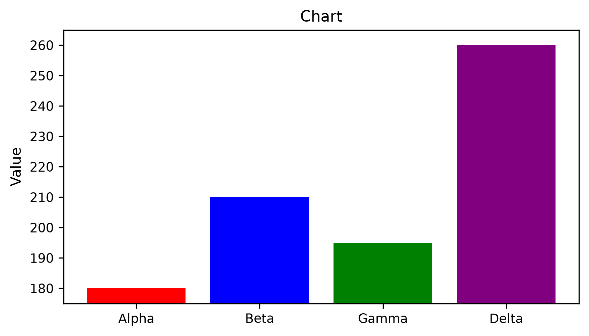

# Exercises — Chapter 14 — Data Visualization and Data Storytelling

**After your attempt:** [Chapter 14 worked solutions](../solutions/ch14.md).

[Language index](../README.md) · [Student notebook](../ch14-student.ipynb)

Attempt the exercises before consulting the solutions. Open-ended questions allow other justified answers.

<a id="chapter-supplement"></a>

## Chapter Supplement

This supplement contains 20 exercises: visual choice (01–07), communication (08–14), and executive narrative (15–20). Work in order within each block. Record prose justifications and preserve the supplied values. Consult the final-part solutions after attempting the tasks. The student notebook contains only prompts, answer areas, and the Exercise 14 stimulus.

Supplementary materials: [student notebook](../ch14-student.ipynb).

<a id="exercises-block-a"></a>

## Exercises — Block A

Four independent datasets support Exercises 01–06:

- categories A, B, and C, with revenues of 120, 180, and 150 thousand dollars;
- January through April 2026, with revenues of 100, 115, 108, and 130 thousand dollars;
- individual delivery times: 3, 4, 4, 5, 5, 6, 7, and 12 days;
- North and South groups, with lead times `[3, 4, 5, 6]` and `[4, 5, 7, 9]` days.

Exercise 07 has its own dataset, supplied in its prompt.

<a id="ex-visualizacao-storytelling-a1"></a>

### Exercise 01 — Business Questions

For each question, identify the desired comparison and required data structure:

1.  Which category has the highest revenue?
2.  How did revenue change from January through April?
3.  Where do delivery times concentrate?
4.  How do lead-time distributions differ between North and South?

<a id="ex-visualizacao-storytelling-a2"></a>

### Exercise 02 — Visual Choice

Choose and justify an appropriate chart for each question in Exercise 01. State what belongs on each axis and what each visual mark represents.

<a id="ex-visualizacao-storytelling-a3"></a>

### Exercise 03 — Categorical Comparison

Plot revenue by category with a title and units. Interpret the highest and lowest values.

<a id="ex-visualizacao-storytelling-a4"></a>

### Exercise 04 — Change over Time

Convert months to dates, sort the data, and plot revenue over time. Interpret increases and declines.

<a id="ex-visualizacao-storytelling-a5"></a>

### Exercise 05 — Individual Distribution

Plot the distribution of delivery times and describe concentration, spread, and observations deserving attention.

<a id="ex-visualizacao-storytelling-a6"></a>

### Exercise 06 — Distributions across Groups

Visually compare North and South lead times. Interpret central position, spread, and the limits of the small sample.

<a id="ex-visualizacao-storytelling-desafio-a"></a>

### Exercise 07 — Challenge A — Cedar Business Network

One row represents a branch in one month. Revenue is in thousands of dollars; lead time is in days.

| branch | region | month      | revenue_thousands | lead_time_days |
|--------|--------|------------|------------------:|---------------:|
| Alpha  | North  | 2026-01-01 |               120 |              5 |
| Alpha  | North  | 2026-02-01 |               132 |              4 |
| Alpha  | North  | 2026-03-01 |               128 |              6 |
| Beta   | South  | 2026-01-01 |               145 |              4 |
| Beta   | South  | 2026-02-01 |               151 |              5 |
| Beta   | South  | 2026-03-01 |               160 |              4 |
| Gamma  | North  | 2026-01-01 |                98 |              7 |
| Gamma  | North  | 2026-02-01 |               105 |              6 |
| Gamma  | North  | 2026-03-01 |               112 |              8 |
| Delta  | South  | 2026-01-01 |               138 |              5 |
| Delta  | South  | 2026-02-01 |               142 |              5 |
| Delta  | South  | 2026-03-01 |               149 |              6 |

Answer without being given a chart type:

1.  Which branch has the highest accumulated revenue?
2.  How does total revenue change from January through March?
3.  How are lead-time values across branch–month combinations distributed?
4.  How do lead-time distributions differ between North and South?

For each question, choose and construct a chart, justify the choice, interpret the evidence, and state a limit. The 12 lead times are values per branch–month; the data neither define them as averages nor supply 12 individual deliveries.

<a id="exercises-block-b"></a>

## Exercises — Block B

Exercises 08–13 use one row per business unit:

| Business unit | Revenue (USD thousands) | Orders | Region |
|---------------|------------------------:|-------:|--------|
| Alpha         |                     180 |    170 | North  |
| Beta          |                     210 |    190 | North  |
| Gamma         |                     195 |    185 | South  |
| Delta         |                     260 |    225 | South  |

Exercises 08–10 develop the same chart in stages. Exercise 14 supplies the program to diagnose.

<a id="ex-visualizacao-storytelling-b1"></a>

### Exercise 08 — Relationship

Plot orders against revenue, preserving one business unit per point.

<a id="ex-visualizacao-storytelling-b2"></a>

### Exercise 09 — Groups

Encode region through both color and marker shape so that the distinction does not depend on color alone.

<a id="ex-visualizacao-storytelling-b3"></a>

### Exercise 10 — Communication

Include an informative title, axis labels, units, and an appropriate legend.

<a id="ex-visualizacao-storytelling-b4"></a>

### Exercise 11 — Diagnosis

Explain why revenue bars with a vertical axis from USD 175 thousand to USD 265 thousand would visually exaggerate differences.

<a id="ex-visualizacao-storytelling-b5"></a>

### Exercise 12 — Correction

Rebuild the bars in sorted order with a full baseline. State the question guiding any highlight and justify that emphasis.

<a id="ex-visualizacao-storytelling-b6"></a>

### Exercise 13 — Message

Write separately: **evidence**, what the values show; **interpretation**, a reasonable descriptive reading; and **limit**, what cannot be concluded.

<a id="ex-visualizacao-storytelling-desafio-b"></a>

### Exercise 14 — Challenge B — Diagnose the Chart

The supplied code produces a chart used in an internal presentation. Run it and assess its appearance without assuming that its choices are appropriate.

<!-- stimulus-cell: 16 -->

``` python
import matplotlib.pyplot as plt
business_units = ['Alpha', 'Beta', 'Gamma', 'Delta']
revenues = [180, 210, 195, 260]
(fig, ax) = plt.subplots(figsize=(6, 3.5))
ax.bar(
    business_units,
    revenues,
    color=['red', 'blue', 'green', 'purple']
)
ax.set_ylim(175, 265)
ax.set_title('Chart')
ax.set_ylabel('Value')
plt.show()
```

<figure>

<figcaption aria-hidden="true">Figure 14.17 — Exercise 14 chart for analysis.</figcaption>
</figure>

Figure 14.17 — Exercise 14 chart for analysis.

Then:

1.  identify visual and editorial problems;
2.  rebuild the chart;
3.  justify each change;
4.  write a final message separating evidence, interpretation, and limits.

<a id="exercises-block-c"></a>

## Exercises — Block C

Western Horizon Operations is fictional. Each row represents a center in one quarter. The year is unspecified. Revenue is in thousands of dollars; orders are counts; margin is already a percentage; lead time is in days. Construct the dataset from these six records:

| Center | Quarter | Revenue | Orders | Margin (%) | Lead time (days) |
|--------|---------|--------:|-------:|-----------:|-----------------:|
| North  | Q1      |     120 |    110 |         24 |                5 |
| North  | Q2      |     135 |    130 |         25 |                4 |
| South  | Q1      |     150 |    125 |         28 |                4 |
| South  | Q2      |     142 |    145 |         27 |                5 |
| East   | Q1      |     105 |    105 |         22 |                6 |
| East   | Q2      |     118 |    118 |         23 |                5 |

Exercises 15–20 form one investigation. Choose three or four questions and figures, justify the presence or absence of emphasis, and end with three to five executive conclusions.

<a id="ex-visualizacao-storytelling-c1"></a>

### Exercise 15 — Dataset

Construct and validate the dataset. Check the center–quarter key and the coverage of the supplied periods.

<a id="ex-visualizacao-storytelling-c2"></a>

### Exercise 16 — Questions

Choose three or four business questions that can be answered with the supplied observations.

<a id="ex-visualizacao-storytelling-c3"></a>

### Exercise 17 — Charts

Choose variables, aggregation rules, and three or four charts corresponding to your questions.

<a id="ex-visualizacao-storytelling-c4"></a>

### Exercise 18 — Emphasis

Independently decide whether emphasis would serve a substantive purpose. Justify a highlight or its absence.

<a id="ex-visualizacao-storytelling-c5"></a>

### Exercise 19 — Messages

For every chart, state the question, visual choice, evidence, interpretation, and limit.

<a id="ex-visualizacao-storytelling-desafio-c"></a>

### Exercise 20 — Challenge C — Executive Visual Narrative

Produce three or four charts and three to five executive conclusions. Decide the questions, charts, grouping, emphasis, and messages. Make no causal claims or forecasts.


---

Daniel de Abreu Pereira Uhr · [MIT / CC BY 4.0](../../LICENSE-SCOPE.md)
