# Worked Solutions — Chapter 14 — Data Visualization and Data Storytelling

[Language index](../README.md) · [Student notebook](../ch14-student.ipynb)

Attempt the exercises before consulting the solutions. Open-ended questions allow other justified answers.

This chapter presents worked solutions to the 20 supplementary exercises. Follow the order within each block because tables and variables are reused. Interpretive questions allow other justified answers; the programs preserve every supplied value.

Preparation for block A.

``` python
import pandas as pd
import matplotlib.pyplot as plt
import seaborn as sns
sns.set_theme(style='whitegrid')
```

<a id="sol-ch14-01"></a>

## Solution to Exercise 01

The first question compares magnitudes across categories: we need a name and revenue for each category. The second follows a temporal sequence: we need ordered months and a comparable measure for each month. The third examines a distribution, requiring all eight individual times. The fourth compares distributions: each lead time must retain its North or South group. We do not combine these four datasets simply because some share a measurement unit.

<a id="sol-ch14-02"></a>

## Solution to Exercise 02

For the first question, bars compare lengths associated with category revenue: categories horizontally and revenue vertically. For the second, a line places months horizontally and revenue vertically, with one point per month. For the third, a histogram uses time intervals and frequency; each bar counts observations in an interval. For the fourth, a boxplot uses groups and lead times; each box summarizes one group’s distribution. These choices follow the comparisons identified in Exercise 01, rather than merely matching functions to column types.

<a id="sol-ch14-03"></a>

## Solution to Exercise 03

Build the category–revenue table and pass its columns to `bar()`. There is one value per category, so no additional aggregation is needed. The title and labels identify the content; the vertical axis retains thousands of dollars.

``` python
categories = pd.DataFrame(
    {
        'category': ['A', 'B', 'C'],
        'revenue_thousands': [120, 180, 150]
    }
)
(fig, ax) = plt.subplots(figsize=(6, 3.5))
ax.bar(
    categories['category'],
    categories['revenue_thousands'],
    color='steelblue'
)
ax.set_title('Revenue by category')
ax.set_xlabel('Category')
ax.set_ylabel('Revenue (USD thousands)')
plt.show()
```

<figure>
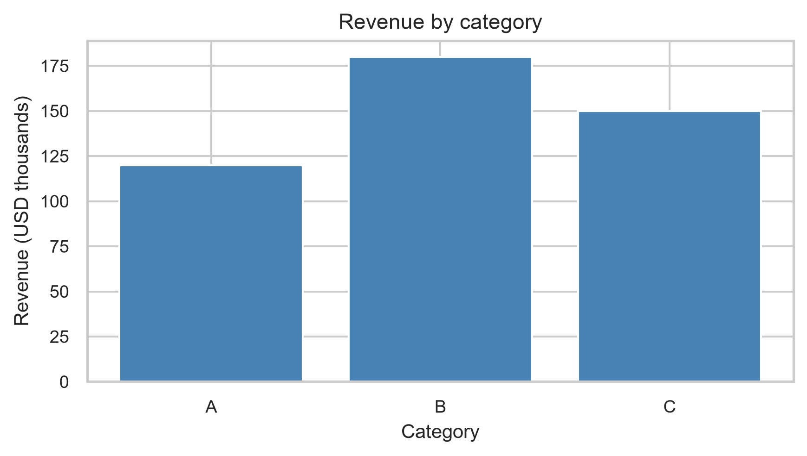
<figcaption aria-hidden="true">Figure 14.18 — Revenue by category</figcaption>
</figure>

Figure 14.18 — Revenue by category

B leads with USD 180 thousand, C has USD 150 thousand, and A has the smallest value, USD 120 thousand. The chart identifies the difference but does not explain it. No additional reporting period is supplied to generalize that leadership.

<a id="sol-ch14-04"></a>

## Solution to Exercise 04

`to_datetime()` creates comparable dates, and `sort_values()` orders the dataset before `plot()`. Markers reveal the four observations; month-start dates identify months rather than daily revenues. Axis ticks and `autofmt_xdate()` improve readability.

``` python
time_data = pd.DataFrame(
    {
        'month': pd.to_datetime(
            [
                '2026-01-01', '2026-02-01', '2026-03-01',
                '2026-04-01',
            ]
        ),
        'revenue_thousands': [100, 115, 108, 130]
    }
).sort_values(
    'month'
)
(fig, ax) = plt.subplots(figsize=(6, 3.5))
ax.plot(
    time_data['month'],
    time_data['revenue_thousands'],
    marker='o',
    color='steelblue'
)
ax.set_title('Observed monthly revenue — Jan–Apr 2026')
ax.set_xlabel('Month')
ax.set_ylabel('Revenue (USD thousands)')
ax.set_xticks(time_data['month'])
fig.autofmt_xdate()
plt.show()
```

<figure>
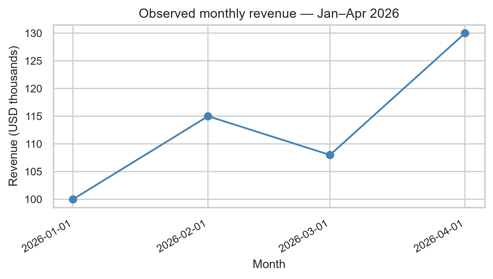
<figcaption aria-hidden="true">Figure 14.19 — Observed monthly revenue — Jan–Apr 2026</figcaption>
</figure>

Figure 14.19 — Observed monthly revenue — Jan–Apr 2026

Values are 100, 115, 108, and 130 thousand dollars: an increase of 15 in February, a decline of 7 in March, and an increase of 22 in April. Four months do not support a forecast; connecting the points adds no intermediate observations.

<a id="sol-ch14-05"></a>

## Solution to Exercise 05

The histogram retains all eight individual times and divides them into five intervals with `bins=5`. Bar height counts occurrences, rather than days or financial impact. Time is horizontal and frequency vertical.

``` python
delivery_times = [3, 4, 4, 5, 5, 6, 7, 12]
(fig, ax) = plt.subplots(figsize=(6, 3.5))
sns.histplot(delivery_times, bins=5, color='steelblue', ax=ax)
ax.set_title('Distribution of delivery times')
ax.set_xlabel('Time (days)')
ax.set_ylabel('Frequency')
plt.show()
```

<figure>
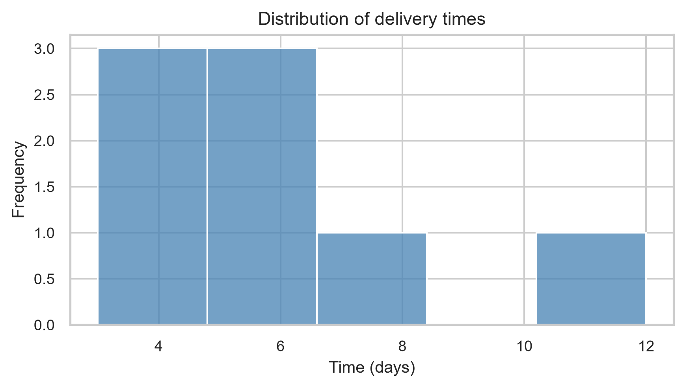
<figcaption aria-hidden="true">Figure 14.20 — Distribution of delivery times</figcaption>
</figure>

Figure 14.20 — Distribution of delivery times

Seven times lie between 3 and 7 days; 12 days is distant. Repeated values at 4 and 5 days contribute to the central concentration. Appearance depends on the chosen intervals, and the distant value does not prove an error.

<a id="sol-ch14-06"></a>

## Solution to Exercise 06

Construct a long-format table: each lead time occupies one row with its group. `boxplot(data=..., x=..., y=...)` separately summarizes the four North and four South observations on the same days scale.

``` python
lead_times = pd.DataFrame(
    {
        'group': ['North'] * 4 + ['South'] * 4,
        'lead_time': [3, 4, 5, 6, 4, 5, 7, 9]
    }
)
(fig, ax) = plt.subplots(figsize=(6, 3.5))
sns.boxplot(
    data=lead_times,
    x='group',
    y='lead_time',
    color='lightblue',
    ax=ax
)
ax.set_title('Lead-time distribution by group')
ax.set_xlabel('Group')
ax.set_ylabel('Lead time (days)')
plt.show()
```

<figure>
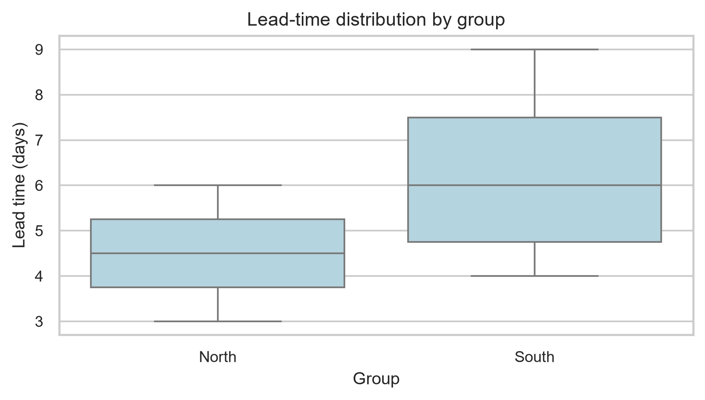
<figcaption aria-hidden="true">Figure 14.21 — Lead-time distribution by group</figcaption>
</figure>

Figure 14.21 — Lead-time distribution by group

North has a median of 4.5 days and values from 3 to 6; South has a median of 6 days and values from 4 to 9. South occupies a higher central position and range. Four observations per group provide a small basis and neither explain the difference nor establish a population pattern.

<a id="sol-ch14-07"></a>

## Solution to Exercise 07

The common dataset contains 12 branch–month combinations. Lead times are values associated with those combinations; they are not 12 individual deliveries, and they have not been defined as averages. `head()` displays the first rows, and `len()` confirms the 12 observations. Inspecting the supplied pairs shows that each branch appears once in each of the three months. We construct four charts, each linked to a question, while retaining every record.

``` python
cedar = pd.DataFrame(
    {
        'branch': ['Alpha'] * 3 + ['Beta'] * 3 + ['Gamma'] * 3 + ['Delta'] * 3,
        'region': ['North'] * 3 + ['South'] * 3 + ['North'] * 3 + ['South'] * 3,
        'month': pd.to_datetime(
            ['2026-01-01', '2026-02-01', '2026-03-01'] * 4
        ),
        'revenue_thousands': [
            120, 132, 128, 145, 151, 160, 98, 105, 112, 138, 142,
            149,
        ],
        'lead_time_days': [5, 4, 6, 4, 5, 4, 7, 6, 8, 5, 5, 6]
    }
)
print(cedar.head())
print('Observations:', len(cedar))
```

``` text
branch region      month  revenue_thousands  lead_time_days
0  Alpha  North 2026-01-01                120               5
1  Alpha  North 2026-02-01                132               4
2  Alpha  North 2026-03-01                128               6
3   Beta  South 2026-01-01                145               4
4   Beta  South 2026-02-01                151               5
Observations: 12
```

``` python
cedar_branch = cedar.groupby('branch', as_index=False)['revenue_thousands'].sum(

).sort_values(
    'revenue_thousands'
)
(fig, ax) = plt.subplots(figsize=(6, 3.5))
ax.barh(
    cedar_branch['branch'],
    cedar_branch['revenue_thousands'],
    color='steelblue'
)
ax.set_title('Revenue by branch — Jan–Mar 2026')
ax.set_xlabel('Accumulated revenue (USD thousands)')
ax.set_ylabel('Branch')
plt.show()
```

<figure>
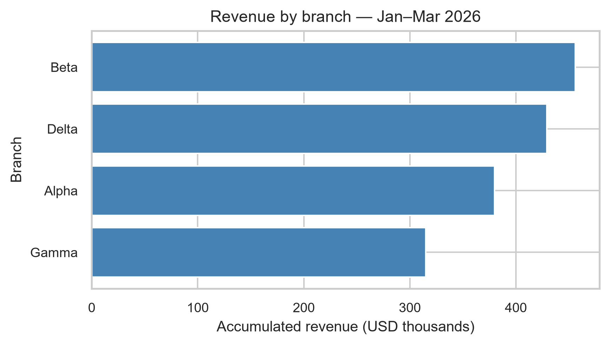
<figcaption aria-hidden="true">Figure 14.22 — Revenue by branch — Jan–Mar 2026</figcaption>
</figure>

Figure 14.22 — Revenue by branch — Jan–Mar 2026

``` python
cedar_time = cedar.groupby('month', as_index=False)['revenue_thousands'].sum(

).sort_values(
    'month'
)
(fig, ax) = plt.subplots(figsize=(6, 3.5))
ax.plot(
    cedar_time['month'],
    cedar_time['revenue_thousands'],
    marker='o'
)
ax.set_title('Monthly total revenue — Jan–Mar 2026')
ax.set_xlabel('Month')
ax.set_ylabel('Total revenue (USD thousands)')
ax.set_xticks(cedar_time['month'])
fig.autofmt_xdate()
plt.show()
```

<figure>
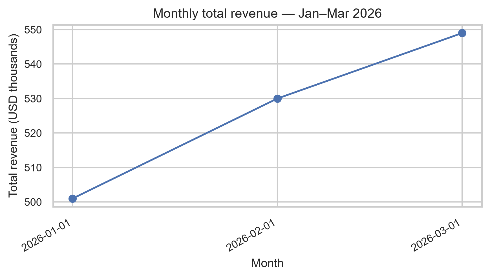
<figcaption aria-hidden="true">Figure 14.23 — Monthly total revenue — Jan–Mar 2026</figcaption>
</figure>

Figure 14.23 — Monthly total revenue — Jan–Mar 2026

``` python
(fig, ax) = plt.subplots(figsize=(6, 3.5))
sns.histplot(
    cedar['lead_time_days'],
    bins=6,
    color='steelblue',
    ax=ax
)
ax.set_title('Distribution of delivery lead times')
ax.set_xlabel('Lead time (days)')
ax.set_ylabel('Frequency')
plt.show()
```

<figure>
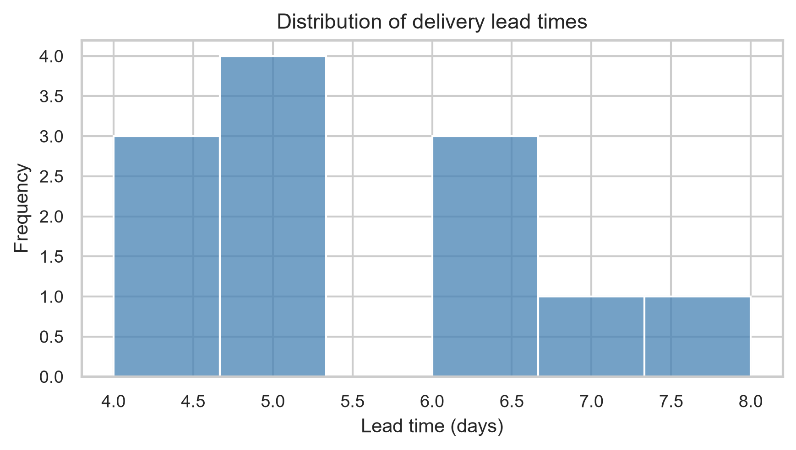
<figcaption aria-hidden="true">Figure 14.24 — Distribution of delivery lead times</figcaption>
</figure>

Figure 14.24 — Distribution of delivery lead times

``` python
(fig, ax) = plt.subplots(figsize=(6, 3.5))
sns.boxplot(
    data=cedar,
    x='region',
    y='lead_time_days',
    color='lightblue',
    ax=ax
)
ax.set_title('Lead-time distribution by region')
ax.set_xlabel('Region')
ax.set_ylabel('Lead time (days)')
plt.show()
```

<figure>
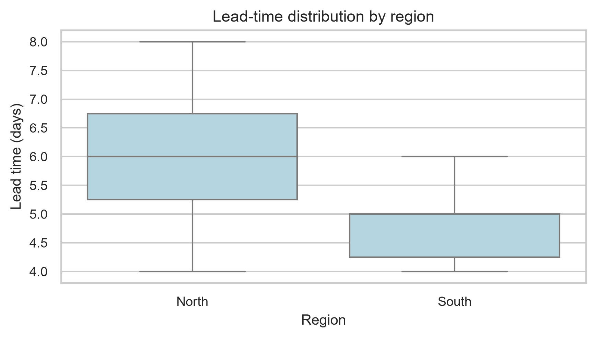
<figcaption aria-hidden="true">Figure 14.25 — Lead-time distribution by region</figcaption>
</figure>

Figure 14.25 — Lead-time distribution by region

**Revenue by branch:** sum `revenue_thousands` by branch, sort, and use horizontal bars. Beta leads with USD 456 thousand; Delta has 429, Alpha 380, and Gamma 315. Bars compare magnitudes, but revenue is not profit.

**Total over time:** sum by month, sort the dates, and connect the three totals with markers. Revenue rises from USD 501 thousand to USD 530 thousand and then USD 549 thousand. The line follows a sequence; three months do not support a forecast.

**Lead-time distribution:** `histplot(..., bins=6)` counts the 12 lead-time values for branch–month combinations. Most lie between 4 and 6 days; 8 is the largest. Frequency does not measure economic impact, and the number of deliveries behind each row is unknown.

**Regional comparison:** the boxplot groups by region and uses lead time as the measure. North has a median of 6 days and a 4–8 range; South has a median of 4.5 and a 4–6 range. North occupies a higher and wider range. There are six observations per region, with branches repeated over time; the figure does not explain the difference.

Preparation for block B.

``` python
import pandas as pd
import matplotlib.pyplot as plt
import seaborn as sns
sns.set_theme(style='whitegrid')
df = pd.DataFrame(
    {
        'business_unit': ['Alpha', 'Beta', 'Gamma', 'Delta'],
        'revenue_thousands': [180, 210, 195, 260],
        'orders': [170, 190, 185, 225],
        'region': ['North', 'North', 'South', 'South']
    }
)
```

<a id="sol-ch14-08"></a>

## Solution to Exercise 08

Choose a scatterplot: each point combines orders and revenue for the same business unit. The four pairs are (170, 180), (190, 210), (185, 195), and (225, 260). Aggregating by region would change the represented unit. Exercises 09 and 10 complete this same chart; the integrated program appears in Solution 10.

<a id="sol-ch14-09"></a>

## Solution to Exercise 09

Use `hue="region"` and `style="region"` in `scatterplot()`. Color and shape represent the same substantive attribute, with two points in North and two in South. The legend identifies groups, and marker shapes preserve the distinction in black and white. The complete program is in Solution 10.

<a id="sol-ch14-10"></a>

## Solution to Exercise 10

This program combines the choices from Exercises 08–10. `data=df` supplies the table; column names define coordinates and groups. The title identifies business units by region; axes identify orders per unit and revenue in thousands of dollars per unit. The legend explains color and shape without replacing axis labels.

``` python
(fig, ax) = plt.subplots(figsize=(6, 3.5))
sns.scatterplot(
    data=df,
    x='orders',
    y='revenue_thousands',
    hue='region',
    style='region',
    s=80,
    ax=ax
)
ax.set_title('Unit orders and revenue by region')
ax.set_xlabel('Orders per unit')
ax.set_ylabel('Revenue (USD thousands per unit)')
ax.legend(title='Region')
plt.show()
```

<figure>
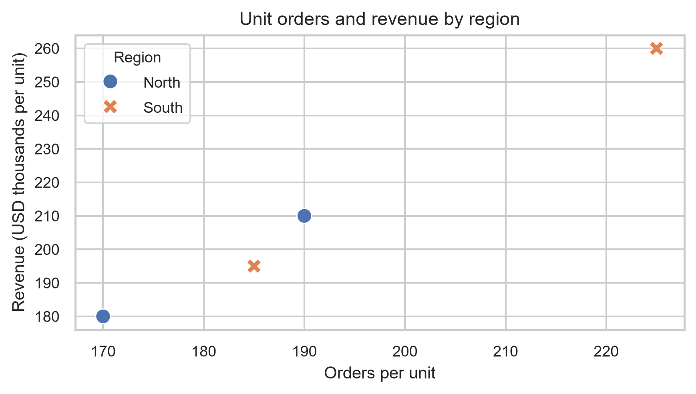
<figcaption aria-hidden="true">Figure 14.26 — Unit orders and revenue by region</figcaption>
</figure>

Figure 14.26 — Unit orders and revenue by region

Orders and revenue are positively associated in these four records; Delta has the largest values, 225 orders and USD 260 thousand. Four observations do not demonstrate causality, and two points per region do not establish a general regional comparison.

<a id="sol-ch14-11"></a>

## Solution to Exercise 11

Starting at 175 leaves visible lengths of 5 and 85 for Alpha and Delta, even though their values are 180 and 260. The ratio of visible lengths would be 17, far from the revenue ratio of about 1.44. The numbers remain correct; the scale distorts the comparison of lengths. A zero baseline restores proportional bars.

<a id="sol-ch14-12"></a>

## Solution to Exercise 12

We choose the question “which unit has the highest observed revenue?”. Sort revenues, start the axis at zero, and highlight Delta. `sort_values()` organizes the table; a list comprehension assigns the main color to Delta and light shades to the others. This is a justified choice, not the only possible answer: another stated question could justify different emphasis or no emphasis.

``` python
ordered = df.sort_values('revenue_thousands')
colors = ['steelblue' if business_unit == 'Delta' else 'lightgray' for business_unit in ordered['business_unit']]
(fig, ax) = plt.subplots(figsize=(6, 3.5))
ax.barh(
    ordered['business_unit'],
    ordered['revenue_thousands'],
    color=colors
)
ax.set_xlim(0, 280)
ax.set_title('Delta has the highest observed revenue')
ax.set_xlabel('Revenue (USD thousands)')
ax.set_ylabel('Business unit')
plt.show()
```

<figure>
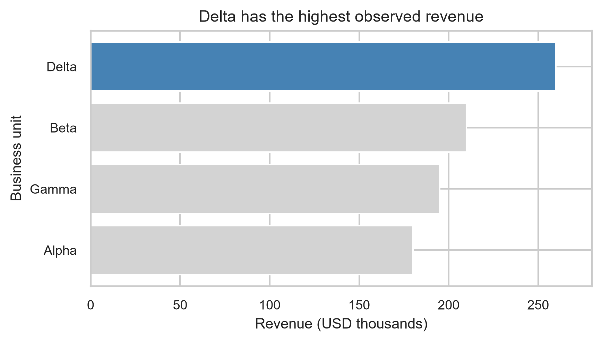
<figcaption aria-hidden="true">Figure 14.27 — Delta has the highest observed revenue</figcaption>
</figure>

Figure 14.27 — Delta has the highest observed revenue

Ascending order is Alpha, Gamma, Beta, and Delta, with revenues of 180, 195, 210, and 260 thousand dollars. A 0–280 scale accommodates all values and preserves context. Emphasis makes the answer easier to find without removing other units.

<a id="sol-ch14-13"></a>

## Solution to Exercise 13

**Evidence:** Delta records USD 260 thousand, above Beta (210), Gamma (195), and Alpha (180). **Interpretation:** Delta leads revenue among the four observed units. **Limit:** the comparison identifies no cause, profitability, or future performance. Interpretation organizes the evidence; it does not add an explanation involving strategy, prices, or costs absent from the dataset.

<a id="sol-ch14-14"></a>

## Solution to Exercise 14

The supplied chart truncates the axis at 175, uses four strong colors without an analytical role, has a generic title and a “Value” axis without a variable or unit, and omits the category-axis label. The first program below reproduces these choices with a title explicitly identifying the inadequate example in the solutions section. The exercise stimulus retains the neutral title “Chart”.

``` python
(fig, ax) = plt.subplots(figsize=(6, 3.5))
ax.bar(
    df['business_unit'],
    df['revenue_thousands'],
    color=['red', 'blue', 'green', 'purple']
)
ax.set_ylim(175, 265)
ax.set_title('Deliberately inadequate example')
ax.set_ylabel('Value')
plt.show()
```

<figure>
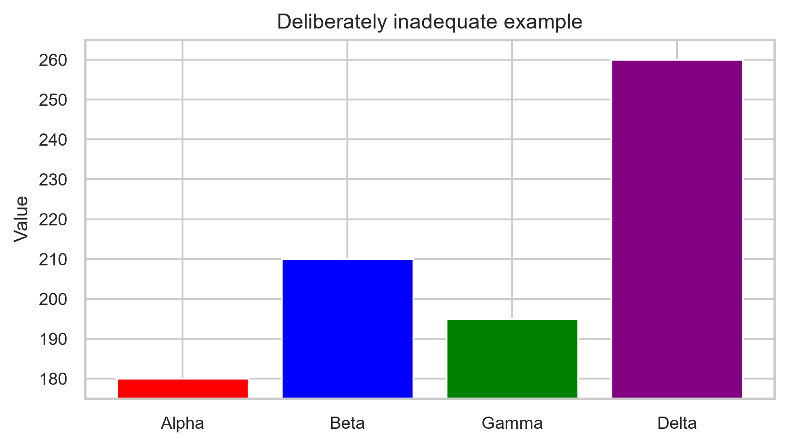
<figcaption aria-hidden="true">Figure 14.28 — Deliberately inadequate example</figcaption>
</figure>

Figure 14.28 — Deliberately inadequate example

``` python
(fig, ax) = plt.subplots(figsize=(6, 3.5))
ax.barh(
    ordered['business_unit'],
    ordered['revenue_thousands'],
    color=colors
)
ax.set_xlim(0, 280)
ax.set_title('Delta has the highest observed revenue')
ax.set_xlabel('Revenue (USD thousands)')
ax.set_ylabel('Business unit')
plt.show()
```

<figure>

<figcaption aria-hidden="true">Figure 14.29 — Delta has the highest observed revenue</figcaption>
</figure>

Figure 14.29 — Delta has the highest observed revenue

The reconstruction reuses `ordered` and `colors` from Solution 12. Zero preserves proportionality; sorting facilitates comparison; gray retains context while the main shade highlights the answer; the title and axes remove ambiguity. The chosen question concerns revenue leadership, which justifies highlighting Delta.

**Evidence:** Delta records USD 260 thousand. **Interpretation:** it has the highest revenue among the observed units. **Limit:** the chart neither explains the difference nor supports a forecast. The correction changes presentation while preserving all four values.

Preparation for block C.

``` python
import pandas as pd
import matplotlib.pyplot as plt
import seaborn as sns
sns.set_theme(style='whitegrid')
```

<a id="sol-ch14-15"></a>

## Solution to Exercise 15

Each row is a center–quarter, and we expect three centers in two quarters, totaling six combinations. Build the DataFrame from aligned lists and check `len()` and `duplicated()` for the key. Also inspect the supplied pairs: each center has Q1 and Q2. No year is specified, so retain those labels without inventing dates.

``` python
western_horizon = pd.DataFrame(
    {
        'center': ['North', 'North', 'South', 'South', 'East', 'East'],
        'quarter': ['Q1', 'Q2'] * 3,
        'revenue_thousands': [120, 135, 150, 142, 105, 118],
        'orders': [110, 130, 125, 145, 105, 118],
        'margin_pct': [24, 25, 28, 27, 22, 23],
        'lead_time_days': [5, 4, 4, 5, 6, 5]
    }
)
print(western_horizon)
print('Observations:', len(western_horizon))
print(
    'Duplicates:',
    western_horizon.duplicated(['center', 'quarter']).sum()
)
```

``` text
center quarter  revenue_thousands  orders  margin_pct  lead_time_days
0  North      Q1                120     110          24               5
1  North      Q2                135     130          25               4
2  South      Q1                150     125          28               4
3  South      Q2                142     145          27               5
4   East      Q1                105     105          22               6
5   East      Q2                118     118          23               5
Observations: 6
Duplicates: 0
```

There are six observations and zero duplicates. Revenue is in thousands of dollars, orders are counts, margin is already a percentage, and lead time is in days. These columns have different meanings and should not be added as interchangeable measures.

<a id="sol-ch14-16"></a>

## Solution to Exercise 16

One possible strategy uses three questions: which center leads accumulated revenue; how total revenue changes from Q1 to Q2; and how orders and revenue relate across the six records. The first requires aggregation by center, the second by quarter, and the third preserves each center–quarter pair. Other sets of three or four questions are acceptable when supported by the dataset and its limits.

<a id="sol-ch14-17"></a>

## Solution to Exercise 17

For the three chosen questions, use bars of revenue summed by center, a line of revenue summed by quarter, and a scatterplot of the six orders–revenue pairs. Begin with bars. `groupby(...).sum()` calculates totals before plotting; sorting and `barh()` facilitate comparison. The line and scatterplot appear with their messages in Solution 19, completing the three charts.

``` python
center_revenue = western_horizon.groupby('center', as_index=False)['revenue_thousands'].sum(

).sort_values(
    'revenue_thousands'
)
colors = ['steelblue' if center == 'South' else 'lightgray' for center in center_revenue['center']]
(fig, ax) = plt.subplots(figsize=(6, 3.5))
ax.barh(
    center_revenue['center'],
    center_revenue['revenue_thousands'],
    color=colors
)
ax.set_title('South leads accumulated revenue')
ax.set_xlabel('Accumulated revenue (USD thousands)')
ax.set_ylabel('Center')
plt.show()
```

<figure>
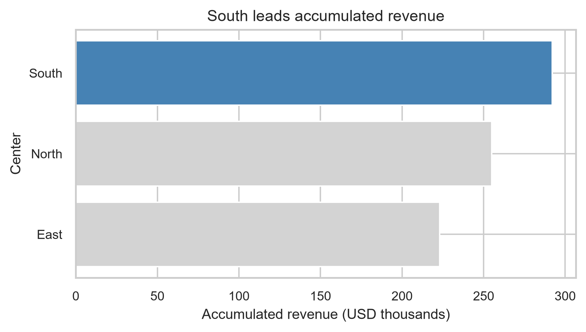
<figcaption aria-hidden="true">Figure 14.30 — South leads accumulated revenue</figcaption>
</figure>

Figure 14.30 — South leads accumulated revenue

South accumulates USD 292 thousand, North USD 255 thousand, and East USD 223 thousand. South leads the observed period. Revenue is not profit, and two quarters do not support a forecast. Bars represent center totals rather than the six original rows.

<a id="sol-ch14-18"></a>

## Solution to Exercise 18

Highlight South in the bars because the question asks which center has the largest accumulated revenue. North and East remain gray to provide context. Emphasis follows the result rather than an aesthetic preference. The line uses a uniform appearance. In the scatterplot, color and shape identify centers without selecting a winning category. Leaving all bars without emphasis would also be valid if justified and clearly presented.

<a id="sol-ch14-19"></a>

## Solution to Exercise 19

**Chart 1 — revenue by center:** the question asks which center leads accumulated revenue. Choose bars after explicit summation. Evidence from Solution 17 is South 292, North 255, and East 223 thousand dollars; the interpretation is South’s leadership in the observed dataset. The limit is that revenue neither measures profit nor anticipates future outcomes.

**Chart 2 — aggregate change:** ask how the total changes from Q1 to Q2. A line respects the substantive order of quarters, and `groupby()` computes the sum before `plot()`. Markers identify the two observed totals.

**Chart 3 — relationship:** ask whether more orders coexist with more revenue. `scatterplot()` preserves two numeric measures for each center–quarter; `corr()` supplies a linear summary displayed to four decimal places.

``` python
quarterly_revenue = western_horizon.groupby('quarter', as_index=False)['revenue_thousands'].sum(

)
(fig, ax) = plt.subplots(figsize=(6, 3.5))
ax.plot(
    quarterly_revenue['quarter'],
    quarterly_revenue['revenue_thousands'],
    marker='o',
    color='steelblue'
)
ax.set_title('Total revenue by quarter')
ax.set_xlabel('Quarter')
ax.set_ylabel('Total revenue (USD thousands)')
plt.show()
```

<figure>
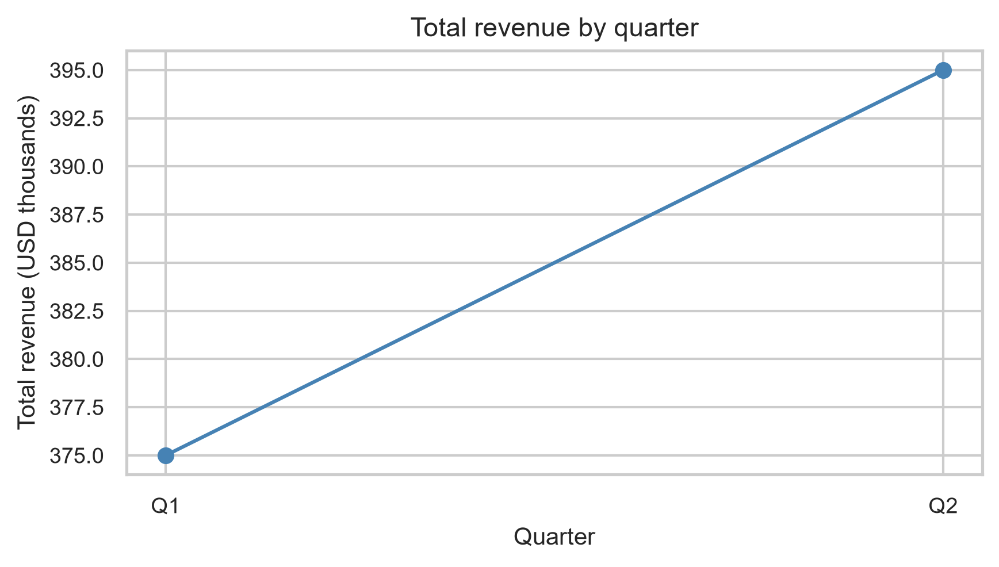
<figcaption aria-hidden="true">Figure 14.31 — Total revenue by quarter</figcaption>
</figure>

Figure 14.31 — Total revenue by quarter

``` python
horizon_corr = western_horizon['orders'].corr(
    western_horizon['revenue_thousands']
)
(fig, ax) = plt.subplots(figsize=(6, 3.5))
sns.scatterplot(
    data=western_horizon,
    x='orders',
    y='revenue_thousands',
    hue='center',
    style='center',
    s=80,
    ax=ax
)
ax.set_title('Orders and revenue by center–quarter')
ax.set_xlabel('Orders per center–quarter')
ax.set_ylabel('Revenue (USD thousands per center–quarter)')
ax.legend(title='Center')
plt.show()
print(f'Observed correlation: {horizon_corr:.4f}')
```

``` text
Observed correlation: 0.7942
```

<figure>
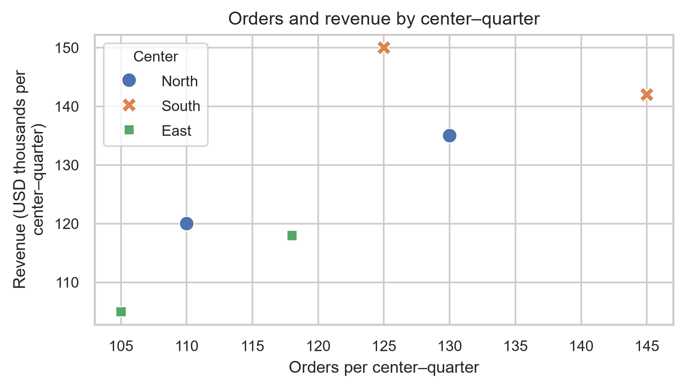
<figcaption aria-hidden="true">Figure 14.32 — Orders and revenue by center–quarter</figcaption>
</figure>

Figure 14.32 — Orders and revenue by center–quarter

In the second chart, the total rises from USD 375 thousand to USD 395 thousand. Coverage is comparable because the same three centers appear in both periods. The USD 20 thousand difference describes a change; it identifies no cause and supports no forecast.

In the third chart, the six points show positive but imperfect association, with correlation of approximately 0.7942. More orders often coexist with more revenue, but the points are not perfectly aligned. This small dataset, with repeated centers, demonstrates no causality, and orders are not the only possible dimension of revenue.

<a id="sol-ch14-20"></a>

## Solution to Exercise 20

The three charts in Solutions 17 and 19 form one possible deliverable: leadership by center, aggregate change across quarters, and the orders–revenue association. We offer five executive conclusions, following question → evidence → interpretation and ending with limits:

1.  South leads observed accumulated revenue, with USD 292 thousand.
2.  Total revenue rises from USD 375 thousand in Q1 to USD 395 thousand in Q2, covering the same three centers.
3.  Orders and revenue show positive, imperfect association across the six records, with correlation of about 0.7942.
4.  Highlighting South answers the leadership question while retaining the other centers as context.
5.  The figures are descriptive: they establish no cause, profit, or future performance.

This is one possible strategy. Other choices of three or four charts and three to five conclusions are valid when justified by the question and constructed without distortion. There is no need to invent a fourth figure to complete this solution.


---

Daniel de Abreu Pereira Uhr · [MIT / CC BY 4.0](../../LICENSE-SCOPE.md)
