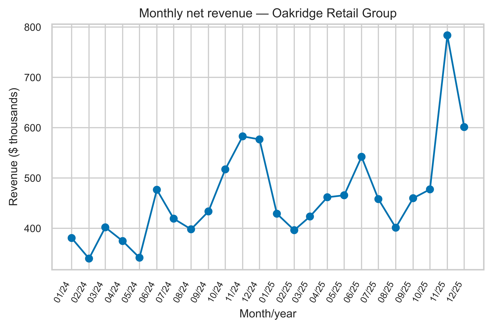
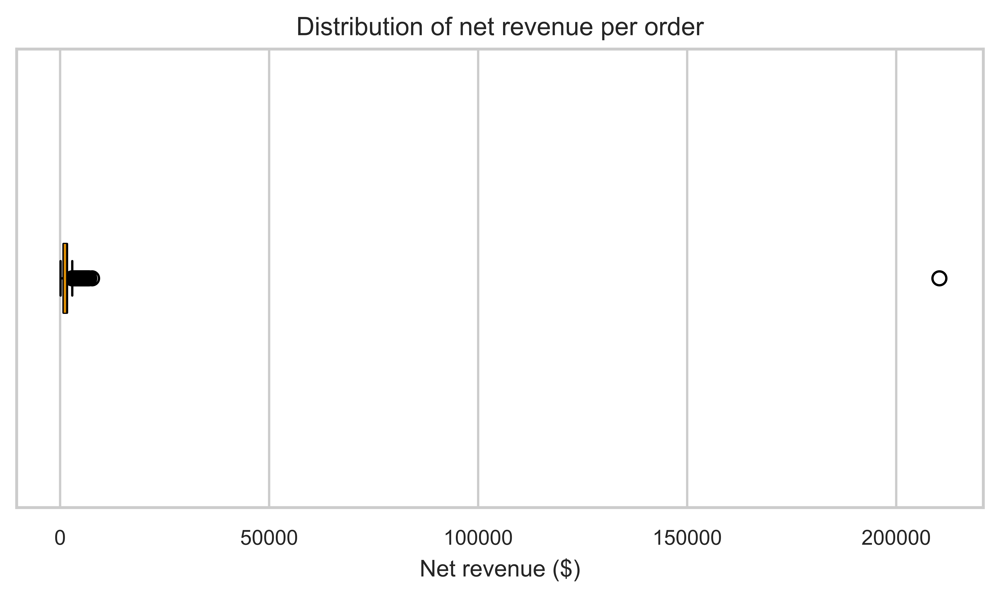

# Worked Solutions — Chapter 16 — Final Business Analytics Project

[Language index](../README.md) · [Student notebook](../ch16-student.ipynb)

Attempt the exercises before consulting the solutions. Open-ended questions allow other justified answers.

<a id="sol-ch16-01"></a>

## Solution to Exercise 01 — Oakridge Integrated Project

Consult this solution after an independent attempt. Programs are sequential: restart the kernel and run in order. Output boxes retain all fields requested by the program; wide tables may appear in keyed column panels or as vertical records. Deliberate `head` selections are identified in the text. Values are formatted for reading, without intermediate rounding in the calculations.

<a id="sol-ch16-section-2"></a>

### 1. Understanding the problem

How can Oakridge Retail Group’s raw tables become a reproducible managerial diagnosis? We will follow an explicit workflow and preserve the received files. This is a reference solution, not the only acceptable sequence. All monetary amounts are synthetic U.S. dollars, with no currency conversion. The named regions are the company’s fictional business groupings.

`Path` organizes file access; pandas reads and manipulates tables; NumPy will support conditional classification; Matplotlib draws figures; seaborn configures the theme; and `display` presents objects in the notebook. `set_theme` changes appearance, not data. `set_option` allows more columns to be shown. `DATA` holds the relative path used by the file readers. These imports prepare the tools and intentionally produce no analytical output.

<!-- source-cell: 3 -->

``` python
from pathlib import Path
import matplotlib.pyplot as plt
import numpy as np
import pandas as pd
import seaborn as sns
from IPython.display import display
sns.set_theme(style='whitegrid', palette='colorblind')
pd.set_option('display.max_columns', 20)
DATA = Path('data/ch16')
```

<a id="sol-ch16-section-4"></a>

### 2. Importing and understanding the tables

Each file has a different unit of observation. This distinction determines the appropriate keys and join cardinalities.

`read_csv` and `read_excel` create a table for each unit. `parse_dates` converts the specified fields into dates. For costs, `sep=";"` and `decimal=","` describe the legacy export format; they do not change the dollar meaning of the values. `sheet_name` selects an Excel worksheet, read with openpyxl support. The small `structure` table combines `len`, which counts rows, with each table’s observational unit. Read the count and meaning together (pandas Developers n.d.; openpyxl Contributors n.d.).

<!-- source-cell: 5 -->

``` python
raw_sales = pd.read_csv(DATA / 'sales.csv', parse_dates=['date'])
costs = pd.read_csv(
    DATA / 'costs.csv',
    sep=';',
    decimal=',',
    parse_dates=['month']
)
targets = pd.read_csv(DATA / 'targets.csv', parse_dates=['month'])
branches = pd.read_excel(
    DATA / 'operating_registry.xlsx',
    sheet_name='branches',
    parse_dates=['opening_date']
)
products = pd.read_excel(
    DATA / 'operating_registry.xlsx',
    sheet_name='products'
)
structure = pd.DataFrame(
    {
        'table': ['sales', 'branches', 'products', 'costs', 'targets'],
        'rows': [
            len(raw_sales), len(branches), len(products),
            len(costs), len(targets),
        ],
        'unit': [
            'order', 'branch', 'product', 'product × month',
            'branch × month',
        ]
    }
)
display(structure)
```

``` text
table     rows  unit           
sales     8085  order
branches  22    branch
products  12    product
costs     288   product × month
targets   528   branch × month
```

Sales is a fact table; branches and products are registries. Costs vary by product and month, while targets belong to the branch–month level. Joining tables without respecting these units can multiply records. The displayed structure contains 8,085 sales rows, 22 branches, 12 products, 288 product–month costs, and 528 branch–month target rows.

<a id="sol-ch16-section-7"></a>

### 3. Quality diagnostics

Which problems could change revenue, margin, customer segmentation, or order counts? We examine repeated keys and identical rows separately, then investigate missing discounts, domain violations, text categories, and target coverage.

`duplicated(subset=..., keep=False)` marks every row whose key repeats; `unique` lists the keys, and the list comprehensions count occurrences and distinct row versions for each key. In contrast, `duplicated()` without `subset` compares entire rows. `isna` and `notna` distinguish missing values, while `between(..., inclusive="both")` includes 0 and 0.40. The `~` operator negates a condition, and `&` requires both conditions. Summing a Boolean mask counts true cases. The sorted segment list reveals spelling differences that a count alone would conceal.

The second part joins opening dates to targets. `.dt.to_period("M").dt.to_timestamp()` represents the first day of the month; the date comparison separates pre-opening periods. The final grouping reports missing-month counts and the beginning and end of each branch’s missing interval. Combining the business rule with evidence is more informative than filling every absence (The pandas development team n.d.a, n.d.c).

<!-- source-cell: 8 -->

``` python
duplicate_key = raw_sales.duplicated(subset=['order_id'], keep=False)
repeated_orders = sorted(raw_sales.loc[duplicate_key, 'order_id'].unique())
duplicate_diagnostics = pd.DataFrame(
    {
        'order_id': repeated_orders,
        'rows': [(raw_sales['order_id'] == order_id).sum() for order_id in repeated_orders],
        'distinct_rows': [len(raw_sales.loc[raw_sales['order_id'] == order_id].drop_duplicates()) for order_id in repeated_orders]
    }
)
duplicate_diagnostics['excess_duplicates'] = duplicate_diagnostics['rows'] - 1
identical_duplicates = raw_sales.duplicated().sum()
missing_discount_count = raw_sales['discount_rate'].isna().sum()
invalid_discounts = (raw_sales['discount_rate'].notna() & ~raw_sales['discount_rate'].between(0, 0.4, inclusive='both')).sum(

)
diagnostics = pd.Series(
    {
        'raw rows': len(raw_sales),
        'repeated order IDs': len(repeated_orders),
        'excess technical duplicates': duplicate_diagnostics['excess_duplicates'].sum(),
        'excess identical duplicates': identical_duplicates,
        'missing discounts': missing_discount_count,
        'invalid discounts': invalid_discounts,
        'segment representations': raw_sales['customer_segment'].nunique(),
        'missing targets': targets['revenue_target'].isna().sum()
    }
)
display(diagnostics)
display(duplicate_diagnostics)
display(
    sorted(raw_sales['customer_segment'].dropna().unique())
)
targets_opening = targets.merge(
    branches[['branch_id', 'opening_date']],
    on='branch_id',
    how='left',
    validate='many_to_one'
)
targets_opening['opening_month'] = targets_opening['opening_date'].dt.to_period('M').dt.to_timestamp(

)
targets_opening['before_opening'] = targets_opening['month'] < targets_opening['opening_month']
missing_target = targets_opening['revenue_target'].isna()
observed_target = targets_opening['revenue_target'].notna()
target_diagnostics = pd.Series(
    {
        'missing targets': missing_target.sum(),
        'missing before opening': (missing_target & targets_opening['before_opening']).sum(

        ),
        'missing after opening': (missing_target & ~targets_opening['before_opening']).sum(

        ),
        'observed targets before opening': (observed_target & targets_opening['before_opening']).sum(

        )
    }
)
missing_target_evidence = targets_opening.loc[missing_target].groupby(
    ['branch_id', 'opening_date'],
    as_index=False
).agg(
    missing_months=('month', 'size'),
    first_missing_month=('month', 'min'),
    last_missing_month=('month', 'max')
)
display(target_diagnostics)
display(missing_target_evidence)
```

``` text
raw rows: 8085
repeated order IDs: 7
excess technical duplicates: 7
excess identical duplicates: 7
missing discounts: 5
invalid discounts: 2
segment representations: 6
missing targets: 21

order_id    rows  distinct_rows  excess_duplicates
PED-000085  2     1              1
PED-000346  2     1              1
PED-000714  2     1              1
PED-001212  2     1              1
PED-001846  2     1              1
PED-002457  2     1              1
PED-003115  2     1              1

[
  "CORPORATE",
  "Corporate",
  "Corporate ",
  "Retail",
  "Small Business",
  "corporate"
]

missing targets: 21
missing before opening: 21
missing after opening: 0
observed targets before opening: 0

branch_id  opening_date         missing_months  first_missing_month
F021       2024-07-01 00:00:00  6               2024-01-01 00:00:00
F022       2025-04-01 00:00:00  15              2024-01-01 00:00:00

branch_id  last_missing_month 
F021       2024-06-01 00:00:00
F022       2025-03-01 00:00:00
```

The order key identifies the order/transaction unit. We first inspect repeated IDs, then confirm that each repetition in this dataset also consists of identical rows. A repeated key and an identical record are related but distinct concepts. The diagnostics identify seven excess technical duplicates.

All 21 missing revenue targets occur before the corresponding branches opened. There are no observed targets before opening and no missing revenue targets after opening. The margin-target field is also missing in those same 21 pre-opening combinations and observed afterward. These absences represent nonoperation, so they are not errors to be automatically imputed.

The data also contain inconsistent segment spellings, five missing discounts, and two discounts outside the inclusive 0%–40% business rule. Six raw segment representations do not mean six substantive customer segments.

<a id="sol-ch16-section-10"></a>

### 4. Cleaning decisions

We remove identical duplicates, standardize spaces and capitalization, and exclude records whose discounts do not support a reliable net-revenue calculation from this reference pipeline.

Exclusion is not a universal rule. Recovering information or assessing alternative treatments would be defensible if documented. We do not impute zero: an unreported discount does not mean a 0% discount. The resulting analytical population is also used for the order and quantity counts below. A different analysis could retain other records for discount-independent measures, provided that its population is clearly labeled.

`drop_duplicates` retains one occurrence of each complete row after the diagnosis has established the issue. `.copy()` creates a separate working object. `.str.strip().str.title()` removes leading/trailing spaces and standardizes capitalization; this rule suits this case’s categories, not every business name. Two masks identify missing and invalid discounts; `.loc` keeps the complement of both. The monthly column comes from the order date. The three counts expose the transition from received data to deduplicated data to the analytical population.

<!-- source-cell: 11 -->

``` python
deduplicated_sales = raw_sales.drop_duplicates().copy()
deduplicated_sales['customer_segment'] = deduplicated_sales['customer_segment'].str.strip().str.title()
missing_discount = deduplicated_sales['discount_rate'].isna()
invalid_discount = deduplicated_sales['discount_rate'].notna() & ~deduplicated_sales['discount_rate'].between(0, 0.4, inclusive='both')
clean_sales = deduplicated_sales.loc[~missing_discount & ~invalid_discount].copy(

)
clean_sales['month'] = clean_sales['date'].dt.to_period('M').dt.to_timestamp()
print(f'Raw rows: {len(raw_sales):,}')
print(f'After deduplication: {len(deduplicated_sales):,}')
print(
    f'Valid rows for discount-dependent metrics: {len(clean_sales):,}'
)
```

``` text
Raw rows: 8,085

After deduplication: 8,078

Valid rows for discount-dependent metrics: 8,071
```

<a id="sol-ch16-section-12"></a>

### 5. Constructing the analytical data

Which key identifies the valid cost for each order? Cost depends on both product and month. A controlled example shows why product alone is insufficient.

This first join deliberately uses an incomplete key. `how="left"` preserves the left-hand orders, but does not prevent each order from matching several cost rows. We compare sizes before and after, then use `del` to discard the incorrect object and prevent later reuse.

<!-- source-cell: 13 -->

``` python
incorrect_merge = clean_sales.merge(costs, on='product_id', how='left')
print(f'Before merge: {len(clean_sales):,}')
print(
    f'Incomplete product-only merge: {len(incorrect_merge):,}'
)
del incorrect_merge
```

``` text
Before merge: 8,071

Incomplete product-only merge: 193,704
```

The incomplete join multiplies each order by the product’s 24 monthly costs, expanding 8,071 rows to 193,704. The code runs, but the observational unit is wrong. We delete this demonstration object and reconstruct the join using the composite key and cardinality validation.

Three joins add branch, product, and monthly cost information to each order. `validate="many_to_one"` requires a unique right-side key: many sales can refer to one registry or cost row, but each sale should match at most one row per key. This does not guarantee coverage, so we also check the row count and nonmissing costs. Validation of the supplied derivatives additionally confirmed complete registry coverage and valid keys. `assert` stops execution when a condition is false (The pandas development team n.d.b).

<!-- source-cell: 15 -->

``` python
analytical_data = clean_sales.merge(
    branches,
    on='branch_id',
    how='left',
    validate='many_to_one'
).merge(
    products,
    on='product_id',
    how='left',
    validate='many_to_one'
).merge(
    costs,
    on=['product_id', 'month'],
    how='left',
    validate='many_to_one'
)
assert len(analytical_data) == len(clean_sales)
assert analytical_data['unit_cost'].notna().all()
print(
    f'Correct product-month merge: {len(analytical_data):,} rows'
)
```

``` text
Correct product-month merge: 8,071 rows
```

<a id="sol-ch16-section-16"></a>

### 6. Indicators

Net revenue incorporates the observed discount. Margin amount subtracts product cost from net revenue; the aggregate margin rate uses net revenue as its denominator. This margin excludes other operating expenses, taxes, and capital costs. It is not net profit or return on investment.

Column operations calculate one value per order. Gross revenue is quantity × price; net revenue applies `(1 - discount)`; total cost is quantity × unit cost; and margin amount is net revenue minus cost. Then `sum` aggregates values and quantities. The aggregate margin rate is a **ratio of sums**, not a simple average of order-level margin rates. Average order value uses `mean` because, after deduplication, each analytical row represents one order. It equals total net revenue divided by the number of those orders. Currency formatting occurs only when printing.

<!-- source-cell: 17 -->

``` python
analytical_data['gross_revenue'] = analytical_data['quantity'] * analytical_data['unit_price']
analytical_data['net_revenue'] = analytical_data['gross_revenue'] * (1 - analytical_data['discount_rate'])
analytical_data['total_cost'] = analytical_data['quantity'] * analytical_data['unit_cost']
analytical_data['margin_amount'] = analytical_data['net_revenue'] - analytical_data['total_cost']
total_revenue = analytical_data['net_revenue'].sum()
total_margin = analytical_data['margin_amount'].sum()
aggregate_margin = total_margin / total_revenue
average_order_value = analytical_data['net_revenue'].mean()
total_quantity = analytical_data['quantity'].sum()
print(f'Net revenue: ${total_revenue:,.2f}')
print(f'Total margin: ${total_margin:,.2f}')
print(f'Aggregate margin: {aggregate_margin:.2%}')
print(f'Average order value: ${average_order_value:,.2f}')
print(f'Quantity: {total_quantity:,}')
```

``` text
Net revenue: $11,142,071.65

Total margin: $3,710,477.85

Aggregate margin: 33.30%

Average order value: $1,380.51

Quantity: 62,811
```

The reference pipeline contains 8,071 analytical orders, approximately \$11.14 million in net revenue, and a 33.30% aggregate margin rate. The quantity total is 62,811 units, and average order value is \$1,380.51. These measures all use the same cleaned population. Defensible alternative cleaning decisions can produce different results.

<a id="sol-ch16-section-19"></a>

### 7. Branches and regions

Who leads in cumulative scale, and who leads after accounting for branch count and operating exposure? “Accounting for” here means changing a descriptive denominator. It does not identify causal effects or establish efficiency.

The time denominator comes from the opening registry, not merely the months that survived cleaning. `clip(lower=...)` prevents exposure from starting before the window. The year difference is converted to months, added to the month difference, and increased by 1 to include both endpoints. Every opening in this case occurs on the first day of a month; a partial-month opening would require an explicit convention. The second `clip` prevents negative exposure.

`groupby` gathers orders by branch and `agg` names the measures. `nunique` counts distinct orders or months. The join adds exposure; equality between transaction months and operating months is checked, not assumed. Monthly revenue divides the total by exposure. `rank(ascending=False, method="min")` gives better ranks to higher values and assigns the lowest tied rank; `astype(int)` displays integer positions. `head(10)` deliberately shows only the ten highest-revenue branches; the full table remains in the notebook.

<!-- source-cell: 20 -->

``` python
window_start = pd.Timestamp('2024-01-01')
window_end = pd.Timestamp('2025-12-01')
branch_exposure = branches[['branch_id', 'opening_date']].copy()
branch_exposure['exposure_start'] = branch_exposure['opening_date'].dt.to_period('M').dt.to_timestamp(

).clip(
    lower=window_start
)
branch_exposure['exposure_months'] = ((window_end.year - branch_exposure['exposure_start'].dt.year) * 12 + window_end.month - branch_exposure['exposure_start'].dt.month + 1).clip(
    lower=0
)
branch_metrics = analytical_data.groupby(
    ['branch_id', 'branch', 'region'],
    as_index=False
).agg(
    revenue=('net_revenue', 'sum'),
    margin=('margin_amount', 'sum'),
    quantity=('quantity', 'sum'),
    orders=('order_id', 'nunique'),
    transaction_months=('month', 'nunique')
).merge(
    branch_exposure[['branch_id', 'exposure_months']],
    on='branch_id',
    how='left',
    validate='one_to_one'
)
branch_metrics['coverage_matches'] = branch_metrics['transaction_months'] == branch_metrics['exposure_months']
branch_metrics['margin_rate'] = branch_metrics['margin'] / branch_metrics['revenue']
branch_metrics['monthly_average_revenue'] = branch_metrics['revenue'] / branch_metrics['exposure_months']
branch_metrics['total_rank'] = branch_metrics['revenue'].rank(ascending=False, method='min').astype(
    int
)
branch_metrics['monthly_rank'] = branch_metrics['monthly_average_revenue'].rank(
    ascending=False,
    method='min'
).astype(
    int
)
print(
    'Branches whose transaction months match exposure:',
    branch_metrics['coverage_matches'].sum(),
    'of',
    len(branch_metrics)
)
display(
    branch_metrics.sort_values('revenue', ascending=False).head(
        10
    )
)
```

``` text
Branches whose transaction months match exposure: 22 of 22

branch_id  branch                  region     revenue      
F001       Manhattan Central       Northeast  910402.804114
F016       Phoenix Central         Southwest  808508.400167
F007       Chicago South           Midwest    653680.022639
F009       Minneapolis Riverfront  Midwest    649694.319822
F003       Philadelphia Liberty    Northeast  641780.2269
F008       Milwaukee Lakeside      Midwest    591500.661569
F010       Indianapolis North      Midwest    568926.982727
F006       Buffalo Waterfront      Northeast  515805.980467
F012       Miami Atlantic          Southeast  498999.437764
F019       Albuquerque Heights     Southwest  491274.462795

branch_id  margin         quantity  orders  transaction_months
F001       270542.025334  5712      702     24
F016       286621.940004  2846      406     24
F007       206696.432519  4729      511     24
F009       215269.407711  3299      454     24
F003       225323.243095  2742      428     24
F008       194362.37798   3466      448     24
F010       185835.270317  3664      441     24
F006       185159.210061  2543      370     24
F012       159606.117477  2796      364     24
F019       174390.358563  2254      333     24

branch_id  exposure_months  coverage_matches  margin_rate
F001       24               True              0.297167
F016       24               True              0.354507
F007       24               True              0.316204
F009       24               True              0.33134
F003       24               True              0.351091
F008       24               True              0.328592
F010       24               True              0.326642
F006       24               True              0.358971
F012       24               True              0.319852
F019       24               True              0.354975

branch_id  monthly_average_revenue  total_rank  monthly_rank
F001       37933.450171             1           1
F016       33687.850007             2           2
F007       27236.66761              3           3
F009       27070.596659             4           4
F003       26740.842788             5           5
F008       24645.860899             6           6
F010       23705.290947             7           7
F006       21491.915853             8           8
F012       20791.64324              9           9
F019       20469.769283             10          10
```

Regional aggregation sums revenue and exposure months while counting distinct branches. Total revenue measures cumulative scale. Total/branch count is cumulative average revenue per branch. Total/summed branch–months is revenue per active branch–month: an exposure-weighted average of branch monthly averages, not their simple mean. The two sort orders show how the leader depends on the question. Normalizing the denominator does not control causes or measure efficiency.

<!-- source-cell: 21 -->

``` python
region_metrics = branch_metrics.groupby('region', as_index=False).agg(
    total_revenue=('revenue', 'sum'),
    branches=('branch_id', 'nunique'),
    active_branch_months=('exposure_months', 'sum')
)
region_metrics['average_branch_revenue'] = region_metrics['total_revenue'] / region_metrics['branches']
region_metrics['revenue_per_active_branch_month'] = region_metrics['total_revenue'] / region_metrics['active_branch_months']
display(
    region_metrics.sort_values(
        'total_revenue',
        ascending=False
    )
)
display(
    region_metrics.sort_values(
        'revenue_per_active_branch_month',
        ascending=False
    )
)
```

``` text
region             total_revenue   branches  active_branch_months
Northeast          3471555.401855  6         144
Midwest            2463801.986756  4         96
Southwest          2212419.429121  4         96
Southeast          2137147.27787   5         120
Pacific Northwest  857147.557776   3         51

region             average_branch_revenue
Northeast          578592.566976
Midwest            615950.496689
Southwest          553104.85728
Southeast          427429.455574
Pacific Northwest  285715.852592

region             revenue_per_active_branch_month
Northeast          24108.023624
Midwest            25664.604029
Southwest          23046.03572
Southeast          17809.560649
Pacific Northwest  16806.814858

region             total_revenue   branches  active_branch_months
Midwest            2463801.986756  4         96
Northeast          3471555.401855  6         144
Southwest          2212419.429121  4         96
Southeast          2137147.27787   5         120
Pacific Northwest  857147.557776   3         51

region             average_branch_revenue
Midwest            615950.496689
Northeast          578592.566976
Southwest          553104.85728
Southeast          427429.455574
Pacific Northwest  285715.852592

region             revenue_per_active_branch_month
Midwest            25664.604029
Northeast          24108.023624
Southwest          23046.03572
Southeast          17809.560649
Pacific Northwest  16806.814858
```

The Northeast leads in total revenue, while the Midwest leads in monthly revenue per active branch. Regional scale and average performance therefore answer different questions. F001 leads in revenue, but its margin rate is lower than that of several other branches. High revenue alone does not establish greater sales profitability.

The two panels use `barh` to compare regions. Each panel sorts its own measure. Dividing by one million or one thousand expresses the axis in millions or thousands without changing ranks. Titles and labels state the distinction. `tight_layout` adjusts spacing, and `show` displays the figure. Panels are stacked to keep names legible on the printed page.

<!-- source-cell: 23 -->

``` python
(fig, axes) = plt.subplots(2, 1, figsize=(6.2, 7.2))
total_plot = region_metrics.sort_values('total_revenue')
axes[0].barh(
    total_plot['region'],
    total_plot['total_revenue'] / 1000000
)
axes[0].set_title('Cumulative revenue by region')
axes[0].set_xlabel('Net revenue ($ millions)')
axes[0].set_ylabel('Region')
average_plot = region_metrics.sort_values('revenue_per_active_branch_month')
axes[1].barh(
    average_plot['region'],
    average_plot['revenue_per_active_branch_month'] / 1000,
    color='#D97706'
)
axes[1].set_title('Monthly revenue per active branch')
axes[1].set_xlabel('Monthly average revenue ($ thousands)')
axes[1].set_ylabel('Region')
fig.suptitle(
    'Regional scale and revenue per active branch month answer different questions'
)
fig.tight_layout()
plt.show()
```

<figure>

<figcaption aria-hidden="true">Figure 16.01 — Regional scale and revenue per active branch–month</figcaption>
</figure>

Figure 16.01 — Regional scale and revenue per active branch–month

The leaders change with the measure. Management comparisons should state exposure and the denominator explicitly. The figure describes differences; it does not explain their causes.

**Time coverage**

Cumulative rankings should be examined alongside opening dates and operating exposure.

A one-to-one join adds opening dates to the existing summary. Selecting columns brings opening, coverage, revenue, and rankings together so that rank differences can be interpreted. Sorting revenue upward and applying `head(5)` deliberately shows the five lowest cumulative revenues, not the whole network.

<!-- source-cell: 26 -->

``` python
coverage = branch_metrics.merge(
    branches[['branch_id', 'opening_date']],
    on='branch_id',
    how='left',
    validate='one_to_one'
)
display(
    coverage.sort_values('revenue')[['branch_id', 'branch', 'opening_date', 'exposure_months', 'transaction_months', 'coverage_matches', 'revenue', 'total_rank', 'monthly_average_revenue', 'monthly_rank']].head(
        5
    )
)
```

``` text
branch_id  branch            opening_date         exposure_months
F022       Spokane Valley    2025-04-01 00:00:00  9
F021       Portland Docks    2024-07-01 00:00:00  18
F015       Orlando Lakeside  2020-06-01 00:00:00  24
F020       Seattle Central   2017-05-01 00:00:00  24
F014       Raleigh Downtown  2019-08-01 00:00:00  24

branch_id  transaction_months  coverage_matches  revenue      
F022       9                   True              174265.864553
F021       18                  True              303264.385513
F015       24                  True              363860.916459
F020       24                  True              379617.307709
F014       24                  True              403254.487606

branch_id  total_rank  monthly_average_revenue  monthly_rank
F022       22          19362.873839             13
F021       21          16848.021417             19
F015       20          15160.871519             22
F020       19          15817.387821             21
F014       18          16802.270317             20
```

F022 — Spokane Valley ranks 22nd in cumulative revenue and has only nine months of exposure. Its shorter coverage mechanically limits the cumulative total; dividing by exposure moves it to 13th. A lower total does not imply worse monthly performance when time coverage differs. This denominator adjustment does not establish what the branch would have earned in unobserved months.

<a id="sol-ch16-section-28"></a>

### 8. Products and categories

Do volume, revenue, and sales margin identify the same leaders? We compare all three dimensions before describing any category or product as “best.”

Grouping by category sums revenue, dollar margin, and quantity. Dividing afterward computes each group’s margin rate from its totals. Product grouping retains ID, name, and category; `nlargest(1, ...)` selects one leader for each measure. These are distinct questions, so we do not choose one “best” product without stating the objective.

<!-- source-cell: 29 -->

``` python
category_metrics = analytical_data.groupby('category', as_index=False).agg(
    revenue=('net_revenue', 'sum'),
    margin=('margin_amount', 'sum'),
    quantity=('quantity', 'sum')
)
category_metrics['margin_rate'] = category_metrics['margin'] / category_metrics['revenue']
product_metrics = analytical_data.groupby(
    ['product_id', 'product', 'category'],
    as_index=False
).agg(
    revenue=('net_revenue', 'sum'),
    quantity=('quantity', 'sum')
)
display(
    category_metrics.sort_values('revenue', ascending=False)
)
print('Revenue-leading product:')
display(product_metrics.nlargest(1, 'revenue'))
print('Quantity-leading product:')
display(product_metrics.nlargest(1, 'quantity'))
```

``` text
category      revenue         margin          quantity  margin_rate
Essential     4230790.899868  1214142.790992  22134     0.286978
Premium       2416450.756126  1167404.951889  2474      0.483107
Professional  2251481.640175  800389.645087   4746      0.355495
Convenience   2243348.357209  528540.4592     33457     0.235603

Revenue-leading product:

product_id  product         category      revenue         quantity
P012        Pro Management  Professional  1266503.094627  2267

Quantity-leading product:

product_id  product           category     revenue        quantity
P008        Everyday Compact  Convenience  607263.416935  13107
```

The three panels retain the same categories while showing units sold, revenue in millions, and the margin rate. Multiplying a proportion by 100 displays percentage points on the axis. `tick_params` rotates category labels, and `suptitle` describes the figure. Compare values within each measure; heights on axes with different units are not directly comparable.

<!-- source-cell: 30 -->

``` python
(fig, axes) = plt.subplots(3, 1, figsize=(6.2, 9.0))
axes[0].bar(
    category_metrics['category'],
    category_metrics['quantity']
)
axes[0].set_title('Quantity')
axes[0].set_ylabel('Units')
axes[1].bar(
    category_metrics['category'],
    category_metrics['revenue'] / 1000000
)
axes[1].set_title('Revenue')
axes[1].set_ylabel('$ millions')
axes[2].bar(
    category_metrics['category'],
    category_metrics['margin_rate'] * 100
)
axes[2].set_title('Margin rate')
axes[2].set_ylabel('Percent')
for ax in axes:
    ax.tick_params(axis='x', rotation=25)
fig.suptitle('Volume, revenue, and sales margin by category')
fig.tight_layout()
plt.show()
```

<figure>

<figcaption aria-hidden="true">Figure 16.02 — Volume, revenue, and margin by category</figcaption>
</figure>

Figure 16.02 — Volume, revenue, and margin by category

Convenience leads in quantity, Essential leads in revenue, and Premium leads in margin rate. P012 — Pro Management leads in product revenue; P008 — Everyday Compact leads in quantity. Volume, revenue, and the margin rate are distinct dimensions. A high percentage margin also differs from a high dollar margin.

<a id="sol-ch16-section-32"></a>

### 9. Change over time

How did revenue evolve from January 2024 through December 2025? We aggregate orders to calendar months before comparing the two observed years.

The first grouping collects revenue and order counts by month. `.dt.year` extracts the year for annual totals. A marked line preserves calendar order; `set_xticks` keeps all 24 months visible and `autofmt_xdate` arranges their labels. The chart uses thousands of dollars. Observed growth does not isolate composition effects, new branches, or extraordinary events.

<!-- source-cell: 33 -->

``` python
monthly = analytical_data.groupby('month', as_index=False).agg(
    revenue=('net_revenue', 'sum'),
    orders=('order_id', 'nunique')
)
monthly['year'] = monthly['month'].dt.year
annual_revenue = monthly.groupby('year', as_index=False)['revenue'].sum()
display(annual_revenue)
(fig, ax) = plt.subplots(figsize=(6.2, 4.2))
ax.plot(
    monthly['month'],
    monthly['revenue'] / 1000,
    marker='o'
)
ax.set_title('Monthly net revenue — Oakridge Retail Group')
ax.set_xlabel('Month')
ax.set_ylabel('Revenue ($ thousands)')
ax.set_xticks(monthly['month'])
fig.autofmt_xdate()
fig.tight_layout()
plt.show()
```

``` text
year  revenue       
2024  5242621.959373
2025  5899449.694005
```

<figure>

<figcaption aria-hidden="true">Figure 16.03 — Monthly revenue in the observed window</figcaption>
</figure>

Figure 16.03 — Monthly revenue in the observed window

Revenue in 2025 exceeds revenue in 2024, and November and December are high-revenue months in both years. This describes the observed period; it is not a forecast. Branch openings, sales composition, and the extreme order are part of this window. Two years do not establish a general seasonal law or identify the cause of growth.

<a id="sol-ch16-section-35"></a>

### 10. Targets

Which branches meet their targets frequently, and how does that differ from the aggregate actual-to-target ratio? We use revenue targets in this reference solution.

First aggregate orders to branch × month, the same level as the targets. The validated one-to-one join uses the target grid as its reference. `dropna(subset=...)` removes periods without a revenue target, already confirmed to be pre-opening. `fillna(0)` would be justified only for known absence of sales; it must not turn unknown data into zero. Coverage has been checked here, and no eligible actual is missing, so it changes no values.

The `>=` comparison creates an attainment mask. `size` counts eligible months and `sum` counts true outcomes; their ratio is frequency. Dividing summed actual revenue by summed targets is a different indicator that incorporates magnitudes. `np.select` evaluates conditions in order and uses the default category when neither holds. Inclusive 80% and 20% thresholds are conventions of this exercise. The high group means frequently meeting **or** exceeding, not strictly exceeding every month.

<!-- source-cell: 36 -->

``` python
monthly_actuals = analytical_data.groupby(
    ['branch_id', 'month'],
    as_index=False
).agg(
    actual_revenue=('net_revenue', 'sum')
)
targets_actuals = targets.merge(
    monthly_actuals,
    on=['branch_id', 'month'],
    how='left',
    validate='one_to_one'
)
active_targets = targets_actuals.dropna(subset=['revenue_target']).copy()
active_targets['actual_revenue'] = active_targets['actual_revenue'].fillna(0)
active_targets['met_target'] = active_targets['actual_revenue'] >= active_targets['revenue_target']
target_summary = active_targets.groupby('branch_id', as_index=False).agg(
    months_with_target=('month', 'size'),
    months_met=('met_target', 'sum'),
    actual=('actual_revenue', 'sum'),
    target=('revenue_target', 'sum')
)
target_summary['attainment_rate'] = target_summary['months_met'] / target_summary['months_with_target']
target_summary['aggregate_actual_target_ratio'] = target_summary['actual'] / target_summary['target']
target_summary['classification'] = np.select(
    [
        target_summary['attainment_rate'] >= 0.8,
        target_summary['attainment_rate'] <= 0.2,
    ],
    ['consistently meets or exceeds', 'consistently below'],
    default='intermediate'
)
display(
    target_summary.sort_values(
        'attainment_rate',
        ascending=False
    )
)
```

``` text
branch_id  months_with_target  months_met  actual       
F003       24                  24          641780.2269
F008       24                  24          591500.661569
F017       24                  24          456526.349027
F020       24                  24          379617.307709
F011       24                  24          447194.644981
F021       18                  11          303264.385513
F014       24                  14          403254.487606
F004       24                  13          480879.543464
F013       24                  13          423837.791059
F015       24                  12          363860.916459
F019       24                  12          491274.462795
F016       24                  12          808508.400167
F002       24                  11          483649.09315
F006       24                  11          515805.980467
F010       24                  11          568926.982727
F007       24                  8           653680.022639
F009       24                  8           649694.319822
F001       24                  0           910402.804114
F005       24                  0           439037.753759
F012       24                  0           498999.437764
F018       24                  0           456110.217132
F022       9                   0           174265.864553

branch_id  target         attainment_rate
F003       595277.64264   1
F008       552384.059348  1
F017       424453.787686  1
F020       351261.551036  1
F011       415231.616426  1
F021       299968.079983  0.611111
F014       404906.283424  0.583333
F004       482690.082869  0.541667
F013       422566.139037  0.541667
F015       366876.260139  0.5
F019       492099.234749  0.5
F016       821232.445225  0.5
F002       486836.500361  0.458333
F006       521912.84136   0.458333
F010       576421.256017  0.458333
F007       665913.325599  0.333333
F009       659567.040384  0.333333
F001       988994.85183   0
F005       472753.177662  0
F012       539940.021415  0
F018       496829.570453  0
F022       185886.635354  0

branch_id  aggregate_actual_target_ratio
F003       1.078119
F008       1.070814
F017       1.075562
F020       1.080725
F011       1.076976
F021       1.010989
F014       0.995921
F004       0.996249
F013       1.003009
F015       0.991781
F019       0.998324
F016       0.984506
F002       0.993453
F006       0.988299
F010       0.986999
F007       0.981629
F009       0.985032
F001       0.920533
F005       0.928683
F012       0.924176
F018       0.918042
F022       0.937485

branch_id  classification               
F003       consistently meets or exceeds
F008       consistently meets or exceeds
F017       consistently meets or exceeds
F020       consistently meets or exceeds
F011       consistently meets or exceeds
F021       intermediate
F014       intermediate
F004       intermediate
F013       intermediate
F015       intermediate
F019       intermediate
F016       intermediate
F002       intermediate
F006       intermediate
F010       intermediate
F007       intermediate
F009       intermediate
F001       consistently below
F005       consistently below
F012       consistently below
F018       consistently below
F022       consistently below
```

Horizontal bars show the frequency for all 22 branches. `axvline` adds 20% and 80% thresholds, distinguished by line pattern and label in grayscale as well. `legend` identifies those lines; they are classification references, not uncertainty intervals. Tied branches have the same rate even if their display order changes.

<!-- source-cell: 37 -->

``` python
(fig, ax) = plt.subplots(figsize=(6.2, 6.8))
target_plot = target_summary.sort_values('attainment_rate')
ax.barh(
    target_plot['branch_id'],
    target_plot['attainment_rate'] * 100
)
ax.axvline(20, color='#B91C1C', linestyle='--', label='20%')
ax.axvline(80, color='#047857', linestyle=':', label='80%')
ax.set_title('Monthly revenue-target attainment frequency')
ax.set_xlabel('Months met / months with target (%)')
ax.set_ylabel('Branch')
ax.legend()
fig.tight_layout()
plt.show()
```

<figure>

<figcaption aria-hidden="true">Figure 16.04 — Revenue-target attainment frequency</figcaption>
</figure>

Figure 16.04 — Revenue-target attainment frequency

Monthly attainment frequency and the aggregate actual-to-target ratio answer different questions: regularity versus cumulative performance. Pre-opening periods without observed targets are excluded from the denominator and are not imputed. All 507 eligible branch–months have observed sales in this dataset, so filling missing actual revenue changes no value here.

Attainment includes equality: actual revenue must be greater than or equal to the target. The high-frequency group meets or exceeds its target in at least 80% of eligible months; the low-frequency group does so in at most 20%. The remaining cases are intermediate. These are exercise-specific thresholds, not universal market benchmarks. “Consistently meets or exceeds” does not mean strictly exceeding the target every month.

The reference evaluates `revenue_target`. The field `margin_target_rate` remains available for a reader-designed extension; it has not been evaluated as a second target in this solution.

<a id="sol-ch16-section-39"></a>

### 11. Observations that warrant investigation

Is the largest transaction invalid, or could it be a legitimate business event? We inspect observable rules and then quantify its influence without changing the main analytical population.

Descending sorting and `.iloc[0]`/`.iloc[1]` locate the two largest orders. Boolean checks compare the largest with rules and registries: `in set(...)` tests membership, `notna` checks cost availability, and counting the deduplicated key checks uniqueness. Ratios measure its distance from the second-largest order and its share of the total.

Sensitivity analysis creates a copy without that order while preserving the main data. The same branch-level sum is calculated in both populations; a one-to-one join allows ranks to be computed and compared. The final filter retains only changed positions. This is neither a new model nor an automatic exclusion decision.

<!-- source-cell: 40 -->

``` python
sorted_transactions = analytical_data.sort_values('net_revenue', ascending=False)
extreme = sorted_transactions.iloc[0]
second = sorted_transactions.iloc[1]
extreme_checks = pd.Series(
    {
        'order_id': extreme['order_id'],
        'net_revenue': extreme['net_revenue'],
        'valid_discount': 0 <= extreme['discount_rate'] <= 0.4,
        'valid_branch': extreme['branch_id'] in set(branches['branch_id']),
        'valid_product': extreme['product_id'] in set(products['product_id']),
        'available_cost': pd.notna(extreme['unit_cost']),
        'unique_order': (deduplicated_sales['order_id'] == extreme['order_id']).sum() == 1,
        'times_second_largest': extreme['net_revenue'] / second['net_revenue'],
        'share_of_total_revenue': extreme['net_revenue'] / total_revenue
    }
)
display(extreme_checks)
data_without_extreme = analytical_data.loc[analytical_data['order_id'] != extreme['order_id']].copy(

)
revenue_without_extreme = data_without_extreme['net_revenue'].sum()
rank_with_extreme = analytical_data.groupby('branch_id', as_index=False)['net_revenue'].sum(

).rename(
    columns={
        'net_revenue': 'revenue_with_extreme'
    }
)
rank_without_extreme = data_without_extreme.groupby('branch_id', as_index=False)['net_revenue'].sum(

).rename(
    columns={
        'net_revenue': 'revenue_without_extreme'
    }
)
rank_comparison = rank_with_extreme.merge(
    rank_without_extreme,
    on='branch_id',
    how='left',
    validate='one_to_one'
)
rank_comparison['rank_with_extreme'] = rank_comparison['revenue_with_extreme'].rank(
    ascending=False,
    method='min'
).astype(
    int
)
rank_comparison['rank_without_extreme'] = rank_comparison['revenue_without_extreme'].rank(
    ascending=False,
    method='min'
).astype(
    int
)
branches_with_changed_rank = rank_comparison.loc[rank_comparison['rank_with_extreme'] != rank_comparison['rank_without_extreme']]
extreme_sensitivity = pd.Series(
    {
        'revenue with extreme': total_revenue,
        'revenue without extreme': revenue_without_extreme,
        'difference': total_revenue - revenue_without_extreme,
        'share of total': extreme['net_revenue'] / total_revenue,
        'branches with changed rank': len(branches_with_changed_rank)
    }
)
display(extreme_sensitivity)
display(
    branches_with_changed_rank.sort_values(
        'rank_with_extreme'
    )
)
```

``` text
order_id: PED-EXT-2025
net_revenue: 210330
valid_discount: True
valid_branch: True
valid_product: True
available_cost: True
unique_order: True
times_second_largest: 27.511184
share_of_total_revenue: 0.018877

revenue with extreme: 11142071.653378
revenue without extreme: 10931741.653378
difference: 210330
share of total: 0.018877
branches with changed rank: 4

branch_id  revenue_with_extreme  revenue_without_extreme
F016       808508.400167         598178.400167
F007       653680.022639         653680.022639
F009       649694.319822         649694.319822
F003       641780.2269           641780.2269

branch_id  rank_with_extreme  rank_without_extreme
F016       2                  5
F007       3                  2
F009       4                  3
F003       5                  4
```

PED-EXT-2025 is highly extreme, but its discount, branch, product, cost, and key pass the documented checks. The order is unique after deduplication and violates no documented rule. It accounts for less than 2% of total revenue. The sensitivity calculation compares totals with and without it and identifies localized ranking changes.

The author’s case documentation additionally identifies the event as a legitimate corporate contract. That context cannot be deduced from the student tables and should not be guessed. In a real organization, confirming it would require contacting the responsible business team.

Valid does not mean unimportant, and extreme does not mean erroneous. The order influences some branch rankings and should not be removed automatically.

`boxplot` summarizes the distribution through quartiles, median, whiskers, and points beyond the whiskers; `orientation="horizontal"` places revenue on the horizontal axis. This is the current orientation argument and does not change the boxplot calculation (Matplotlib Developers n.d.). `set_yticks([])` removes unnecessary ticks for the single distribution. The full scale retains the extreme, compressing the central box; that limitation belongs in the interpretation.

<!-- source-cell: 42 -->

``` python
(fig, ax) = plt.subplots(figsize=(6.2, 3.8))
ax.boxplot(
    analytical_data['net_revenue'],
    orientation='horizontal'
)
ax.set_title('Distribution of net revenue per order')
ax.set_xlabel('Net revenue ($)')
ax.set_yticks([])
fig.tight_layout()
plt.show()
```

<figure>

<figcaption aria-hidden="true">Figure 16.05 — Order revenue distribution, full scale</figcaption>
</figure>

Figure 16.05 — Order revenue distribution, full scale

The extreme order is visually isolated. This warrants individual investigation. The boxplot indicates distributional distance; it does not determine business validity. The full horizontal scale retains the extreme value, which compresses the central distribution. That compression is disclosed rather than hiding the observation.

<a id="sol-ch16-section-44"></a>

### 12. Visualizations

The five nonredundant figures cover regions, categories, monthly change, targets, and the transaction distribution. Each addresses a different question and includes interpretation and a limitation. The first two contain panels; each set is one figure. Stacked panels improve print readability without changing the measures. The target thresholds differ by line pattern as well as label, so the comparison remains legible in grayscale (Knaflic 2015).

<a id="sol-ch16-section-45"></a>

### 13. Five executive conclusions

1.  **Regional scale and average performance.** The Northeast leads in cumulative revenue, while the Midwest leads in revenue per active branch–month. Region comparisons should display scale and exposure alongside their chosen measure.
2.  **Revenue and margin.** F001 leads in revenue but has a relatively lower margin rate. High revenue should not be presented as equivalent to higher sales profitability; both measures belong in the diagnosis.
3.  **Volume, revenue, and sales margin.** Convenience leads in quantity, Essential in revenue, and Premium in margin rate. Portfolio decisions need multiple measures because the leaders depend on the objective.
4.  **Time coverage.** F022 ranks 22nd cumulatively and 13th by monthly exposure-adjusted revenue. A late opening changes the interpretation of its rank; the shorter window must accompany the comparison.
5.  **Time, targets, and quality.** Revenue is higher in 2025 than in 2024, November and December are high-revenue months, and target attainment varies across branches. These descriptions depend on cleaning, correct joins, and explicit denominators; they do not constitute a forecast or a causal explanation.

<a id="sol-ch16-section-46"></a>

### 14. Recommendations

1.  **Present scale and average performance separately.** Show totals alongside measures per branch and per month of exposure.
2.  **Manage the portfolio against distinct objectives.** Monitor volume, revenue, and margin together without choosing one universally “best” product.
3.  **Monitor targets through frequency and cumulative results.** Use the two measures together and investigate branches persistently below target.
4.  **Maintain a quality and unusual-event protocol.** Document duplicates, missing data, domain rules, and extraordinary contracts before making analytical decisions.

The data support a descriptive diagnosis. They do not demonstrate that these proposed actions will cause a particular outcome.

<a id="sol-ch16-section-47"></a>

### 15. Limitations

- The data are synthetic and do not represent an actual company.
- The analysis is descriptive and does not identify causality.
- Cleaning decisions change the analytical population.
- Branches have different time coverage.
- Two years provide limited evidence for temporal generalization.
- No inferential models or forecasts were estimated.
- Recommendations require managerial assessment and additional information.

The margin measures only revenue less the supplied product costs. Exposure adjustment does not account for all differences in markets, capacity, or branch characteristics. Revenue-target analysis does not imply that margin targets were assessed.

<a id="sol-ch16-section-48"></a>

### 16. Compare with your solution

- Did you identify the same unit of observation?
- Did you find the same quality problems?
- Did you make different cleaning decisions? Why?
- Did your joins preserve cardinality?
- Do your indicators have the same definitions?
- Do your rankings agree?
- Did you distinguish totals from average performance?
- Did you account for operating exposure?
- Did you investigate the extreme observation before deciding?
- Did you distinguish volume, revenue, and margin?
- Do your visualizations answer explicit questions?
- Do your conclusions have supporting evidence?
- Are recommendations separate from observed evidence?
- Did you make any causal claim?
- Does your notebook run from beginning to end?

When a result differs, first compare definitions, retained records, keys, and denominators. A different number is not automatically wrong, but its origin must be explainable.

<a id="sol-ch16-section-49"></a>

### What you have learned

You have integrated importing, quality assessment, transformation, joining, indicators, time, exploratory analysis, visualization, and communication into a reproducible business workflow. You have also compared defensible decisions without treating the reference as the only acceptable strategy.

<a id="sol-ch16-section-50"></a>

### References and documentation

McKinney provides a broad reference for the data workflow (McKinney 2022). pandas, NumPy, Matplotlib, seaborn, and openpyxl supply the implementation used here (McKinney 2010; Harris et al. 2020; Hunter 2007; Waskom 2021; openpyxl Contributors n.d.). Consult the case dictionary and Chapters 1–15 for definitions and preceding techniques. The environment and dependency file identify the versions actually used.

This material is for educational use. The author-created case is synthetic. The programs prioritize learning, clarity, and interpretation; professional work may require different solutions depending on scale, infrastructure, and purpose.

<a id="bibliography"></a>

# References

Harris, Charles R., K. Jarrod Millman, Stéfan J. van der Walt, Ralf Gommers, Pauli Virtanen, David Cournapeau, Eric Wieser, et al. 2020. “Array Programming with NumPy.” *Nature* 585 (7825): 357–62. <https://doi.org/10.1038/s41586-020-2649-2>.

Hunter, John D. 2007. “Matplotlib: A 2D Graphics Environment.” *Computing in Science & Engineering* 9 (3): 90–95. <https://doi.org/10.1109/MCSE.2007.55>.

Knaflic, Cole Nussbaumer. 2015. *Storytelling with Data: A Data Visualization Guide for Business Professionals*. Wiley. <https://doi.org/10.1002/9781119055259>.

Matplotlib Developers. n.d. “Matplotlib Axes.boxplot.” Accessed October 27, 2026. <https://matplotlib.org/stable/api/_as_gen/matplotlib.axes.Axes.boxplot.html>.

McKinney, Wes. 2010. “Data Structures for Statistical Computing in Python.” In *Proceedings of the 9th Python in Science Conference*, edited by Stéfan van der Walt and Jarrod Millman, 56–61. <https://doi.org/10.25080/Majora-92bf1922-00a>.

———. 2022. *Python for Data Analysis: Data Wrangling with Pandas, NumPy, and Jupyter*. 3rd ed. O’Reilly Media. <https://wesmckinney.com/book/>.

openpyxl Contributors. n.d. “Openpyxl: Documentation.” Accessed October 27, 2026. <https://openpyxl.readthedocs.io/en/stable/>.

pandas Developers. n.d. “Pandas.read_excel.” Accessed October 27, 2026. <https://pandas.pydata.org/docs/reference/api/pandas.read_excel.html>.

The pandas development team. n.d.a. “<span class="nocase">pandas</span>: DataFrame.duplicated.” Accessed October 26, 2026. <https://pandas.pydata.org/docs/reference/api/pandas.DataFrame.duplicated.html>.

———. n.d.b. “<span class="nocase">pandas</span>: DataFrame.merge.” Accessed October 26, 2026. <https://pandas.pydata.org/docs/reference/api/pandas.DataFrame.merge.html>.

———. n.d.c. “<span class="nocase">pandas</span>: Missing Data.” Accessed October 26, 2026. <https://pandas.pydata.org/docs/user_guide/missing_data.html>.

Waskom, Michael L. 2021. “Seaborn: Statistical Data Visualization.” *Journal of Open Source Software* 6 (60): 3021. <https://doi.org/10.21105/joss.03021>.


---

Daniel de Abreu Pereira Uhr · [MIT / CC BY 4.0](../../LICENSE-SCOPE.md)
