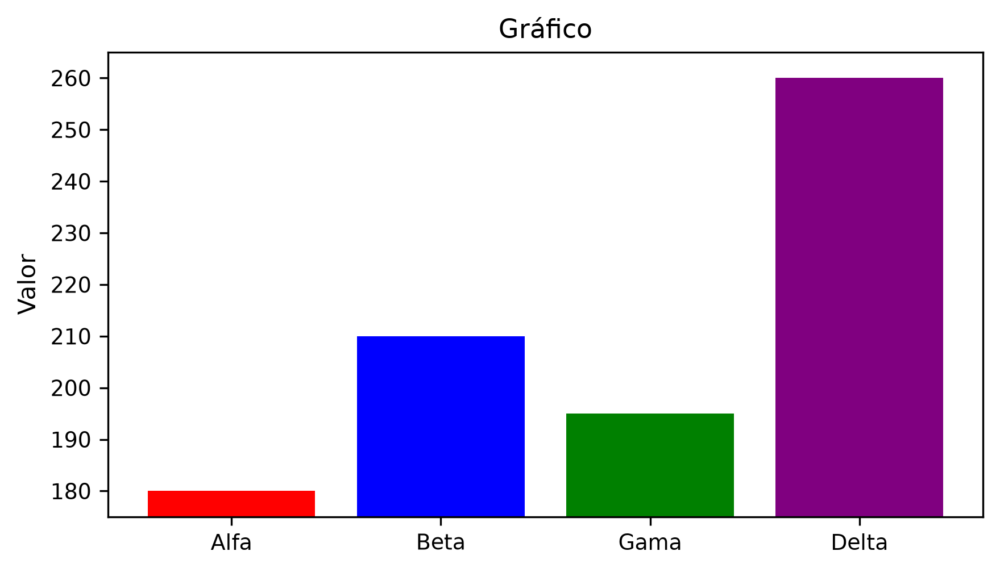

# Exercícios — Capítulo 14 — Visualização de Dados e Data Storytelling

**Após sua tentativa:** [resoluções do Capítulo 14](../solutions/ch14.md).

[Índice do idioma](../README.md) · [Notebook do estudante](../ch14-student.ipynb)

Tente os exercícios antes de consultar as resoluções. Questões abertas admitem outras respostas justificadas.

<a id="suplemento-do-capítulo"></a>

## Suplemento do capítulo

Este suplemento contém 20 exercícios: escolha visual (01–07), comunicação (08–14) e narrativa executiva (15–20). Trabalhe em ordem dentro de cada bloco. Registre justificativas em texto e preserve os valores fornecidos. Consulte as resoluções nos materiais de resoluções depois de tentar as atividades. O notebook do estudante inclui somente enunciados, áreas de resposta e o estímulo do Exercício 14.

Materiais complementares: [notebook do estudante](../ch14-student.ipynb).

<a id="bloco-14a-escolha-de-gráficos"></a>

## Bloco 14A — Escolha de gráficos

Quatro bases independentes atendem aos Exercícios 01–06:

- categorias A, B e C, com receitas de 120, 180 e 150 R\$ mil;
- janeiro a abril de 2026, com receitas de 100, 115, 108 e 130 R\$ mil;
- tempos individuais de entrega: 3, 4, 4, 5, 5, 6, 7 e 12 dias;
- grupos Norte e Sul, com prazos `[3, 4, 5, 6]` e `[4, 5, 7, 9]` dias.

O Exercício 07 possui uma base própria, fornecida em seu enunciado.

<a id="ex-visualizacao-storytelling-a1"></a>

### Exercício 01 — Perguntas empresariais

Para cada pergunta, identifique a comparação desejada e a estrutura dos dados:

1.  Qual categoria possui maior receita?
2.  Como a receita mudou entre janeiro e abril?
3.  Onde os tempos de entrega se concentram?
4.  Como a distribuição dos prazos difere entre Norte e Sul?

<a id="ex-visualizacao-storytelling-a2"></a>

### Exercício 02 — Escolha visual

Escolha e justifique o gráfico mais adequado para cada pergunta de Exercício 01. Considere o que ocupará os eixos e o que cada marca visual representará.

<a id="ex-visualizacao-storytelling-a3"></a>

### Exercício 03 — Comparação categórica

Construa a visualização da receita por categoria com título e unidades. Interprete maior e menor valor.

<a id="ex-visualizacao-storytelling-a4"></a>

### Exercício 04 — Evolução temporal

Converta os meses em datas, ordene a base e construa a visualização da evolução da receita. Interprete aumentos e quedas.

<a id="ex-visualizacao-storytelling-a5"></a>

### Exercício 05 — Distribuição individual

Construa uma visualização da distribuição dos tempos e descreva concentração, dispersão e observações que mereçam atenção.

<a id="ex-visualizacao-storytelling-a6"></a>

### Exercício 06 — Distribuições entre grupos

Compare visualmente os prazos de Norte e Sul. Interprete posição central, dispersão e limites da pequena amostra.

<a id="ex-visualizacao-storytelling-desafio-a"></a>

### Exercício 07 — Desafio A — Rede Comercial Cedro

Uma linha representa uma filial em um mês.

| filial | região | mês        | receita_mil | prazo_dias |
|--------|--------|------------|------------:|-----------:|
| Alfa   | Norte  | 2026-01-01 |         120 |          5 |
| Alfa   | Norte  | 2026-02-01 |         132 |          4 |
| Alfa   | Norte  | 2026-03-01 |         128 |          6 |
| Beta   | Sul    | 2026-01-01 |         145 |          4 |
| Beta   | Sul    | 2026-02-01 |         151 |          5 |
| Beta   | Sul    | 2026-03-01 |         160 |          4 |
| Gama   | Norte  | 2026-01-01 |          98 |          7 |
| Gama   | Norte  | 2026-02-01 |         105 |          6 |
| Gama   | Norte  | 2026-03-01 |         112 |          8 |
| Delta  | Sul    | 2026-01-01 |         138 |          5 |
| Delta  | Sul    | 2026-02-01 |         142 |          5 |
| Delta  | Sul    | 2026-03-01 |         149 |          6 |

Responda sem receber previamente o tipo de gráfico:

1.  Qual filial apresenta maior receita acumulada?
2.  Como a receita total evolui entre janeiro e março?
3.  Como os valores de prazo das combinações filial–mês se distribuem?
4.  Como a distribuição dos prazos difere entre Norte e Sul?

Para cada pergunta, escolha o gráfico, construa-o, justifique a escolha, interprete a evidência e registre um limite.

Os 12 prazos são valores por filial–mês; a base não informa que sejam médias nem fornece 12 entregas individuais.

<a id="bloco-14b-comunicação-visual"></a>

## Bloco 14B — Comunicação visual

Os Exercícios 08–13 usam uma linha por unidade empresarial:

| Unidade | Receita (R\$ mil) | Pedidos | Região |
|---------|------------------:|--------:|--------|
| Alfa    |               180 |     170 | Norte  |
| Beta    |               210 |     190 | Norte  |
| Gama    |               195 |     185 | Sul    |
| Delta   |               260 |     225 | Sul    |

Os Exercícios 08–10 desenvolvem o mesmo gráfico em etapas. O Exercício 14 traz o programa a diagnosticar.

<a id="ex-visualizacao-storytelling-b1"></a>

### Exercício 08 — Relação

Construa a relação entre pedidos e receita preservando uma unidade por ponto.

<a id="ex-visualizacao-storytelling-b2"></a>

### Exercício 09 — Grupos

Codifique região com cor e marcador para não depender exclusivamente da cor.

<a id="ex-visualizacao-storytelling-b3"></a>

### Exercício 10 — Comunicação

Inclua título informativo, eixos, unidades e legenda adequada.

<a id="ex-visualizacao-storytelling-b4"></a>

### Exercício 11 — Diagnóstico

Explique por que barras de receita com eixo vertical entre 175 e 265 R\$ mil exagerariam visualmente as diferenças.

<a id="ex-visualizacao-storytelling-b5"></a>

### Exercício 12 — Correção

Reconstrua as barras ordenadas com eixo íntegro e destaque justificado pela pergunta. Declare a pergunta que orienta o destaque e justifique sua escolha.

<a id="ex-visualizacao-storytelling-b6"></a>

### Exercício 13 — Mensagem

Escreva separadamente:

- **evidência:** o que os valores mostram;
- **interpretação:** qual leitura descritiva é razoável;
- **limite:** o que não pode ser concluído.

<a id="ex-visualizacao-storytelling-desafio-b"></a>

### Exercício 14 — Desafio B — Diagnóstico sem pistas

O código abaixo produz um gráfico usado em uma apresentação interna. Execute-o e avalie o resultado visual sem assumir que as escolhas são adequadas.

<!-- stimulus-cell: 16 -->

``` python
import matplotlib.pyplot as plt
unidades = ['Alfa', 'Beta', 'Gama', 'Delta']
receitas = [180, 210, 195, 260]
(fig, ax) = plt.subplots(figsize=(6, 3.5))
ax.bar(
    unidades,
    receitas,
    color=['red', 'blue', 'green', 'purple']
)
ax.set_ylim(175, 265)
ax.set_title('Gráfico')
ax.set_ylabel('Valor')
plt.show()
```

<figure>

<figcaption aria-hidden="true">Figura 14.17 — Gráfico do Exercício 14 para análise.</figcaption>
</figure>

Figura 14.17 — Gráfico do Exercício 14 para análise.

Depois:

1.  identifique os problemas visuais e editoriais;
2.  reconstrua o gráfico;
3.  justifique cada mudança;
4.  escreva mensagem final com evidência, interpretação e limite.

<a id="bloco-14c-narrativa-visual"></a>

## Bloco 14C — Narrativa visual

A Operação Empresarial Horizonte Oeste é fictícia. Cada linha representa um centro em um trimestre. O ano não foi informado. Receita está em milhares de reais; pedidos são contagens; margem já está em porcentagem; prazo está em dias. Construa a base a partir dos seis registros:

| Centro | Trimestre | Receita | Pedidos | Margem (%) | Prazo (dias) |
|--------|-----------|--------:|--------:|-----------:|-------------:|
| Norte  | Q1        |     120 |     110 |         24 |            5 |
| Norte  | Q2        |     135 |     130 |         25 |            4 |
| Sul    | Q1        |     150 |     125 |         28 |            4 |
| Sul    | Q2        |     142 |     145 |         27 |            5 |
| Leste  | Q1        |     105 |     105 |         22 |            6 |
| Leste  | Q2        |     118 |     118 |         23 |            5 |

Os Exercícios 15–20 integram a mesma investigação. Escolha três ou quatro perguntas e figuras, justifique a presença ou ausência de destaque e encerre com três a cinco conclusões executivas.

<a id="ex-visualizacao-storytelling-c1"></a>

### Exercício 15 — Base

Construa e valide a base. Confira a chave centro–trimestre e a cobertura dos períodos fornecidos.

<a id="ex-visualizacao-storytelling-c2"></a>

### Exercício 16 — Perguntas

Escolha três ou quatro perguntas empresariais.

<a id="ex-visualizacao-storytelling-c3"></a>

### Exercício 17 — Gráficos

Escolha variáveis, agregações e gráficos. Produza três ou quatro gráficos correspondentes às perguntas escolhidas.

<a id="ex-visualizacao-storytelling-c4"></a>

### Exercício 18 — Destaque

Decida autonomamente se algum destaque é substantivamente útil. Justifique sua decisão.

<a id="ex-visualizacao-storytelling-c5"></a>

### Exercício 19 — Mensagens

Para cada gráfico, escreva pergunta, escolha visual, evidência, interpretação e limite.

<a id="ex-visualizacao-storytelling-desafio-c"></a>

### Exercício 20 — Desafio C — Narrativa visual executiva

Produza três ou quatro gráficos e três a cinco conclusões executivas. Decida pergunta, gráfico, agrupamento, destaque e mensagem. Não faça afirmações causais ou previsões.


---

Daniel de Abreu Pereira Uhr · [MIT / CC BY 4.0](../../LICENSE-SCOPE.md)
