# Resoluções — Capítulo 14 — Visualização de Dados e Data Storytelling

[Índice do idioma](../README.md) · [Notebook do estudante](../ch14-student.ipynb)

Tente os exercícios antes de consultar as resoluções. Questões abertas admitem outras respostas justificadas.

Este capítulo apresenta as resoluções comentadas dos 20 exercícios do suplemento. Siga a ordem dentro de cada bloco, pois tabelas e variáveis são reutilizadas. As questões interpretativas admitem outras respostas justificadas; os programas preservam todos os valores fornecidos.

Preparação do bloco A.

``` python
import pandas as pd
import matplotlib.pyplot as plt
import seaborn as sns
sns.set_theme(style='whitegrid')
```

<a id="sol-ch14-01"></a>

## Solução do Exercício 01

A primeira pergunta compara magnitudes entre categorias: precisamos de um nome e uma receita por categoria. A segunda acompanha uma sequência temporal: precisamos de meses ordenados e uma medida comparável em cada mês. A terceira examina uma distribuição: precisamos preservar os oito tempos individuais. A quarta compara distribuições: cada prazo deve estar associado ao seu grupo, Norte ou Sul. Não misturamos as quatro bases apenas porque algumas usam a mesma unidade.

<a id="sol-ch14-02"></a>

## Solução do Exercício 02

Para a primeira pergunta, barras permitem comparar o comprimento associado à receita de cada categoria: categorias na horizontal e receita na vertical. Para a segunda, uma linha usa meses na horizontal, receita na vertical e um ponto por mês. Para a terceira, um histograma usa intervalos de tempo e frequência; cada barra conta observações em um intervalo. Para a quarta, um boxplot usa grupos e prazos; cada caixa resume a distribuição de um grupo. Essas escolhas respondem às comparações identificadas no Exercício 01, em vez de apenas associar uma função a um tipo de coluna.

<a id="sol-ch14-03"></a>

## Solução do Exercício 03

Construímos a tabela de categorias e receitas e passamos suas colunas a `bar()`. Como há um valor por categoria, nenhuma agregação adicional é necessária. Título e rótulos declaram o conteúdo; o eixo vertical mantém a unidade em milhares de reais.

``` python
categorias = pd.DataFrame(
    {
        'categoria': ['A', 'B', 'C'],
        'receita_mil': [120, 180, 150]
    }
)
(fig, ax) = plt.subplots(figsize=(6, 3.5))
ax.bar(
    categorias['categoria'],
    categorias['receita_mil'],
    color='steelblue'
)
ax.set_title('Receita por categoria')
ax.set_xlabel('Categoria')
ax.set_ylabel('Receita (R$ mil)')
plt.show()
```

<figure>
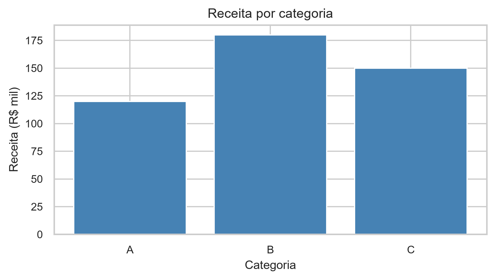
<figcaption aria-hidden="true">Figura 14.18 — Receita por categoria</figcaption>
</figure>

Figura 14.18 — Receita por categoria

B lidera com R\$ 180 mil, C tem R\$ 150 mil e A tem o menor valor, R\$ 120 mil. O gráfico identifica a diferença, mas não a explica. Não há período adicional informado para generalizar a liderança.

<a id="sol-ch14-04"></a>

## Solução do Exercício 04

`to_datetime()` cria datas comparáveis e `sort_values()` ordena a base antes de `plot()`. Os marcadores revelam as quatro observações; as datas no primeiro dia identificam meses, não receitas diárias. As referências do eixo e `autofmt_xdate()` facilitam a leitura.

``` python
tempo = pd.DataFrame(
    {
        'mes': pd.to_datetime(
            [
                '2026-01-01', '2026-02-01', '2026-03-01',
                '2026-04-01',
            ]
        ),
        'receita_mil': [100, 115, 108, 130]
    }
).sort_values(
    'mes'
)
(fig, ax) = plt.subplots(figsize=(6, 3.5))
ax.plot(
    tempo['mes'],
    tempo['receita_mil'],
    marker='o',
    color='steelblue'
)
ax.set_title('Receita mensal observada — jan–abr/2026')
ax.set_xlabel('Mês')
ax.set_ylabel('Receita (R$ mil)')
ax.set_xticks(tempo['mes'])
fig.autofmt_xdate()
plt.show()
```

<figure>
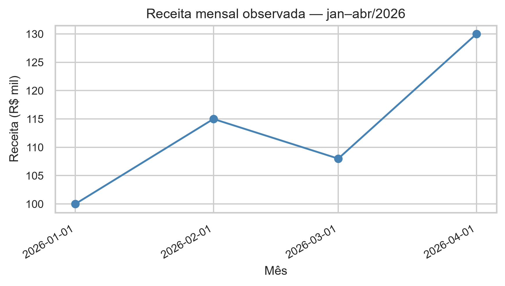
<figcaption aria-hidden="true">Figura 14.19 — Receita mensal observada — jan–abr/2026</figcaption>
</figure>

Figura 14.19 — Receita mensal observada — jan–abr/2026

Os valores são 100, 115, 108 e 130 R\$ mil. Há aumento de 15 em fevereiro, queda de 7 em março e aumento de 22 em abril. Quatro meses não sustentam previsão; a ligação dos pontos não acrescenta observações intermediárias.

<a id="sol-ch14-05"></a>

## Solução do Exercício 05

O histograma mantém os oito tempos individuais e os divide em cinco intervalos com `bins=5`. Sua altura conta ocorrências, não dias nem impacto financeiro. Identificamos tempo na horizontal e frequência na vertical.

``` python
tempos = [3, 4, 4, 5, 5, 6, 7, 12]
(fig, ax) = plt.subplots(figsize=(6, 3.5))
sns.histplot(tempos, bins=5, color='steelblue', ax=ax)
ax.set_title('Distribuição dos tempos de entrega')
ax.set_xlabel('Tempo (dias)')
ax.set_ylabel('Frequência')
plt.show()
```

<figure>
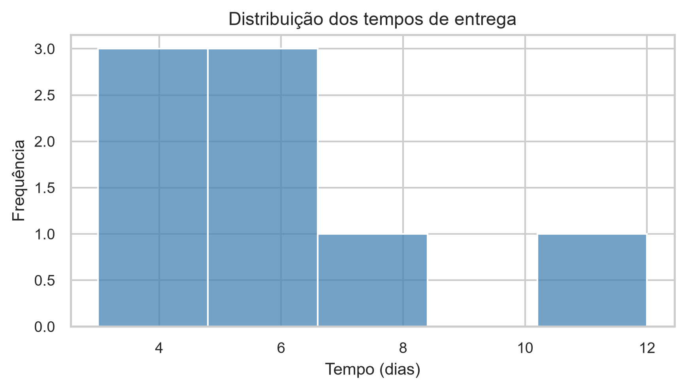
<figcaption aria-hidden="true">Figura 14.20 — Distribuição dos tempos de entrega</figcaption>
</figure>

Figura 14.20 — Distribuição dos tempos de entrega

Sete tempos estão entre 3 e 7 dias; 12 dias aparece distante. Os valores repetidos em 4 e 5 dias contribuem para a concentração central. A aparência depende dos intervalos escolhidos, e o valor distante não é prova de erro.

<a id="sol-ch14-06"></a>

## Solução do Exercício 06

Construímos uma tabela longa: cada prazo ocupa uma linha e recebe seu grupo. `boxplot(data=..., x=..., y=...)` resume separadamente as quatro observações de Norte e as quatro de Sul, mantendo a mesma escala de dias.

``` python
prazos = pd.DataFrame(
    {
        'grupo': ['Norte'] * 4 + ['Sul'] * 4,
        'prazo': [3, 4, 5, 6, 4, 5, 7, 9]
    }
)
(fig, ax) = plt.subplots(figsize=(6, 3.5))
sns.boxplot(
    data=prazos,
    x='grupo',
    y='prazo',
    color='lightblue',
    ax=ax
)
ax.set_title('Distribuição do prazo por grupo')
ax.set_xlabel('Grupo')
ax.set_ylabel('Prazo (dias)')
plt.show()
```

<figure>
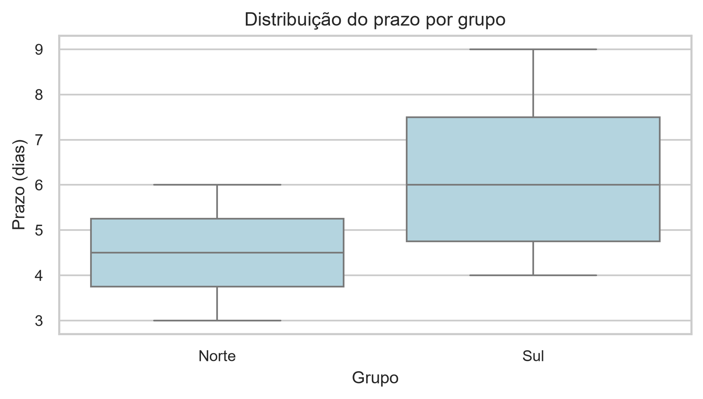
<figcaption aria-hidden="true">Figura 14.21 — Distribuição do prazo por grupo</figcaption>
</figure>

Figura 14.21 — Distribuição do prazo por grupo

Norte tem mediana 4,5 dias e valores de 3 a 6; Sul tem mediana 6 dias e valores de 4 a 9. Sul ocupa posição central e faixa superiores. Quatro observações por grupo são uma base pequena e não explicam a diferença nem estabelecem um padrão populacional.

<a id="sol-ch14-07"></a>

## Solução do Exercício 07

A base única reúne 12 combinações de filial e mês. Os prazos são valores associados a essas combinações; não são 12 entregas individuais, e sua definição como média não foi fornecida. `head()` apresenta as primeiras linhas, e `len()` confirma as 12 observações. Conferindo os pares fornecidos, cada filial aparece uma vez em cada um dos três meses. Construímos quatro gráficos, cada um ligado a uma pergunta, preservando todos os registros.

``` python
cedro = pd.DataFrame(
    {
        'filial': ['Alfa'] * 3 + ['Beta'] * 3 + ['Gama'] * 3 + ['Delta'] * 3,
        'regiao': ['Norte'] * 3 + ['Sul'] * 3 + ['Norte'] * 3 + ['Sul'] * 3,
        'mes': pd.to_datetime(
            ['2026-01-01', '2026-02-01', '2026-03-01'] * 4
        ),
        'receita_mil': [
            120, 132, 128, 145, 151, 160, 98, 105, 112, 138, 142,
            149,
        ],
        'prazo_dias': [5, 4, 6, 4, 5, 4, 7, 6, 8, 5, 5, 6]
    }
)
print(cedro.head())
print('Observações:', len(cedro))
```

``` text
filial regiao        mes  receita_mil  prazo_dias
0   Alfa  Norte 2026-01-01          120           5
1   Alfa  Norte 2026-02-01          132           4
2   Alfa  Norte 2026-03-01          128           6
3   Beta    Sul 2026-01-01          145           4
4   Beta    Sul 2026-02-01          151           5
Observações: 12
```

``` python
cedro_filial = cedro.groupby('filial', as_index=False)['receita_mil'].sum().sort_values(
    'receita_mil'
)
(fig, ax) = plt.subplots(figsize=(6, 3.5))
ax.barh(
    cedro_filial['filial'],
    cedro_filial['receita_mil'],
    color='steelblue'
)
ax.set_title('Receita acumulada por filial — jan–mar/2026')
ax.set_xlabel('Receita acumulada (R$ mil)')
ax.set_ylabel('Filial')
plt.show()
```

<figure>
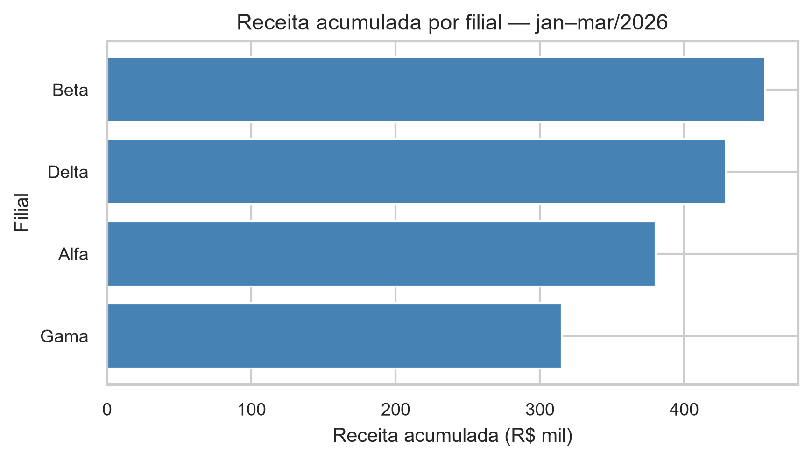
<figcaption aria-hidden="true">Figura 14.22 — Receita acumulada por filial — jan–mar/2026</figcaption>
</figure>

Figura 14.22 — Receita acumulada por filial — jan–mar/2026

``` python
cedro_tempo = cedro.groupby('mes', as_index=False)['receita_mil'].sum().sort_values(
    'mes'
)
(fig, ax) = plt.subplots(figsize=(6, 3.5))
ax.plot(
    cedro_tempo['mes'],
    cedro_tempo['receita_mil'],
    marker='o'
)
ax.set_title('Receita total mensal — jan–mar/2026')
ax.set_xlabel('Mês')
ax.set_ylabel('Receita total (R$ mil)')
ax.set_xticks(cedro_tempo['mes'])
fig.autofmt_xdate()
plt.show()
```

<figure>
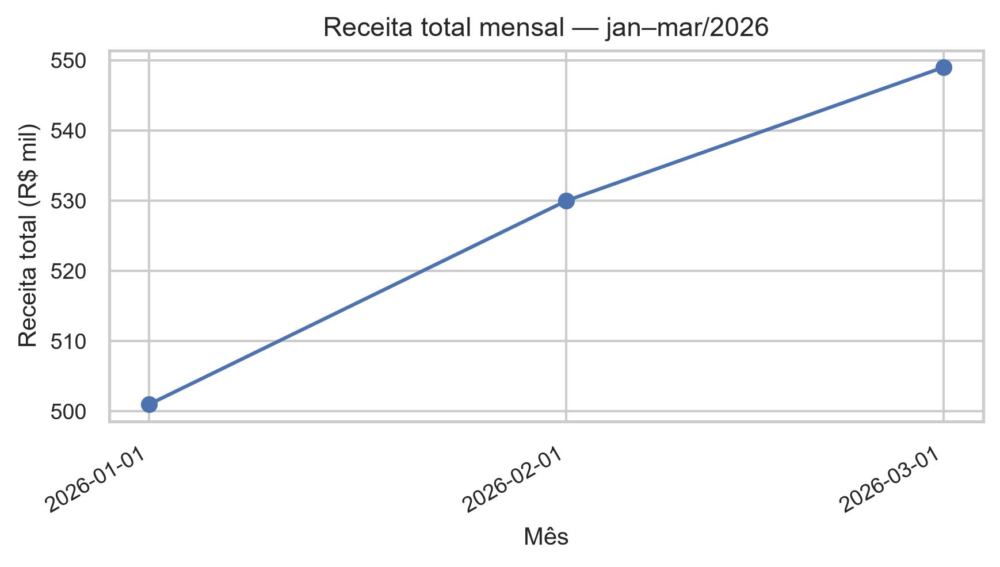
<figcaption aria-hidden="true">Figura 14.23 — Receita total mensal — jan–mar/2026</figcaption>
</figure>

Figura 14.23 — Receita total mensal — jan–mar/2026

``` python
(fig, ax) = plt.subplots(figsize=(6, 3.5))
sns.histplot(
    cedro['prazo_dias'],
    bins=6,
    color='steelblue',
    ax=ax
)
ax.set_title('Distribuição dos prazos de entrega')
ax.set_xlabel('Prazo (dias)')
ax.set_ylabel('Frequência')
plt.show()
```

<figure>
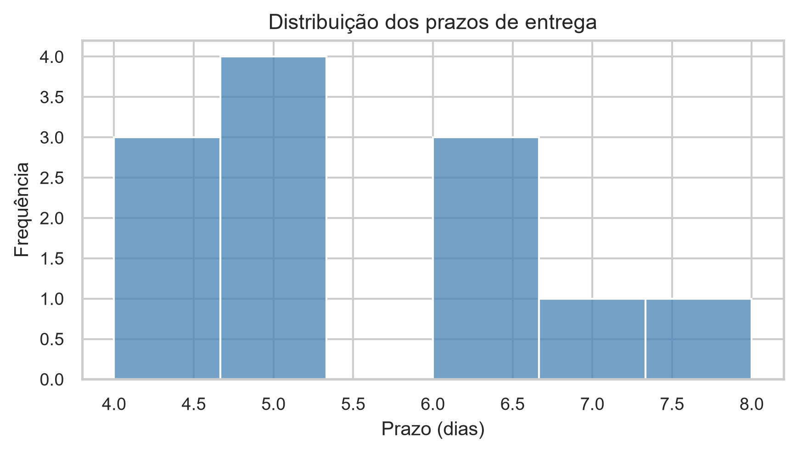
<figcaption aria-hidden="true">Figura 14.24 — Distribuição dos prazos de entrega</figcaption>
</figure>

Figura 14.24 — Distribuição dos prazos de entrega

``` python
(fig, ax) = plt.subplots(figsize=(6, 3.5))
sns.boxplot(
    data=cedro,
    x='regiao',
    y='prazo_dias',
    color='lightblue',
    ax=ax
)
ax.set_title('Distribuição do prazo por região')
ax.set_xlabel('Região')
ax.set_ylabel('Prazo (dias)')
plt.show()
```

<figure>
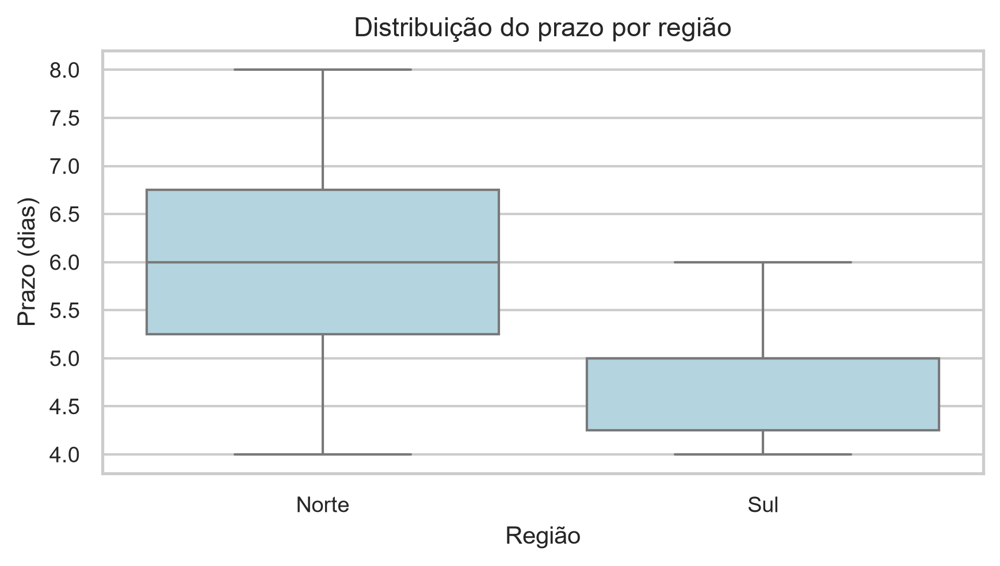
<figcaption aria-hidden="true">Figura 14.25 — Distribuição do prazo por região</figcaption>
</figure>

Figura 14.25 — Distribuição do prazo por região

**Receita por filial:** somamos `receita_mil` por filial, ordenamos e usamos barras horizontais. Beta lidera com R\$ 456 mil; Delta tem 429, Alfa 380 e Gama 315. Barras comparam magnitudes, mas receita não equivale a lucro.

**Evolução total:** somamos por mês, ordenamos as datas e ligamos os três totais com marcadores. O total cresce de R\$ 501 mil para R\$ 530 mil e depois R\$ 549 mil. A linha acompanha uma sequência; três meses não sustentam previsão.

**Distribuição dos prazos:** `histplot(..., bins=6)` conta os 12 valores de prazo das combinações filial–mês. A maior parte está entre 4 e 6 dias; 8 é o maior valor. Frequência não mede impacto econômico, e não conhecemos o número de entregas por linha.

**Comparação regional:** o boxplot usa região como grupo e prazo como medida. Norte tem mediana 6 dias e faixa 4–8; Sul tem mediana 4,5 e faixa 4–6. Norte ocupa faixa mais alta e mais dispersa. São seis observações por região, com repetição das filiais ao longo do tempo; a figura não explica a diferença.

Preparação do bloco B.

``` python
import pandas as pd
import matplotlib.pyplot as plt
import seaborn as sns
sns.set_theme(style='whitegrid')
df = pd.DataFrame(
    {
        'unidade': ['Alfa', 'Beta', 'Gama', 'Delta'],
        'receita_mil': [180, 210, 195, 260],
        'pedidos': [170, 190, 185, 225],
        'regiao': ['Norte', 'Norte', 'Sul', 'Sul']
    }
)
```

<a id="sol-ch14-08"></a>

## Solução do Exercício 08

Escolhemos dispersão: cada ponto combina pedidos e receita da mesma unidade. Os quatro pares são (170, 180), (190, 210), (185, 195) e (225, 260). Agregar por região nesta etapa mudaria a unidade representada. Os Exercícios 09 e 10 completam este mesmo gráfico; o programa integrado aparece na Solução 10.

<a id="sol-ch14-09"></a>

## Solução do Exercício 09

Usamos `hue="regiao"` e `style="regiao"` na chamada de `scatterplot()`. Cor e formato representam o mesmo atributo substantivo, mantendo dois pontos em Norte e dois em Sul. A legenda identifica os grupos, e os marcadores preservam a distinção em preto e branco. O programa completo está na Solução 10.

<a id="sol-ch14-10"></a>

## Solução do Exercício 10

O programa reúne as escolhas dos Exercícios 08–10. `data=df` fornece a tabela; os nomes de colunas definem coordenadas e grupos. O título identifica as unidades por região; os eixos identificam pedidos por unidade e receita em milhares de reais por unidade. A legenda explica cor e marcador, sem substituir os rótulos dos eixos.

``` python
(fig, ax) = plt.subplots(figsize=(6, 3.5))
sns.scatterplot(
    data=df,
    x='pedidos',
    y='receita_mil',
    hue='regiao',
    style='regiao',
    s=80,
    ax=ax
)
ax.set_title('Pedidos e receita das unidades por região')
ax.set_xlabel('Pedidos por unidade')
ax.set_ylabel('Receita (R$ mil por unidade)')
ax.legend(title='Região')
plt.show()
```

<figure>
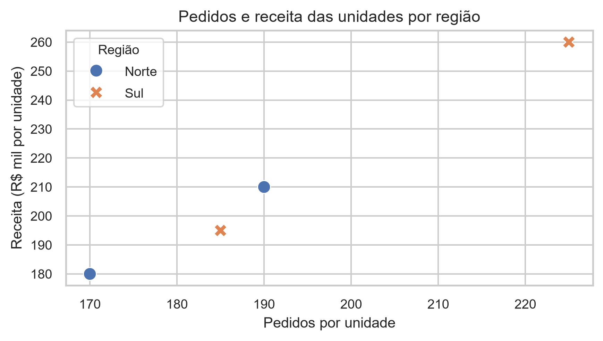
<figcaption aria-hidden="true">Figura 14.26 — Pedidos e receita das unidades por região</figcaption>
</figure>

Figura 14.26 — Pedidos e receita das unidades por região

Pedidos e receita têm associação positiva nos quatro registros; Delta ocupa os maiores valores, 225 pedidos e R\$ 260 mil. Quatro observações não demonstram causalidade, e os dois pontos de cada região não permitem uma comparação regional geral.

<a id="sol-ch14-11"></a>

## Solução do Exercício 11

Ao começar em 175, os comprimentos visíveis de Alfa e Delta correspondem a 5 e 85, embora os valores sejam 180 e 260. A relação entre os trechos visíveis seria 17, muito diferente da relação entre as receitas, aproximadamente 1,44. Os dados continuam corretos; a escala distorce a comparação dos comprimentos. A base zero restaura a proporcionalidade das barras.

<a id="sol-ch14-12"></a>

## Solução do Exercício 12

Adotamos a pergunta “qual unidade tem a maior receita observada?”. Ordenamos as receitas, iniciamos o eixo em zero e destacamos Delta. `sort_values()` organiza a tabela; a compreensão de lista cria um tom principal para Delta e tons claros para as demais. Essa é uma escolha justificada, não a única resposta possível: outra pergunta declarada poderia justificar outro destaque ou sua ausência.

``` python
ordenado = df.sort_values('receita_mil')
cores = ['steelblue' if unidade == 'Delta' else 'lightgray' for unidade in ordenado['unidade']]
(fig, ax) = plt.subplots(figsize=(6, 3.5))
ax.barh(
    ordenado['unidade'],
    ordenado['receita_mil'],
    color=cores
)
ax.set_xlim(0, 280)
ax.set_title('Delta registra a maior receita observada')
ax.set_xlabel('Receita (R$ mil)')
ax.set_ylabel('Unidade')
plt.show()
```

<figure>

<figcaption aria-hidden="true">Figura 14.27 — Delta registra a maior receita observada</figcaption>
</figure>

Figura 14.27 — Delta registra a maior receita observada

A ordem crescente é Alfa, Gama, Beta e Delta, com 180, 195, 210 e 260 R\$ mil. A escala de 0 a 280 acomoda todos os valores e preserva o contexto. O destaque facilita encontrar a resposta sem retirar as outras unidades.

<a id="sol-ch14-13"></a>

## Solução do Exercício 13

**Evidência:** Delta registra R\$ 260 mil, acima de Beta (210), Gama (195) e Alfa (180). **Interpretação:** Delta lidera a receita entre as quatro unidades observadas. **Limite:** a comparação não identifica causa, rentabilidade nem desempenho futuro. A interpretação organiza a evidência; não acrescenta uma explicação sobre estratégia, preço ou custos que a base não contém.

<a id="sol-ch14-14"></a>

## Solução do Exercício 14

O gráfico recebido corta o eixo em 175, usa quatro cores fortes sem função analítica, apresenta título genérico e eixo “Valor” sem variável nem unidade, e omite o rótulo do eixo de categorias. O primeiro programa abaixo reproduz essas escolhas com um título que identifica explicitamente o exemplo inadequado, já na parte de resoluções. O estímulo do enunciado conserva o título neutro “Gráfico”.

``` python
(fig, ax) = plt.subplots(figsize=(6, 3.5))
ax.bar(
    df['unidade'],
    df['receita_mil'],
    color=['red', 'blue', 'green', 'purple']
)
ax.set_ylim(175, 265)
ax.set_title('Exemplo propositalmente inadequado')
ax.set_ylabel('Valor')
plt.show()
```

<figure>
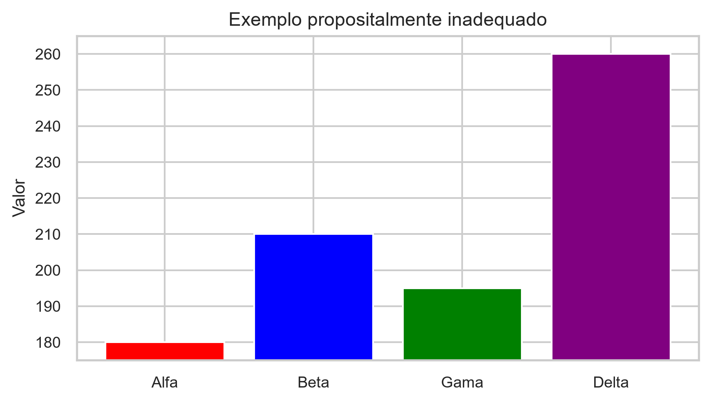
<figcaption aria-hidden="true">Figura 14.28 — Exemplo propositalmente inadequado</figcaption>
</figure>

Figura 14.28 — Exemplo propositalmente inadequado

``` python
(fig, ax) = plt.subplots(figsize=(6, 3.5))
ax.barh(
    ordenado['unidade'],
    ordenado['receita_mil'],
    color=cores
)
ax.set_xlim(0, 280)
ax.set_title('Delta registra a maior receita observada')
ax.set_xlabel('Receita (R$ mil)')
ax.set_ylabel('Unidade')
plt.show()
```

<figure>
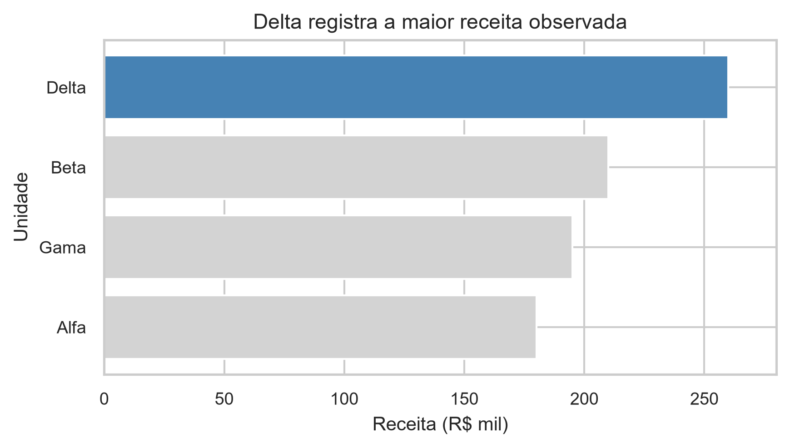
<figcaption aria-hidden="true">Figura 14.29 — Delta registra a maior receita observada</figcaption>
</figure>

Figura 14.29 — Delta registra a maior receita observada

A reconstrução reutiliza `ordenado` e `cores` da Solução 12. Zero preserva a proporcionalidade; ordenação facilita comparar; cinza mantém o contexto e o tom principal destaca a resposta; título e eixos eliminam ambiguidades. A pergunta adotada é a de liderança da receita, que justifica destacar Delta.

**Evidência:** Delta registra R\$ 260 mil. **Interpretação:** é a maior receita entre as unidades observadas. **Limite:** o gráfico não explica a diferença nem sustenta previsão. A correção muda a apresentação, preservando integralmente os quatro valores.

Preparação do bloco C.

``` python
import pandas as pd
import matplotlib.pyplot as plt
import seaborn as sns
sns.set_theme(style='whitegrid')
```

<a id="sol-ch14-15"></a>

## Solução do Exercício 15

Cada linha é um centro–trimestre, e esperamos três centros em dois trimestres, totalizando seis combinações. Construímos o DataFrame com listas alinhadas e verificamos `len()` e `duplicated()` para a chave. Conferimos também os pares fornecidos: cada centro tem Q1 e Q2. Nenhum ano foi informado, portanto preservamos esses rótulos sem inventar datas.

``` python
horizonte = pd.DataFrame(
    {
        'centro': ['Norte', 'Norte', 'Sul', 'Sul', 'Leste', 'Leste'],
        'trimestre': ['Q1', 'Q2'] * 3,
        'receita_mil': [120, 135, 150, 142, 105, 118],
        'pedidos': [110, 130, 125, 145, 105, 118],
        'margem_pct': [24, 25, 28, 27, 22, 23],
        'prazo_dias': [5, 4, 4, 5, 6, 5]
    }
)
print(horizonte)
print('Observações:', len(horizonte))
print(
    'Duplicações:',
    horizonte.duplicated(['centro', 'trimestre']).sum()
)
```

``` text
centro trimestre  receita_mil  pedidos  margem_pct  prazo_dias
0  Norte        Q1          120      110          24           5
1  Norte        Q2          135      130          25           4
2    Sul        Q1          150      125          28           4
3    Sul        Q2          142      145          27           5
4  Leste        Q1          105      105          22           6
5  Leste        Q2          118      118          23           5
Observações: 6
Duplicações: 0
```

São seis observações e zero duplicações. Receita está em milhares de reais, pedidos são contagens, margem já está em porcentagem e prazo está em dias. Essas colunas têm significados diferentes; não se deve somá-las como se fossem medidas intercambiáveis.

<a id="sol-ch14-16"></a>

## Solução do Exercício 16

Uma estratégia possível usa três perguntas: qual centro lidera a receita acumulada; como a receita total muda de Q1 para Q2; e como pedidos e receita se relacionam nos seis registros. A primeira exige agregação por centro, a segunda por trimestre e a terceira preserva cada par centro–trimestre. Outras três ou quatro perguntas são aceitáveis quando compatíveis com a base e com seus limites.

<a id="sol-ch14-17"></a>

## Solução do Exercício 17

Para as três perguntas escolhidas, usamos barras de receita somada por centro, linha de receita somada por trimestre e dispersão dos seis pares de pedidos e receita. Começamos pelas barras. `groupby(...).sum()` calcula os totais antes de desenhar; a ordenação e `barh()` facilitam comparar. A linha e a dispersão são apresentadas na Solução 19 junto de suas mensagens, completando os três gráficos.

``` python
receita_centro = horizonte.groupby('centro', as_index=False)['receita_mil'].sum(

).sort_values(
    'receita_mil'
)
cores = ['steelblue' if centro == 'Sul' else 'lightgray' for centro in receita_centro['centro']]
(fig, ax) = plt.subplots(figsize=(6, 3.5))
ax.barh(
    receita_centro['centro'],
    receita_centro['receita_mil'],
    color=cores
)
ax.set_title('Sul lidera a receita acumulada')
ax.set_xlabel('Receita acumulada (R$ mil)')
ax.set_ylabel('Centro')
plt.show()
```

<figure>
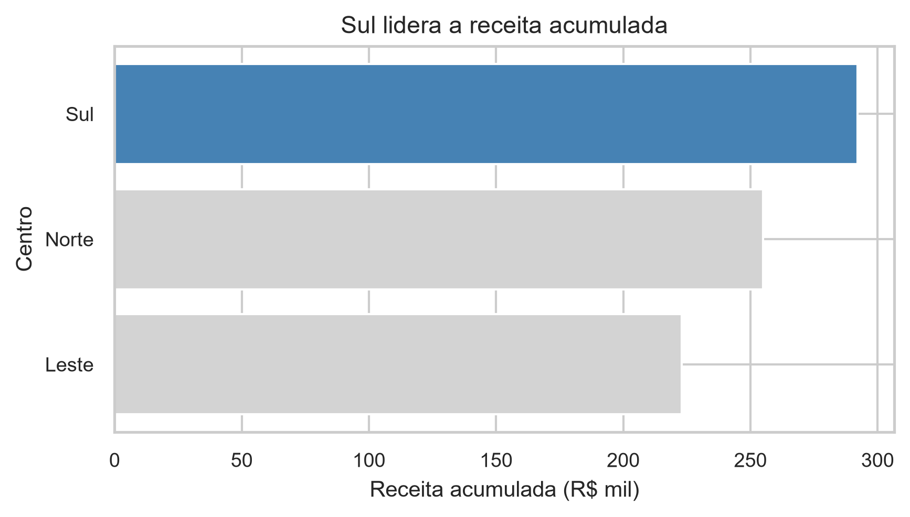
<figcaption aria-hidden="true">Figura 14.30 — Sul lidera a receita acumulada</figcaption>
</figure>

Figura 14.30 — Sul lidera a receita acumulada

Sul acumula R\$ 292 mil, Norte R\$ 255 mil e Leste R\$ 223 mil. Sul lidera o período observado. Receita não equivale a lucro, e dois trimestres não sustentam previsão. As barras representam totais por centro, não as seis linhas originais.

<a id="sol-ch14-18"></a>

## Solução do Exercício 18

Destacamos Sul nas barras porque a pergunta procura o centro com maior receita acumulada. Norte e Leste permanecem em cinza para fornecer contexto. O destaque decorre do resultado, não de preferência estética. Na linha usamos apresentação uniforme. Na dispersão, cor e formato identificam os centros, sem selecionar uma categoria vencedora. Também seria válido não destacar nenhuma barra, desde que a decisão fosse explicada e a comparação continuasse clara.

<a id="sol-ch14-19"></a>

## Solução do Exercício 19

**Gráfico 1 — receita por centro:** a pergunta é qual centro lidera a receita acumulada. Escolhemos barras sobre soma explícita. A evidência da Solução 17 é Sul 292, Norte 255 e Leste 223 R\$ mil; a interpretação é liderança de Sul no conjunto observado. O limite é que receita não mede lucro nem antecipa resultados futuros.

**Gráfico 2 — evolução agregada:** perguntamos como o total muda de Q1 para Q2. A linha respeita a ordem substantiva dos trimestres, e `groupby()` calcula a soma antes de `plot()`. Marcadores identificam os dois totais observados.

**Gráfico 3 — relação:** perguntamos se mais pedidos coexistem com mais receita. `scatterplot()` preserva duas medidas numéricas de cada centro–trimestre; `corr()` fornece um resumo linear, exibido com quatro casas decimais.

``` python
receita_trimestre = horizonte.groupby('trimestre', as_index=False)['receita_mil'].sum(

)
(fig, ax) = plt.subplots(figsize=(6, 3.5))
ax.plot(
    receita_trimestre['trimestre'],
    receita_trimestre['receita_mil'],
    marker='o',
    color='steelblue'
)
ax.set_title('Receita total por trimestre')
ax.set_xlabel('Trimestre')
ax.set_ylabel('Receita total (R$ mil)')
plt.show()
```

<figure>
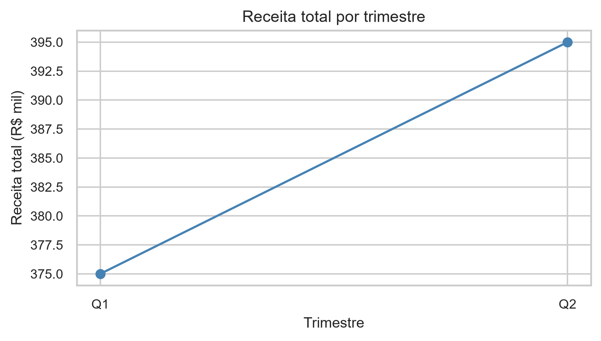
<figcaption aria-hidden="true">Figura 14.31 — Receita total por trimestre</figcaption>
</figure>

Figura 14.31 — Receita total por trimestre

``` python
correlacao_horizonte = horizonte['pedidos'].corr(horizonte['receita_mil'])
(fig, ax) = plt.subplots(figsize=(6, 3.5))
sns.scatterplot(
    data=horizonte,
    x='pedidos',
    y='receita_mil',
    hue='centro',
    style='centro',
    s=80,
    ax=ax
)
ax.set_title('Pedidos e receita por centro-trimestre')
ax.set_xlabel('Pedidos por centro-trimestre')
ax.set_ylabel('Receita (R$ mil por centro-trimestre)')
ax.legend(title='Centro')
plt.show()
print(f'Correlação observada: {correlacao_horizonte:.4f}')
```

``` text
Correlação observada: 0.7942
```

<figure>
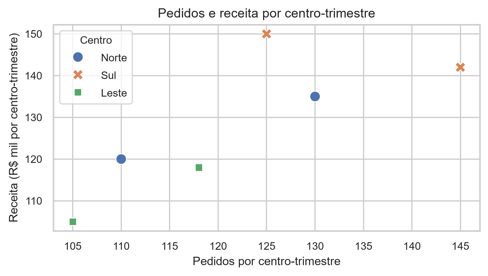
<figcaption aria-hidden="true">Figura 14.32 — Pedidos e receita por centro-trimestre</figcaption>
</figure>

Figura 14.32 — Pedidos e receita por centro-trimestre

No segundo gráfico, o total aumenta de R\$ 375 mil para R\$ 395 mil. A cobertura é comparável porque os mesmos três centros aparecem nos dois períodos. A diferença de R\$ 20 mil descreve uma mudança; não identifica causa nem sustenta previsão.

No terceiro, os seis pontos mostram associação positiva, porém imperfeita, com correlação de aproximadamente 0,7942. Pedidos maiores frequentemente coexistem com receitas maiores, mas os pontos não formam uma relação perfeitamente alinhada. A pequena base, com centros repetidos, não demonstra causalidade, e pedidos não são a única dimensão possível da receita.

<a id="sol-ch14-20"></a>

## Solução do Exercício 20

Os três gráficos das Soluções 17 e 19 formam uma entrega possível: liderança por centro, mudança agregada entre trimestres e associação entre pedidos e receita. Apresentamos cinco conclusões executivas, mantendo a ordem pergunta → evidência → interpretação e encerrando com os limites:

1.  Sul lidera a receita acumulada observada, com R\$ 292 mil.
2.  A receita total cresce de R\$ 375 mil em Q1 para R\$ 395 mil em Q2, cobrindo os mesmos três centros.
3.  Pedidos e receita apresentam associação positiva e imperfeita nos seis registros, com correlação aproximada de 0,7942.
4.  O destaque de Sul responde à pergunta de liderança, mantendo os demais centros como contexto.
5.  As figuras são descritivas: não demonstram causa, lucro ou desempenho futuro.

Esta é uma estratégia possível. Outras escolhas de três ou quatro gráficos e três a cinco conclusões são válidas quando justificadas pela pergunta e construídas sem distorcer os dados. Não é necessário inventar uma quarta figura para completar esta solução.


---

Daniel de Abreu Pereira Uhr · [MIT / CC BY 4.0](../../LICENSE-SCOPE.md)
