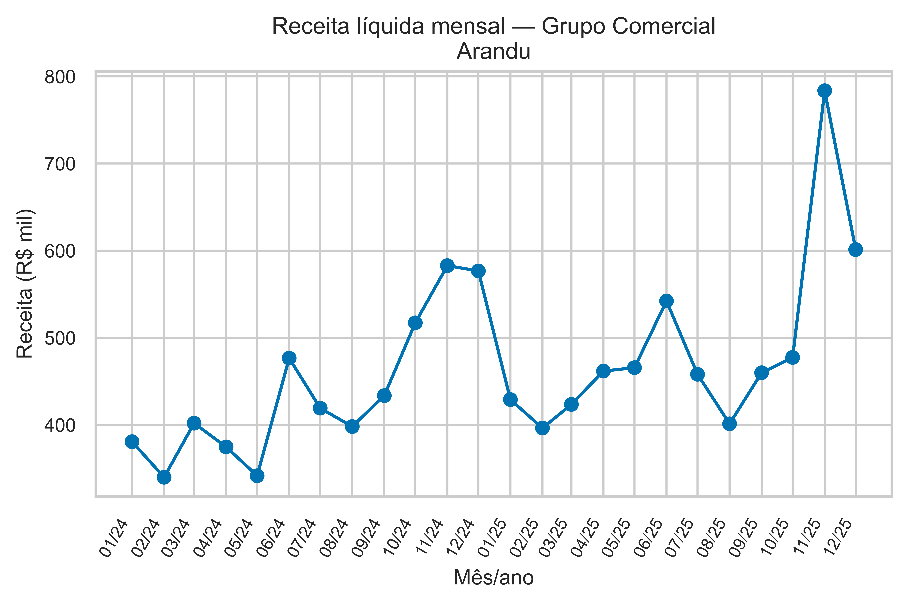
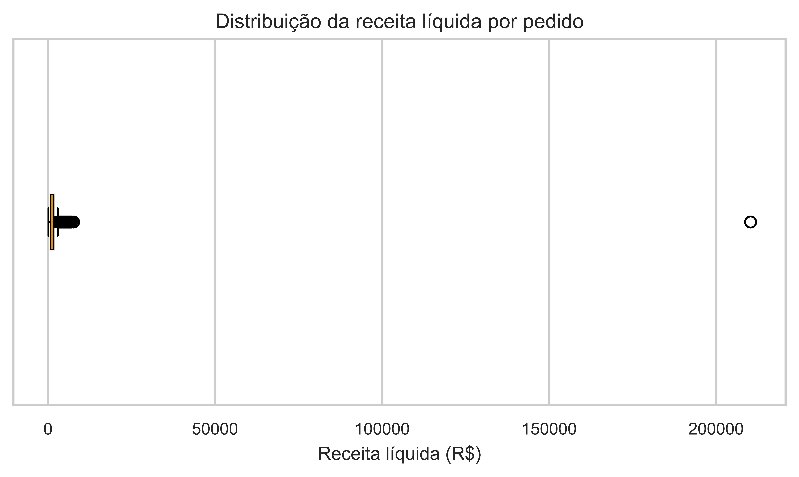

# Resoluções — Capítulo 16 — Projeto Final de Business Analytics

[Índice do idioma](../README.md) · [Notebook do estudante](../ch16-student.ipynb)

Tente os exercícios antes de consultar as resoluções. Questões abertas admitem outras respostas justificadas.

<a id="sol-ch16-01"></a>

## Solução do Exercício 01 — Projeto integrado Arandu

Esta resolução deve ser consultada depois de uma tentativa autônoma. Os programas são sequenciais: reinicie o kernel e execute em ordem. As caixas de saída mantêm todos os campos solicitados pelo programa; tabelas largas podem ser apresentadas em painéis de colunas com a chave repetida ou em registros verticais. Os cortes por `head` são indicados no texto. Valores são formatados para leitura, sem arredondamento intermediário nos cálculos.

<a id="sol-ch16-section-2"></a>

### 1. Entendendo o problema

**Pergunta**

Como transformar as bases brutas do Grupo Comercial Arandu em um diagnóstico gerencial reproduzível?

**Decisão**

Seguiremos um pipeline explícito e preservaremos os arquivos originais. Esta é uma solução de referência, não a única sequência aceitável.

`Path` organiza o acesso aos arquivos; pandas lê e manipula tabelas; NumPy apoiará a classificação por condições; Matplotlib desenha as figuras; seaborn configura o tema; `display` apresenta objetos no notebook. `set_theme` muda a aparência, não os dados. `set_option` permite mostrar mais colunas. `PASTA_DADOS` concentra o caminho relativo usado nas leituras. A pequena função `formato_br` troca os separadores apenas na exibição de números formatados: o cálculo continua numérico e sem arredondamento intermediário.

<!-- source-cell: 3 -->

``` python
from pathlib import Path
import matplotlib.pyplot as plt
import numpy as np
import pandas as pd
import seaborn as sns
from IPython.display import display
sns.set_theme(style='whitegrid', palette='colorblind')
pd.set_option('display.max_columns', 20)
PASTA_DADOS = Path('data/ch16')
def formato_br(valor, especificacao):
    return format(valor, especificacao).translate(str.maketrans(',.', '.,'))
```

<a id="sol-ch16-section-4"></a>

### 2. Importando e compreendendo as bases

Cada arquivo possui uma unidade de observação diferente. Essa distinção orientará as chaves e as cardinalidades.

`read_csv` e `read_excel` constroem uma tabela para cada unidade. `parse_dates` converte os campos indicados em datas. Em custos, `sep=";"` e `decimal=","` descrevem o formato recebido; não alteram o significado monetário. `sheet_name` escolhe a aba do Excel, lida com apoio de openpyxl. O pequeno quadro `estrutura` reúne `len`, que conta linhas, com o significado de uma linha em cada base. Contagem e significado precisam ser lidos juntos (pandas Developers s.d.; openpyxl Contributors s.d.).

<!-- source-cell: 5 -->

``` python
vendas_brutas = pd.read_csv(PASTA_DADOS / 'vendas.csv', parse_dates=['data'])
custos = pd.read_csv(
    PASTA_DADOS / 'custos.csv',
    sep=';',
    decimal=',',
    parse_dates=['mes']
)
metas = pd.read_csv(PASTA_DADOS / 'metas.csv', parse_dates=['mes'])
filiais = pd.read_excel(
    PASTA_DADOS / 'cadastro_operacional.xlsx',
    sheet_name='filiais',
    parse_dates=['data_abertura']
)
produtos = pd.read_excel(
    PASTA_DADOS / 'cadastro_operacional.xlsx',
    sheet_name='produtos'
)
estrutura = pd.DataFrame(
    {
        'base': ['vendas', 'filiais', 'produtos', 'custos', 'metas'],
        'linhas': [
            len(vendas_brutas), len(filiais), len(produtos),
            len(custos), len(metas),
        ],
        'unidade': [
            'pedido', 'filial', 'produto', 'produto × mês',
            'filial × mês',
        ]
    }
)
display(estrutura)
```

``` text
base      linhas  unidade      
vendas    8085    pedido
filiais   22      filial
produtos  12      produto
custos    288     produto × mês
metas     528     filial × mês
```

**Interpretação**

Vendas é uma tabela de fatos. Filiais e produtos são cadastros. Custos variam por produto e mês; metas pertencem ao nível filial × mês. Combinar tabelas sem respeitar essas unidades pode multiplicar registros.

<a id="sol-ch16-section-7"></a>

### 3. Diagnóstico de qualidade

**Pergunta**

Quais problemas podem alterar medidas de receita, margem, segmentação ou contagem de pedidos?

`duplicated(subset=..., keep=False)` marca todas as linhas com uma chave repetida; `unique` lista as chaves, e a compreensão de lista conta ocorrências e versões distintas de cada uma. Já `duplicated()` sem `subset` compara a linha integral. `isna` e `notna` distinguem ausência, enquanto `between(..., inclusive="both")` inclui os limites 0 e 0,40. O operador `~` nega a condição, e `&` exige duas condições simultâneas. Somar uma máscara lógica conta os casos verdadeiros. A lista ordenada de segmentos expõe diferenças de grafia que uma contagem isolada esconderia.

Na segunda parte, a junção traz a data de abertura para cada meta. `.dt.to_period("M").dt.to_timestamp()` representa o primeiro dia do mês; a comparação temporal separa períodos anteriores à operação. O agrupamento final informa quantos meses faltam e os extremos do intervalo para cada filial. Essa combinação entre regra e evidência é mais informativa que preencher toda ausência (The pandas development team s.d.a, s.d.c).

<!-- source-cell: 8 -->

``` python
duplicacao_chave = vendas_brutas.duplicated(subset=['pedido_id'], keep=False)
pedidos_repetidos = sorted(
    vendas_brutas.loc[duplicacao_chave, 'pedido_id'].unique()
)
diagnostico_duplicacoes = pd.DataFrame(
    {
        'pedido_id': pedidos_repetidos,
        'linhas': [(vendas_brutas['pedido_id'] == pedido_id).sum() for pedido_id in pedidos_repetidos],
        'linhas_distintas': [len(vendas_brutas.loc[vendas_brutas['pedido_id'] == pedido_id].drop_duplicates()) for pedido_id in pedidos_repetidos]
    }
)
diagnostico_duplicacoes['duplicacoes_excedentes'] = diagnostico_duplicacoes['linhas'] - 1
duplicacoes_integrais = vendas_brutas.duplicated().sum()
missing_desconto = vendas_brutas['desconto_pct'].isna().sum()
descontos_invalidos = (vendas_brutas['desconto_pct'].notna() & ~vendas_brutas['desconto_pct'].between(0, 0.4, inclusive='both')).sum(

)
diagnostico = pd.Series(
    {
        'linhas brutas': len(vendas_brutas),
        'pedido_id repetidos': len(pedidos_repetidos),
        'duplicações técnicas excedentes': diagnostico_duplicacoes['duplicacoes_excedentes'].sum(

        ),
        'duplicações integrais excedentes': duplicacoes_integrais,
        'descontos ausentes': missing_desconto,
        'descontos inválidos': descontos_invalidos,
        'representações de segmento': vendas_brutas['segmento_cliente'].nunique(),
        'metas ausentes': metas['meta_receita'].isna().sum()
    }
)
display(diagnostico)
display(diagnostico_duplicacoes)
display(
    sorted(
        vendas_brutas['segmento_cliente'].dropna().unique()
    )
)
metas_abertura = metas.merge(
    filiais[['filial_id', 'data_abertura']],
    on='filial_id',
    how='left',
    validate='many_to_one'
)
metas_abertura['mes_abertura'] = metas_abertura['data_abertura'].dt.to_period('M').dt.to_timestamp(

)
metas_abertura['periodo_anterior_abertura'] = metas_abertura['mes'] < metas_abertura['mes_abertura']
meta_ausente = metas_abertura['meta_receita'].isna()
meta_observada = metas_abertura['meta_receita'].notna()
diagnostico_metas = pd.Series(
    {
        'metas ausentes': meta_ausente.sum(),
        'ausentes antes da abertura': (meta_ausente & metas_abertura['periodo_anterior_abertura']).sum(

        ),
        'ausentes após a abertura': (meta_ausente & ~metas_abertura['periodo_anterior_abertura']).sum(

        ),
        'metas observadas antes da abertura': (meta_observada & metas_abertura['periodo_anterior_abertura']).sum(

        )
    }
)
evidencia_metas_ausentes = metas_abertura.loc[meta_ausente].groupby(
    ['filial_id', 'data_abertura'],
    as_index=False
).agg(
    meses_ausentes=('mes', 'size'),
    primeiro_mes_ausente=('mes', 'min'),
    ultimo_mes_ausente=('mes', 'max')
)
display(diagnostico_metas)
display(evidencia_metas_ausentes)
```

``` text
linhas brutas: 8085
pedido_id repetidos: 7
duplicações técnicas excedentes: 7
duplicações integrais excedentes: 7
descontos ausentes: 5
descontos inválidos: 2
representações de segmento: 6
metas ausentes: 21

pedido_id   linhas  linhas_distintas  duplicacoes_excedentes
PED-000085  2       1                 1
PED-000346  2       1                 1
PED-000714  2       1                 1
PED-001212  2       1                 1
PED-001846  2       1                 1
PED-002457  2       1                 1
PED-003115  2       1                 1

[
  "CORPORATIVO",
  "Corporativo",
  "Corporativo ",
  "Pequena Empresa",
  "Varejo",
  "corporativo"
]

metas ausentes: 21
ausentes antes da abertura: 21
ausentes após a abertura: 0
metas observadas antes da abertura: 0

filial_id  data_abertura        meses_ausentes
F021       2024-07-01 00:00:00  6
F022       2025-04-01 00:00:00  15

filial_id  primeiro_mes_ausente  ultimo_mes_ausente 
F021       2024-01-01 00:00:00   2024-06-01 00:00:00
F022       2024-01-01 00:00:00   2025-03-01 00:00:00
```

**Evidência e interpretação**

A chave `pedido_id` identifica a unidade pedido/transação. Primeiro verificamos sua unicidade e mostramos os IDs repetidos; depois confirmamos que, neste conjunto de dados, cada repetição também corresponde à igualdade integral das linhas. Unicidade da chave e igualdade integral são conceitos relacionados, mas não idênticos. O diagnóstico confirma sete duplicações técnicas excedentes.

As 21 metas ausentes ocorrem exclusivamente em períodos anteriores à abertura das respectivas filiais. Não há metas observadas indevidamente antes da abertura nem metas ausentes após a abertura. Portanto, trata-se de missing estrutural: ele não é classificado como erro e não recebe imputação automática.

Também há grafias inconsistentes de segmento, descontos ausentes e descontos fora da regra de 0% a 40%.

A meta de margem também está ausente nas mesmas 21 combinações pré-abertura e observada depois delas, conforme a conferência dos arquivos.

<a id="sol-ch16-section-10"></a>

### 4. Decisões de limpeza

**Decisão**

Retiramos duplicações integrais, padronizamos espaços e capitalização e excluímos do pipeline de receita líquida os registros cujo desconto não permite calcular a métrica de maneira confiável.

**Limite**

Excluir não é regra universal. Recuperar a informação ou fazer análise de sensibilidade seriam alternativas aceitáveis se documentadas. Não imputamos zero porque ausência de desconto informado não significa desconto de 0%.

As contagens e quantidades adiante usam o mesmo universo de pedidos válidos para desconto. Uma análise de medidas independentes do desconto poderia preservar outro universo, desde que o declarasse.

`drop_duplicates` mantém uma ocorrência de cada linha integral, após o diagnóstico confirmar o problema. `.copy()` cria o objeto de trabalho separado. `.str.strip().str.title()` retira espaços nas bordas e uniformiza a capitalização; essa regra é adequada às categorias deste caso, não a qualquer nome empresarial. Duas máscaras identificam descontos ausentes e inválidos; `.loc` retém o complemento de ambas. A coluna mensal é criada a partir da data do pedido. As três contagens deixam visível a passagem entre base recebida, deduplicada e universo analítico.

<!-- source-cell: 11 -->

``` python
vendas_deduplicadas = vendas_brutas.drop_duplicates().copy()
vendas_deduplicadas['segmento_cliente'] = vendas_deduplicadas['segmento_cliente'].str.strip().str.title(

)
desconto_ausente = vendas_deduplicadas['desconto_pct'].isna()
desconto_invalido = vendas_deduplicadas['desconto_pct'].notna() & ~vendas_deduplicadas['desconto_pct'].between(0, 0.4, inclusive='both')
vendas_limpas = vendas_deduplicadas.loc[~desconto_ausente & ~desconto_invalido].copy(

)
vendas_limpas['mes'] = vendas_limpas['data'].dt.to_period('M').dt.to_timestamp()
print(f"Linhas brutas: {formato_br(len(vendas_brutas), ',')}")
print(
    f"Após duplicações: {formato_br(len(vendas_deduplicadas), ',')}"
)
print(
    f"Base válida para métricas dependentes de desconto: {formato_br(len(vendas_limpas), ',')}"
)
```

``` text
Linhas brutas: 8.085

Após duplicações: 8.078

Base válida para métricas dependentes de desconto: 8.071
```

<a id="sol-ch16-section-12"></a>

### 5. Construção da base analítica

**Pergunta**

Qual chave localiza o custo válido para cada pedido?

O custo varia por produto **e por mês**. Uma demonstração controlada mostra por que usar apenas o produto é insuficiente.

A primeira junção usa deliberadamente uma chave incompleta. `how="left"` preserva os pedidos do lado esquerdo, mas não impede que cada pedido encontre várias linhas de custos. Comparamos os tamanhos antes e depois; em seguida, `del` descarta o objeto incorreto para evitar seu uso posterior.

<!-- source-cell: 13 -->

``` python
merge_incorreto = vendas_limpas.merge(custos, on='produto_id', how='left')
print(
    f"Antes do merge: {formato_br(len(vendas_limpas), ',')}"
)
print(
    f"Merge incompleto somente por produto: {formato_br(len(merge_incorreto), ',')}"
)
del merge_incorreto
```

``` text
Antes do merge: 8.071

Merge incompleto somente por produto: 193.704
```

O merge incompleto multiplica cada pedido pelos 24 custos mensais do produto. O código executa, mas a unidade da base fica errada. Reconstruiremos a integração com a chave composta e validação de cardinalidade.

As três junções acrescentam filial, produto e custo mensal a cada pedido. `validate="many_to_one"` exige unicidade da chave no lado cadastral: muitas vendas podem apontar para um cadastro ou custo, mas cada venda deve encontrar no máximo uma linha por chave. Isso não garante cobertura; por isso também verificamos o número de linhas e a presença do custo. A conferência dos derivados confirmou ainda cobertura integral dos cadastros e chaves válidas. `assert` interrompe a execução se a condição for falsa (The pandas development team s.d.b).

<!-- source-cell: 15 -->

``` python
base_analitica = vendas_limpas.merge(
    filiais,
    on='filial_id',
    how='left',
    validate='many_to_one'
).merge(
    produtos,
    on='produto_id',
    how='left',
    validate='many_to_one'
).merge(
    custos,
    on=['produto_id', 'mes'],
    how='left',
    validate='many_to_one'
)
assert len(base_analitica) == len(vendas_limpas)
assert base_analitica['custo_unitario'].notna().all()
print(
    f"Merge correto por produto × mês: {formato_br(len(base_analitica), ',')} linhas"
)
```

``` text
Merge correto por produto × mês: 8.071 linhas
```

<a id="sol-ch16-section-16"></a>

### 6. Indicadores

Receita líquida incorpora o desconto observado. Margem em valor compara receita líquida e custo total. Margem percentual usa a receita líquida como denominador.

As operações entre colunas calculam um valor por pedido. Receita bruta é quantidade × preço; receita líquida aplica `(1 - desconto)`; custo total é quantidade × custo unitário; margem em valor é a diferença entre receita líquida e custo. Depois, `sum` agrega valores e quantidades. A margem agregada é **razão de somas**, não média simples das margens percentuais dos pedidos. O ticket usa `mean` porque, após a deduplicação, cada linha do universo analítico representa um pedido. Equivale à receita líquida total dividida pelo número desses pedidos.

A margem deste caso desconta apenas o custo dos produtos informado. Não inclui todas as despesas operacionais, tributos ou custo de capital, portanto não é lucro líquido nem retorno sobre investimento. A formatação monetária ocorre somente ao imprimir.

<!-- source-cell: 17 -->

``` python
base_analitica['receita_bruta'] = base_analitica['quantidade'] * base_analitica['preco_unitario']
base_analitica['receita_liquida'] = base_analitica['receita_bruta'] * (1 - base_analitica['desconto_pct'])
base_analitica['custo_total'] = base_analitica['quantidade'] * base_analitica['custo_unitario']
base_analitica['margem_valor'] = base_analitica['receita_liquida'] - base_analitica['custo_total']
receita_total = base_analitica['receita_liquida'].sum()
margem_total = base_analitica['margem_valor'].sum()
margem_agregada = margem_total / receita_total
ticket_medio = base_analitica['receita_liquida'].mean()
quantidade_total = base_analitica['quantidade'].sum()
print(
    f"Receita líquida: R$ {formato_br(receita_total, ',.2f')}"
)
print(f"Margem total: R$ {formato_br(margem_total, ',.2f')}")
print(
    f"Margem agregada: {formato_br(margem_agregada, '.2%')}"
)
print(f"Ticket médio: R$ {formato_br(ticket_medio, ',.2f')}")
print(f"Quantidade: {formato_br(quantidade_total, ',')}")
```

``` text
Receita líquida: R$ 11.142.071,65

Margem total: R$ 3.710.477,85

Margem agregada: 33,30%

Ticket médio: R$ 1.380,51

Quantidade: 62.811
```

**Interpretação**

O pipeline canônico contém 8.071 pedidos analíticos, receita líquida de aproximadamente R\$ 11,14 milhões e margem agregada de 33,30%. Resultados podem variar sob decisões alternativas justificadas de limpeza.

<a id="sol-ch16-section-19"></a>

### 7. Filiais e regiões

**Pergunta**

Quem lidera em escala acumulada e quem lidera quando controlamos número de filiais e exposição operacional?

O denominador temporal vem do cadastro de abertura, não apenas dos meses que sobreviveram à limpeza. `clip(lower=...)` impede iniciar a exposição antes da janela; a diferença entre anos é convertida em meses, somada à diferença entre meses e acrescida de 1 para incluir as duas pontas. Todas as aberturas deste caso ocorrem no dia 1; uma abertura parcial exigiria explicitar outra convenção. O segundo `clip` evita exposição negativa.

`groupby` reúne pedidos da mesma filial e `agg` nomeia suas medidas. `nunique` conta pedidos ou meses distintos. A junção adiciona a exposição; a igualdade entre meses com transação e meses operacionais é verificada, não presumida. A receita mensal divide o total pela exposição. `rank(ascending=False, method="min")` atribui as melhores posições aos maiores valores e conserva a menor posição em um empate; `astype(int)` apresenta posições inteiras. `head(10)` exibe deliberadamente apenas as dez maiores receitas; a tabela completa permanece no notebook.

<!-- source-cell: 20 -->

``` python
inicio_janela = pd.Timestamp('2024-01-01')
fim_janela = pd.Timestamp('2025-12-01')
exposicao_filiais = filiais[['filial_id', 'data_abertura']].copy()
exposicao_filiais['inicio_exposicao'] = exposicao_filiais['data_abertura'].dt.to_period('M').dt.to_timestamp(

).clip(
    lower=inicio_janela
)
exposicao_filiais['meses_exposicao'] = ((fim_janela.year - exposicao_filiais['inicio_exposicao'].dt.year) * 12 + fim_janela.month - exposicao_filiais['inicio_exposicao'].dt.month + 1).clip(
    lower=0
)
filial_metricas = base_analitica.groupby(
    ['filial_id', 'filial', 'regiao'],
    as_index=False
).agg(
    receita=('receita_liquida', 'sum'),
    margem=('margem_valor', 'sum'),
    quantidade=('quantidade', 'sum'),
    pedidos=('pedido_id', 'nunique'),
    meses_com_transacao=('mes', 'nunique')
).merge(
    exposicao_filiais[['filial_id', 'meses_exposicao']],
    on='filial_id',
    how='left',
    validate='one_to_one'
)
filial_metricas['cobertura_compativel'] = filial_metricas['meses_com_transacao'] == filial_metricas['meses_exposicao']
filial_metricas['margem_pct'] = filial_metricas['margem'] / filial_metricas['receita']
filial_metricas['receita_media_mensal'] = filial_metricas['receita'] / filial_metricas['meses_exposicao']
filial_metricas['ranking_acumulado'] = filial_metricas['receita'].rank(ascending=False, method='min').astype(
    int
)
filial_metricas['ranking_mensal'] = filial_metricas['receita_media_mensal'].rank(
    ascending=False,
    method='min'
).astype(
    int
)
print(
    'Filiais com meses de transação compatíveis com a exposição:',
    filial_metricas['cobertura_compativel'].sum(),
    'de',
    len(filial_metricas)
)
display(
    filial_metricas.sort_values('receita', ascending=False).head(
        10
    )
)
```

``` text
Filiais com meses de transação compatíveis com a exposição: 22 de
  22

filial_id  filial              regiao        receita      
F001       Paulista Central    Sudeste       910402,804114
F016       Brasília Plano      Centro-Oeste  808508,400167
F007       Curitiba Sul        Sul           653680,022639
F009       Florianópolis Ilha  Sul           649694,319822
F003       Guanabara           Sudeste       641780,2269
F008       Serra Gaúcha        Sul           591500,661569
F010       Londrina Norte      Sul           568926,982727
F006       Litoral Capixaba    Sudeste       515805,980467
F012       Salvador Atlântico  Nordeste      498999,437764
F019       Campo Grande        Centro-Oeste  491274,462795

filial_id  margem         quantidade  pedidos  meses_com_transacao
F001       270542,025334  5712        702      24
F016       286621,940004  2846        406      24
F007       206696,432519  4729        511      24
F009       215269,407711  3299        454      24
F003       225323,243095  2742        428      24
F008       194362,37798   3466        448      24
F010       185835,270317  3664        441      24
F006       185159,210061  2543        370      24
F012       159606,117477  2796        364      24
F019       174390,358563  2254        333      24

filial_id  meses_exposicao  cobertura_compativel  margem_pct
F001       24               True                  0,297167
F016       24               True                  0,354507
F007       24               True                  0,316204
F009       24               True                  0,33134
F003       24               True                  0,351091
F008       24               True                  0,328592
F010       24               True                  0,326642
F006       24               True                  0,358971
F012       24               True                  0,319852
F019       24               True                  0,354975

filial_id  receita_media_mensal  ranking_acumulado  ranking_mensal
F001       37933,450171          1                  1
F016       33687,850007          2                  2
F007       27236,66761           3                  3
F009       27070,596659          4                  4
F003       26740,842788          5                  5
F008       24645,860899          6                  6
F010       23705,290947          7                  7
F006       21491,915853          8                  8
F012       20791,64324           9                  9
F019       20469,769283          10                 10
```

A agregação regional soma receitas e meses de exposição, contando filiais distintas. O total responde pela escala acumulada. Total/número de filiais é receita média acumulada por filial. Total/soma de meses-filial é receita por mês de filial ativa: uma média das receitas mensais de filial ponderada pela exposição, não uma média simples dessas médias. As duas ordenações exibem como o líder depende da pergunta. “Normalizar” o denominador não equivale a controlar causas ou medir eficiência.

<!-- source-cell: 21 -->

``` python
regiao_metricas = filial_metricas.groupby('regiao', as_index=False).agg(
    receita_total=('receita', 'sum'),
    filiais=('filial_id', 'nunique'),
    meses_filial_exposicao=('meses_exposicao', 'sum')
)
regiao_metricas['receita_media_filial'] = regiao_metricas['receita_total'] / regiao_metricas['filiais']
regiao_metricas['receita_mensal_filial_ativa'] = regiao_metricas['receita_total'] / regiao_metricas['meses_filial_exposicao']
display(
    regiao_metricas.sort_values(
        'receita_total',
        ascending=False
    )
)
display(
    regiao_metricas.sort_values(
        'receita_mensal_filial_ativa',
        ascending=False
    )
)
```

``` text
regiao        receita_total   filiais  meses_filial_exposicao
Sudeste       3471555,401855  6        144
Sul           2463801,986756  4        96
Centro-Oeste  2212419,429121  4        96
Nordeste      2137147,27787   5        120
Norte         857147,557776   3        51

regiao        receita_media_filial  receita_mensal_filial_ativa
Sudeste       578592,566976         24108,023624
Sul           615950,496689         25664,604029
Centro-Oeste  553104,85728          23046,03572
Nordeste      427429,455574         17809,560649
Norte         285715,852592         16806,814858

regiao        receita_total   filiais  meses_filial_exposicao
Sul           2463801,986756  4        96
Sudeste       3471555,401855  6        144
Centro-Oeste  2212419,429121  4        96
Nordeste      2137147,27787   5        120
Norte         857147,557776   3        51

regiao        receita_media_filial  receita_mensal_filial_ativa
Sul           615950,496689         25664,604029
Sudeste       578592,566976         24108,023624
Centro-Oeste  553104,85728          23046,03572
Nordeste      427429,455574         17809,560649
Norte         285715,852592         16806,814858
```

**Evidência e interpretação**

Sudeste lidera a receita total, enquanto Sul lidera o desempenho mensal médio por filial exposta. Logo, escala regional e desempenho médio são dimensões diferentes.

F001 lidera receita, mas sua margem percentual é relativamente menor que a de várias filiais. Receita elevada não deve ser tratada como sinônimo de maior rentabilidade.

Os dois painéis usam `barh` para comparar regiões. Cada painel ordena a sua própria medida. As divisões por um milhão e mil mudam a unidade visual para milhões e milhares, sem alterar rankings. Títulos e rótulos declaram a diferença. `tight_layout` ajusta o espaço, e `show` apresenta a figura. Os painéis são empilhados para manter nomes legíveis na página.

<!-- source-cell: 23 -->

``` python
(fig, axes) = plt.subplots(2, 1, figsize=(6.2, 7.2))
total_plot = regiao_metricas.sort_values('receita_total')
axes[0].barh(
    total_plot['regiao'],
    total_plot['receita_total'] / 1000000
)
axes[0].set_title('Receita acumulada por região')
axes[0].set_xlabel('Receita líquida (R$ milhões)')
axes[0].set_ylabel('Região')
media_plot = regiao_metricas.sort_values('receita_mensal_filial_ativa')
axes[1].barh(
    media_plot['regiao'],
    media_plot['receita_mensal_filial_ativa'] / 1000,
    color='#D97706'
)
axes[1].set_title('Performance mensal por filial ativa')
axes[1].set_xlabel('Receita média mensal (R$ mil)')
axes[1].set_ylabel('Região')
fig.suptitle(
    'Escala regional e performance normalizada respondem perguntas diferentes'
)
fig.tight_layout()
plt.show()
```

<figure>

<figcaption aria-hidden="true">Figura 16.01 — Escala regional e receita por mês de filial ativa</figcaption>
</figure>

Figura 16.01 — Escala regional e receita por mês de filial ativa

**Evidência:** os líderes mudam conforme a medida. **Implicação:** comparações gerenciais devem declarar exposição e denominador. **Limite:** a medida é descritiva e não identifica causas das diferenças. A medida normalizada não identifica eficiência nem efeitos causais.

**Cobertura temporal**

O ranking acumulado deve ser confrontado com a data de abertura e os meses efetivamente observados.

A junção um para um acrescenta a data de abertura ao resumo já calculado. A seleção de colunas aproxima abertura, cobertura, receita e rankings, permitindo interpretar a mudança de posição. A ordenação crescente por receita e `head(5)` mostram deliberadamente as cinco menores receitas acumuladas, não toda a rede.

<!-- source-cell: 26 -->

``` python
cobertura = filial_metricas.merge(
    filiais[['filial_id', 'data_abertura']],
    on='filial_id',
    how='left',
    validate='one_to_one'
)
display(
    cobertura.sort_values('receita')[['filial_id', 'filial', 'data_abertura', 'meses_exposicao', 'meses_com_transacao', 'cobertura_compativel', 'receita', 'ranking_acumulado', 'receita_media_mensal', 'ranking_mensal']].head(
        5
    )
)
```

``` text
filial_id  filial          data_abertura        meses_exposicao
F022       Palmas Cerrado  2025-04-01 00:00:00  9
F021       Belém Docas     2024-07-01 00:00:00  18
F015       Maceió Lagoa    2020-06-01 00:00:00  24
F020       Manaus Centro   2017-05-01 00:00:00  24
F014       João Pessoa     2019-08-01 00:00:00  24

filial_id  meses_com_transacao  cobertura_compativel  receita      
F022       9                    True                  174265,864553
F021       18                   True                  303264,385513
F015       24                   True                  363860,916459
F020       24                   True                  379617,307709
F014       24                   True                  403254,487606

filial_id  ranking_acumulado  receita_media_mensal  ranking_mensal
F022       22                 19362,873839          13
F021       21                 16848,021417          19
F015       20                 15160,871519          22
F020       19                 15817,387821          21
F014       18                 16802,270317          20
```

F022 — Palmas Cerrado aparece em 22º no acumulado e possui apenas nove meses de exposição. A cobertura menor penaliza mecanicamente o total; quando normalizamos pela exposição, ela sobe para 13º. **Menor acumulado não implica pior performance mensal quando a cobertura temporal difere.** Essa normalização não estima quanto a filial teria vendido nos meses não observados.

<a id="sol-ch16-section-28"></a>

### 8. Produtos e categorias

**Pergunta**

Volume, receita e rentabilidade apontam os mesmos líderes?

O agrupamento por categoria soma receita, margem em valor e quantidade. A divisão posterior calcula a margem percentual de cada grupo pela razão de seus totais. O agrupamento por produto preserva ID, nome e categoria; `nlargest(1, ...)` seleciona um líder para cada medida. São duas perguntas distintas, por isso não escolhemos um único produto “melhor” sem declarar o objetivo.

<!-- source-cell: 29 -->

``` python
categoria_metricas = base_analitica.groupby('categoria', as_index=False).agg(
    receita=('receita_liquida', 'sum'),
    margem=('margem_valor', 'sum'),
    quantidade=('quantidade', 'sum')
)
categoria_metricas['margem_pct'] = categoria_metricas['margem'] / categoria_metricas['receita']
produto_metricas = base_analitica.groupby(
    ['produto_id', 'produto', 'categoria'],
    as_index=False
).agg(
    receita=('receita_liquida', 'sum'),
    quantidade=('quantidade', 'sum')
)
display(
    categoria_metricas.sort_values('receita', ascending=False)
)
print('Líder em receita por produto:')
display(produto_metricas.nlargest(1, 'receita'))
print('Líder em quantidade por produto:')
display(produto_metricas.nlargest(1, 'quantidade'))
```

``` text
categoria     receita         margem          quantidade
Essencial     4230790,899868  1214142,790992  22134
Premium       2416450,756126  1167404,951889  2474
Profissional  2251481,640175  800389,645087   4746
Conveniência  2243348,357209  528540,4592     33457

categoria     margem_pct
Essencial     0,286978
Premium       0,483107
Profissional  0,355495
Conveniência  0,235603

Líder em receita por produto:

produto_id  produto     categoria     receita         quantidade
P012        Pro Gestão  Profissional  1266503,094627  2267

Líder em quantidade por produto:

produto_id  produto        categoria     receita        quantidade
P008        Giro Compacto  Conveniência  607263,416935  13107
```

Os três painéis mantêm as mesmas categorias, mas mostram unidades vendidas, receita em milhões e margem percentual. Multiplicar a proporção por 100 converte a escala para porcentagem. `tick_params` inclina os nomes, e `suptitle` descreve o conjunto. Compare cada medida dentro do próprio eixo; alturas de eixos com unidades diferentes não são diretamente comparáveis.

<!-- source-cell: 30 -->

``` python
(fig, axes) = plt.subplots(3, 1, figsize=(6.2, 9.0))
axes[0].bar(
    categoria_metricas['categoria'],
    categoria_metricas['quantidade']
)
axes[0].set_title('Quantidade')
axes[0].set_ylabel('Unidades')
axes[1].bar(
    categoria_metricas['categoria'],
    categoria_metricas['receita'] / 1000000
)
axes[1].set_title('Receita')
axes[1].set_ylabel('R$ milhões')
axes[2].bar(
    categoria_metricas['categoria'],
    categoria_metricas['margem_pct'] * 100
)
axes[2].set_title('Margem percentual')
axes[2].set_ylabel('Percentual')
for ax in axes:
    ax.tick_params(axis='x', rotation=25)
fig.suptitle('Volume, receita e rentabilidade por categoria')
fig.tight_layout()
plt.show()
```

<figure>

<figcaption aria-hidden="true">Figura 16.02 — Volume, receita e margem por categoria</figcaption>
</figure>

Figura 16.02 — Volume, receita e margem por categoria

**Evidência:** Conveniência lidera quantidade, Essencial lidera receita e Premium lidera margem percentual. P012 lidera receita por produto; P008 lidera quantidade. **Interpretação:** volume, receita e rentabilidade são dimensões distintas.

<a id="sol-ch16-section-32"></a>

### 9. Evolução temporal

**Pergunta**

Como a receita evoluiu entre janeiro de 2024 e dezembro de 2025?

O primeiro agrupamento reúne receita e número de pedidos por mês. `.dt.year` extrai o ano para a soma anual. A linha com marcadores preserva a ordem do calendário; `set_xticks` mantém os 24 meses visíveis e `autofmt_xdate` organiza os rótulos. O gráfico mostra milhares de reais. O crescimento observado não isola efeitos de composição, novas filiais ou eventos extraordinários.

<!-- source-cell: 33 -->

``` python
mensal = base_analitica.groupby('mes', as_index=False).agg(
    receita=('receita_liquida', 'sum'),
    pedidos=('pedido_id', 'nunique')
)
mensal['ano'] = mensal['mes'].dt.year
receita_anual = mensal.groupby('ano', as_index=False)['receita'].sum()
display(receita_anual)
(fig, ax) = plt.subplots(figsize=(6.2, 4.2))
ax.plot(mensal['mes'], mensal['receita'] / 1000, marker='o')
ax.set_title(
    'Receita líquida mensal — Grupo Comercial Arandu'
)
ax.set_xlabel('Mês')
ax.set_ylabel('Receita (R$ mil)')
ax.set_xticks(mensal['mes'])
fig.autofmt_xdate()
fig.tight_layout()
plt.show()
```

``` text
ano   receita       
2024  5242621,959373
2025  5899449,694005
```

<figure>

<figcaption aria-hidden="true">Figura 16.03 — Receita mensal na janela observada</figcaption>
</figure>

Figura 16.03 — Receita mensal na janela observada

A receita de 2025 supera a de 2024, e novembro/dezembro concentram meses de maior receita nos dois anos. Trata-se de descrição do período observado, não de previsão futura. Abertura de filiais, composição das vendas e o pedido extremo fazem parte dessa janela. Dois anos não estabelecem sazonalidade universal nem a causa da diferença anual.

<a id="sol-ch16-section-35"></a>

### 10. Metas

**Pergunta**

Quais filiais atingem metas com frequência e como isso difere da razão agregada realizado/meta?

Primeiro agregamos os pedidos para filial × mês, o mesmo nível das metas. A junção validada como um para um usa a grade de metas como referência. `dropna(subset=...)` retira os períodos sem meta de receita, cuja natureza pré-abertura já foi confirmada. `fillna(0)` só teria sentido para ausência conhecida de venda; não deve transformar dado desconhecido em zero. Neste caso, a cobertura foi conferida e nenhum realizado elegível está ausente, portanto ele não muda valores.

A comparação `>=` gera a máscara de atingimento. `size` conta meses elegíveis e `sum` conta os verdadeiros; sua razão é frequência. A divisão entre somas de realizado e meta é outro indicador, que incorpora magnitudes. `np.select` avalia as condições na ordem e usa a categoria padrão quando nenhuma vale. Os limites inclusivos de 80% e 20% são convenções deste exercício. A categoria alta significa atingir **ou** superar com frequência, não superar estritamente em todo mês.

<!-- source-cell: 36 -->

``` python
realizado_mensal = base_analitica.groupby(['filial_id', 'mes'], as_index=False).agg(
    receita_realizada=('receita_liquida', 'sum')
)
metas_realizado = metas.merge(
    realizado_mensal,
    on=['filial_id', 'mes'],
    how='left',
    validate='one_to_one'
)
metas_ativas = metas_realizado.dropna(subset=['meta_receita']).copy()
metas_ativas['receita_realizada'] = metas_ativas['receita_realizada'].fillna(0)
metas_ativas['atingiu'] = metas_ativas['receita_realizada'] >= metas_ativas['meta_receita']
resumo_metas = metas_ativas.groupby('filial_id', as_index=False).agg(
    meses_com_meta=('mes', 'size'),
    meses_atingidos=('atingiu', 'sum'),
    realizado=('receita_realizada', 'sum'),
    meta=('meta_receita', 'sum')
)
resumo_metas['taxa_atingimento'] = resumo_metas['meses_atingidos'] / resumo_metas['meses_com_meta']
resumo_metas['realizado_meta_agregado'] = resumo_metas['realizado'] / resumo_metas['meta']
resumo_metas['classificacao'] = np.select(
    [
        resumo_metas['taxa_atingimento'] >= 0.8,
        resumo_metas['taxa_atingimento'] <= 0.2,
    ],
    [
        'atinge ou supera sistematicamente',
        'abaixo sistematicamente',
    ],
    default='intermediário'
)
display(
    resumo_metas.sort_values(
        'taxa_atingimento',
        ascending=False
    )
)
```

``` text
filial_id  meses_com_meta  meses_atingidos  realizado    
F003       24              24               641780,2269
F008       24              24               591500,661569
F017       24              24               456526,349027
F020       24              24               379617,307709
F011       24              24               447194,644981
F021       18              11               303264,385513
F014       24              14               403254,487606
F004       24              13               480879,543464
F013       24              13               423837,791059
F015       24              12               363860,916459
F019       24              12               491274,462795
F016       24              12               808508,400167
F002       24              11               483649,09315
F006       24              11               515805,980467
F010       24              11               568926,982727
F007       24              8                653680,022639
F009       24              8                649694,319822
F001       24              0                910402,804114
F005       24              0                439037,753759
F012       24              0                498999,437764
F018       24              0                456110,217132
F022       9               0                174265,864553

filial_id  meta           taxa_atingimento  realizado_meta_agregado
F003       595277,64264   1                 1,078119
F008       552384,059348  1                 1,070814
F017       424453,787686  1                 1,075562
F020       351261,551036  1                 1,080725
F011       415231,616426  1                 1,076976
F021       299968,079983  0,611111          1,010989
F014       404906,283424  0,583333          0,995921
F004       482690,082869  0,541667          0,996249
F013       422566,139037  0,541667          1,003009
F015       366876,260139  0,5               0,991781
F019       492099,234749  0,5               0,998324
F016       821232,445225  0,5               0,984506
F002       486836,500361  0,458333          0,993453
F006       521912,84136   0,458333          0,988299
F010       576421,256017  0,458333          0,986999
F007       665913,325599  0,333333          0,981629
F009       659567,040384  0,333333          0,985032
F001       988994,85183   0                 0,920533
F005       472753,177662  0                 0,928683
F012       539940,021415  0                 0,924176
F018       496829,570453  0                 0,918042
F022       185886,635354  0                 0,937485

filial_id  classificacao                    
F003       atinge ou supera sistematicamente
F008       atinge ou supera sistematicamente
F017       atinge ou supera sistematicamente
F020       atinge ou supera sistematicamente
F011       atinge ou supera sistematicamente
F021       intermediário
F014       intermediário
F004       intermediário
F013       intermediário
F015       intermediário
F019       intermediário
F016       intermediário
F002       intermediário
F006       intermediário
F010       intermediário
F007       intermediário
F009       intermediário
F001       abaixo sistematicamente
F005       abaixo sistematicamente
F012       abaixo sistematicamente
F018       abaixo sistematicamente
F022       abaixo sistematicamente
```

As barras horizontais mostram a frequência de cada uma das 22 filiais. `axvline` acrescenta os marcos de 20% e 80%, distintos por traço e rótulo também em preto e branco. `legend` explica essas linhas; elas são referências classificatórias, não intervalos de incerteza. Empates têm a mesma taxa mesmo que a ordem visual entre filiais empatadas varie.

<!-- source-cell: 37 -->

``` python
(fig, ax) = plt.subplots(figsize=(6.2, 6.8))
metas_plot = resumo_metas.sort_values('taxa_atingimento')
ax.barh(
    metas_plot['filial_id'],
    metas_plot['taxa_atingimento'] * 100
)
ax.axvline(20, color='#B91C1C', linestyle='--', label='20%')
ax.axvline(80, color='#047857', linestyle=':', label='80%')
ax.set_title(
    'Frequência mensal de atingimento da meta de receita'
)
ax.set_xlabel('Meses atingidos / meses com meta (%)')
ax.set_ylabel('Filial')
ax.legend()
fig.tight_layout()
plt.show()
```

<figure>

<figcaption aria-hidden="true">Figura 16.04 — Frequência de atingimento da meta de receita</figcaption>
</figure>

Figura 16.04 — Frequência de atingimento da meta de receita

A frequência mensal e a razão realizado/meta agregada respondem perguntas diferentes: regularidade versus resultado acumulado. Períodos anteriores à abertura, sem meta observada, não entram no denominador e não foram imputados.

A solução canônica de atingimento apresentada utiliza `meta_receita`. A variável `meta_margem_pct` permanece disponível como dimensão adicional para uma extensão do projeto.

Os 507 meses-filial elegíveis têm realizado observado; `fillna(0)` não altera nenhum valor neste caso. As faixas classificatórias são convenções do exercício. A meta de margem não foi avaliada na solução de referência.

<a id="sol-ch16-section-39"></a>

### 11. Observações que merecem investigação

**Pergunta**

A maior transação é inválida ou um evento empresarial legítimo?

A ordenação decrescente e `.iloc[0]`/`.iloc[1]` localizam os dois maiores pedidos. Verificações lógicas confrontam o maior com regras e cadastros: `in set(...)` testa pertencimento, `notna` verifica custo, e a contagem da chave após deduplicação confere unicidade. As razões medem sua distância ao segundo e sua participação no total.

A análise de sensibilidade cria uma cópia sem esse pedido, preservando a base principal. Repete-se a mesma soma por filial nos dois universos; uma junção um para um permite calcular e confrontar os rankings. O filtro final mantém apenas posições alteradas. Não se trata de um novo modelo nem de uma decisão automática de exclusão.

<!-- source-cell: 40 -->

``` python
transacoes_ordenadas = base_analitica.sort_values('receita_liquida', ascending=False)
extremo = transacoes_ordenadas.iloc[0]
segundo = transacoes_ordenadas.iloc[1]
validacoes_extremo = pd.Series(
    {
        'pedido_id': extremo['pedido_id'],
        'receita_liquida': extremo['receita_liquida'],
        'desconto_valido': 0 <= extremo['desconto_pct'] <= 0.4,
        'filial_valida': extremo['filial_id'] in set(filiais['filial_id']),
        'produto_valido': extremo['produto_id'] in set(produtos['produto_id']),
        'custo_disponivel': pd.notna(extremo['custo_unitario']),
        'pedido_unico': (vendas_deduplicadas['pedido_id'] == extremo['pedido_id']).sum() == 1,
        'vezes_segundo_maior': extremo['receita_liquida'] / segundo['receita_liquida'],
        'participacao_receita_total': extremo['receita_liquida'] / receita_total
    }
)
display(validacoes_extremo)
base_sem_extremo = base_analitica.loc[base_analitica['pedido_id'] != extremo['pedido_id']].copy(

)
receita_sem_extremo = base_sem_extremo['receita_liquida'].sum()
ranking_com_extremo = base_analitica.groupby('filial_id', as_index=False)['receita_liquida'].sum(

).rename(
    columns={
        'receita_liquida': 'receita_com_extremo'
    }
)
ranking_sem_extremo = base_sem_extremo.groupby('filial_id', as_index=False)['receita_liquida'].sum(

).rename(
    columns={
        'receita_liquida': 'receita_sem_extremo'
    }
)
comparacao_ranking = ranking_com_extremo.merge(
    ranking_sem_extremo,
    on='filial_id',
    how='left',
    validate='one_to_one'
)
comparacao_ranking['ranking_com_extremo'] = comparacao_ranking['receita_com_extremo'].rank(
    ascending=False,
    method='min'
).astype(
    int
)
comparacao_ranking['ranking_sem_extremo'] = comparacao_ranking['receita_sem_extremo'].rank(
    ascending=False,
    method='min'
).astype(
    int
)
filiais_com_ranking_alterado = comparacao_ranking.loc[comparacao_ranking['ranking_com_extremo'] != comparacao_ranking['ranking_sem_extremo']]
sensibilidade_extremo = pd.Series(
    {
        'receita com extremo': receita_total,
        'receita sem extremo': receita_sem_extremo,
        'diferença': receita_total - receita_sem_extremo,
        'participação no total': extremo['receita_liquida'] / receita_total,
        'filiais com ranking alterado': len(filiais_com_ranking_alterado)
    }
)
display(sensibilidade_extremo)
display(
    filiais_com_ranking_alterado.sort_values(
        'ranking_com_extremo'
    )
)
```

``` text
pedido_id: PED-EXT-2025
receita_liquida: 210330
desconto_valido: True
filial_valida: True
produto_valido: True
custo_disponivel: True
pedido_unico: True
vezes_segundo_maior: 27,511184
participacao_receita_total: 0,018877

receita com extremo: 11142071,653378
receita sem extremo: 10931741,653378
diferença: 210330
participação no total: 0,018877
filiais com ranking alterado: 4

filial_id  receita_com_extremo  receita_sem_extremo
F016       808508,400167        598178,400167
F007       653680,022639        653680,022639
F009       649694,319822        649694,319822
F003       641780,2269          641780,2269

filial_id  ranking_com_extremo  ranking_sem_extremo
F016       2                    5
F007       3                    2
F009       4                    3
F003       5                    4
```

Os dados permitem verificar que PED-EXT-2025 é altamente extremo, mas possui desconto, filial, produto, custo e chave válidos, é único e não viola nenhuma regra documentada. Ele representa menos de 2% da receita total. A análise de sensibilidade mostra o resultado agregado com e sem o pedido e identifica eventuais mudanças localizadas no ranking.

A documentação autoral do caso informa adicionalmente que se trata de um contrato corporativo legítimo. Esse contexto não pode ser deduzido pelo aluno apenas a partir das tabelas e não deveria ser adivinhado: em uma situação real, exigiria investigação junto à área responsável.

**Válido não significa irrelevante; extremo não significa erro.** O pedido pode influenciar resultados localizados, mas não deve ser removido automaticamente.

`boxplot` resume a distribuição por quartis, mediana, hastes e pontos além delas; `orientation="horizontal"` coloca a receita no eixo horizontal. Essa é a forma atual de especificar a orientação, sem mudar o cálculo do boxplot (Matplotlib Developers s.d.). `set_yticks([])` retira marcas sem significado para a única distribuição. A escala integral mantém o extremo; a caixa central fica comprimida, limite que deve acompanhar sua leitura.

<!-- source-cell: 42 -->

``` python
(fig, ax) = plt.subplots(figsize=(6.2, 3.8))
ax.boxplot(
    base_analitica['receita_liquida'],
    orientation='horizontal'
)
ax.set_title('Distribuição da receita líquida por pedido')
ax.set_xlabel('Receita líquida (R$)')
ax.set_yticks([])
fig.tight_layout()
plt.show()
```

<figure>

<figcaption aria-hidden="true">Figura 16.05 — Distribuição da receita por pedido, escala integral</figcaption>
</figure>

Figura 16.05 — Distribuição da receita por pedido, escala integral

**Evidência:** o pedido extremo é visualmente isolado. **Interpretação:** merece investigação individual. **Limite:** o boxplot sinaliza distância distributiva, mas não determina validade empresarial.

<a id="sol-ch16-section-44"></a>

### 12. Visualizações

Foram produzidas cinco figuras não redundantes: regiões, categorias, evolução temporal, metas e distribuição transacional. Cada uma responde a uma pergunta diferente e foi acompanhada de interpretação e limite. Os dois primeiros conjuntos são figuras com painéis empilhados para impressão. As linhas de metas são distinguíveis por traço e rótulo em cinza (Knaflic 2015).

<a id="sol-ch16-section-45"></a>

### 13. Cinco conclusões executivas

1.  **Escala regional × desempenho médio:** Sudeste lidera receita acumulada, mas Sul lidera a receita mensal média por filial exposta. Comparações regionais precisam controlar escala e exposição.
2.  **Receita × margem:** F001 lidera receita, embora apresente margem percentual relativamente menor. Receita elevada não deve ser tratada como sinônimo de maior rentabilidade.
3.  **Volume × receita × rentabilidade:** Conveniência lidera volume, Essencial lidera receita e Premium lidera margem percentual. O portfólio deve ser avaliado por múltiplas dimensões.
4.  **Cobertura temporal:** F022 é 22ª no acumulado e 13ª na média mensal por exposição. A abertura tardia altera a interpretação do ranking.
5.  **Tempo, metas e qualidade:** 2025 supera 2024 e novembro/dezembro concentram receita, enquanto o atingimento de metas é heterogêneo. Esses resultados dependem de limpeza, integração e denominadores corretamente definidos.

<a id="sol-ch16-section-46"></a>

### 14. Recomendações

1.  **Apresentar escala e desempenho médio separadamente:** mostrar totais ao lado de medidas por filial e por mês de exposição.
2.  **Gerenciar o portfólio por objetivos distintos:** acompanhar conjuntamente volume, receita e margem, sem eleger um único “melhor” produto.
3.  **Acompanhar metas por frequência e resultado agregado:** usar as duas medidas como complementares e revisar filiais persistentemente abaixo da meta.
4.  **Criar protocolo de qualidade e eventos incomuns:** documentar duplicações, dados ausentes, regras de domínio e contratos extraordinários antes das decisões analíticas.

Os dados sustentam o diagnóstico descritivo; não demonstram que essas ações causarão determinado resultado.

<a id="sol-ch16-section-47"></a>

### 15. Limitações

- os dados são sintéticos e não representam uma empresa real;
- a análise é descritiva e não identifica causalidade;
- decisões de limpeza afetam o universo analítico;
- filiais possuem coberturas temporais diferentes;
- um período de dois anos é limitado para generalizações temporais;
- não foram estimados modelos inferenciais nem previsões;
- recomendações exigem avaliação gerencial e informações adicionais.

A margem considera apenas os custos de produtos fornecidos. O ajuste de exposição não considera todas as diferenças de mercado, capacidade ou características das filiais.

<a id="sol-ch16-section-48"></a>

### 16. Compare com a sua solução

- você identificou a mesma unidade de observação?
- encontrou os mesmos problemas de qualidade?
- tomou decisões diferentes de limpeza? Por quê?
- seus merges preservaram a cardinalidade?
- seus indicadores têm a mesma definição?
- seus rankings coincidem?
- você distinguiu total de desempenho médio?
- considerou a exposição operacional?
- investigou o extremo antes de decidir?
- distinguiu volume, receita e margem?
- suas visualizações respondem perguntas?
- suas conclusões possuem evidência?
- suas recomendações estão separadas das evidências?
- fez alguma afirmação causal?
- seu notebook roda do início ao fim?

Quando um número divergir, compare primeiro definições, registros retidos, chaves e denominadores. Um resultado diferente não é automaticamente incorreto, mas sua origem precisa ser explicável.

<a id="sol-ch16-section-49"></a>

### O que você aprendeu

Você integrou importação, qualidade, transformação, combinação, indicadores, tempo, EDA, visualização e comunicação em um pipeline empresarial reproduzível. Também comparou decisões possíveis sem tratar a solução de referência como a única estratégia admissível.

<a id="sol-ch16-section-50"></a>

### Referências e documentação

McKinney oferece uma referência para o fluxo de dados (McKinney 2022). pandas, NumPy, Matplotlib, seaborn e openpyxl apoiam sua implementação (McKinney 2010; Harris et al. 2020; Hunter 2007; Waskom 2021; openpyxl Contributors s.d.). Consulte também o dicionário do caso e os Capítulos 1–15. O ambiente e o arquivo de dependências identificam as versões efetivamente utilizadas.

Este material tem finalidade educacional. O caso autoral é sintético. Os códigos priorizam aprendizagem, clareza e interpretação; aplicações profissionais podem exigir outras escolhas conforme escala, infraestrutura e objetivo.

<a id="bibliography"></a>

# Referências

Harris, Charles R., K. Jarrod Millman, Stéfan J. van der Walt, Ralf Gommers, Pauli Virtanen, David Cournapeau, Eric Wieser, et al. 2020. “Array programming with NumPy”. *Nature* 585 (7825): 357–62. <https://doi.org/10.1038/s41586-020-2649-2>.

Hunter, John D. 2007. “Matplotlib: A 2D Graphics Environment”. *Computing in Science & Engineering* 9 (3): 90–95. <https://doi.org/10.1109/MCSE.2007.55>.

Knaflic, Cole Nussbaumer. 2015. *Storytelling with Data: A Data Visualization Guide for Business Professionals*. Wiley. <https://doi.org/10.1002/9781119055259>.

Matplotlib Developers. s.d. “Matplotlib Axes.boxplot”. Acesso em 27 de outubro de 2026. <https://matplotlib.org/stable/api/_as_gen/matplotlib.axes.Axes.boxplot.html>.

McKinney, Wes. 2010. “Data Structures for Statistical Computing in Python”. Em *Proceedings of the 9th Python in Science Conference*, editado por Stéfan van der Walt e Jarrod Millman, 56–61. <https://doi.org/10.25080/Majora-92bf1922-00a>.

———. 2022. *Python for Data Analysis: Data Wrangling with pandas, NumPy, and Jupyter*. 3ª ed. O’Reilly Media. <https://wesmckinney.com/book/>.

openpyxl Contributors. s.d. “openpyxl: Documentation”. Acesso em 27 de outubro de 2026. <https://openpyxl.readthedocs.io/en/stable/>.

pandas Developers. s.d. “pandas.read_excel”. Acesso em 27 de outubro de 2026. <https://pandas.pydata.org/docs/reference/api/pandas.read_excel.html>.

The pandas development team. s.d.a. “pandas: DataFrame.duplicated”. Acesso em 26 de outubro de 2026. <https://pandas.pydata.org/docs/reference/api/pandas.DataFrame.duplicated.html>.

———. s.d.b. “pandas: DataFrame.merge”. Acesso em 26 de outubro de 2026. <https://pandas.pydata.org/docs/reference/api/pandas.DataFrame.merge.html>.

———. s.d.c. “pandas: missing data”. Acesso em 26 de outubro de 2026. <https://pandas.pydata.org/docs/user_guide/missing_data.html>.

Waskom, Michael L. 2021. “seaborn: statistical data visualization”. *Journal of Open Source Software* 6 (60): 3021. <https://doi.org/10.21105/joss.03021>.


---

Daniel de Abreu Pereira Uhr · [MIT / CC BY 4.0](../../LICENSE-SCOPE.md)
